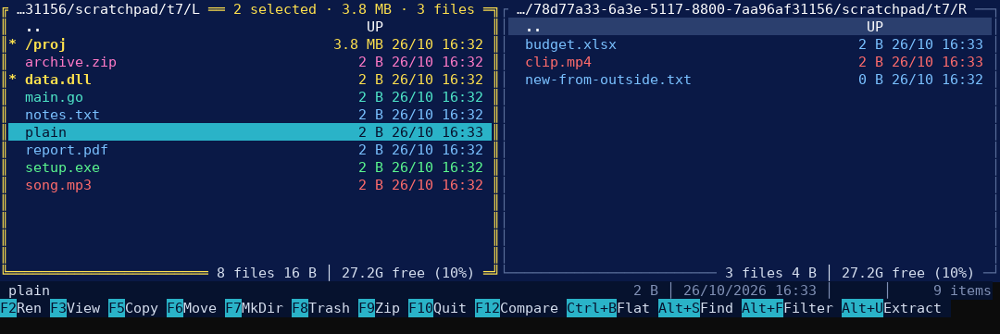

# gofm — dual-pane file manager for the Windows console

A keyboard-driven, two-panel file manager for Windows Terminal and the classic console,
in the tradition of Norton Commander, Midnight Commander and Total Commander.
A single executable (`gofm.exe`, ~7 MB) with nothing to install.



**Highlights:** copy/move with the Windows copy engine and parallel small-file copies ·
browse and extract ZIP and 7z archives · flat view of a whole folder tree · network shares
(UNC) with share lists · Recycle Bin · folder comparison · type-to-jump · automatic refresh ·
free space per panel · remembers your folders.

## Download

Get **`gofm-<version>-windows.zip`** from the [latest release](https://github.com/rives1/goFm_src/releases/latest) (a `.sha256` checksum is published next to it). The zip contains `gofm.exe` (x64), `gofm-arm64.exe` (ARM), this README, the changelog, the licences and the `windows-terminal` folder with the install script.

To check a download, compare its hash with the one on the release page (PowerShell):

```
Get-FileHash .\gofm-1.12-windows.zip     # the zip: see the .sha256 file
Get-FileHash .\gofm.exe                  # the program: see the release notes
```

### Antivirus warnings

Some antivirus programs — Microsoft Defender in particular, with names ending in `!ml` such as `Trojan:Win32/Bearfoos.B!ml` — flag new, unsigned Go executables by **machine-learning heuristics**, not because they recognise malware. The Go FAQ calls this "almost always a false positive". gofm 1.10 was reported this way.

What you can rely on:
- every release is built by GitHub Actions from the public source, with the compiler pinned in `go.mod`, and the build is **reproducible**: rebuilding the tagged commit with `scripts/build-release.sh` on Linux (or WSL) gives the same bytes as the published executables (the release notes list their SHA-256);
- since 1.11 the executables carry version information, a manifest that never asks for administrator rights, and an icon.

If your antivirus quarantines gofm: check the hash as above, report the false positive to the vendor (Microsoft: <https://www.microsoft.com/en-us/wdsi/filesubmission>, "Incorrectly detected"), and restore the file only if the hash matches. Please do not disable your antivirus.

## Running

```
gofm.exe                        :: both panels in the current folder
gofm.exe C:\Projects D:\Backup  :: left and right panel
```

Without arguments gofm **reopens the folders you were in** last time (see *Remembered folders*).

**Windows Terminal** is recommended (full colours and Unicode). Classic `cmd.exe` and PowerShell windows work too.
To run it from anywhere, copy `gofm.exe` into a folder on your `PATH`.

### Font with icons (Cascadia Mono NF) — install it first

gofm shows an **icon** before each name (folder, archive, program, image, document, audio/video, code, system file, other). The icons come from a **Nerd Font**, a font with extra symbols: a terminal program cannot draw pictures, only characters, so the icons are characters of that font. With an ordinary font they appear as **empty boxes**.

Install **Cascadia Mono NF** once, by hand:

1. Download `CascadiaCode-<version>.zip` from <https://github.com/microsoft/cascadia-code/releases> (the asset of the latest release).
2. Open the zip, go to the `ttf` folder, right-click **`CascadiaMonoNF.ttf`** → **Install** (or *Install for all users*).
3. Use the gofm profile below, which already selects **Cascadia Mono NF**, or set that font in your own Windows Terminal profile (*Settings → profile → Appearance → Font face*).

No font at hand, or the classic console? Press **Alt+I**: gofm switches to **basic symbols** (`► ¶ ▒ ♦ ☼ ♫ § ◘ ·`) that every console font has. The choice is remembered; Alt+I again switches back.

### Windows Terminal profile (Cascadia Mono NF)

A terminal program cannot choose its font: the terminal does. The `windows-terminal` folder adds a **gofm** profile to Windows Terminal with the **Cascadia Mono NF** font (size 11), the **gofm Navy** colour scheme and an underscore cursor. If the font is not installed, Windows Terminal says so and falls back to its default font (the icons then show as boxes: install the font or press Alt+I).

```
powershell -ExecutionPolicy Bypass -File windows-terminal\install-gofm.ps1 [-AddToPath]
```

The script copies the right executable to `%LOCALAPPDATA%\Programs\gofm`, installs the profile as a Windows Terminal *fragment* and, with `-AddToPath`, adds the folder to your user PATH. It also tells you if Cascadia Mono NF is not installed (it does not install fonts). No administrator rights are needed. Restart Windows Terminal and pick **gofm** from the drop-down. If Windows blocks the script because the zip came from the Internet, right-click the zip → Properties → Unblock before extracting.

Use `gofm-arm64.exe` only on Windows PCs with an ARM processor (e.g. Snapdragon laptops).

## Keys

Typing letters in a panel jumps to the first matching name, so every command
uses a function key, **Alt+letter**, **Ctrl+letter**, or **Shift+letter** (drives).
**Ctrl+F2** shows all the keys in the program.

| Key | Action |
|---|---|
| ↑ ↓ PgUp PgDn Home End | move the cursor |
| → | enter folder / browse inside a .zip or .7z (does nothing on other files) |
| ← / Backspace | parent folder, or leave the archive |
| Enter | open folder / open file with its program (preview, inside an archive) |
| Tab | switch panel |
| *lower-case letters* | quick search: jump to the first name starting with (or containing) what you type (case does not matter for the match); Backspace deletes a character, Esc ends it |
| Shift+*letter* | go to that drive (Shift+D → D:), returning to the last folder you used there |
| Ctrl+B | **flat view**: all files of this folder and its subfolders in one list; Ctrl+B again to go back |
| Ctrl+→ (left panel) | show this location in the right panel |
| Ctrl+← (right panel) | show this location in the left panel |
| Space / Ins | mark/unmark; the panel's top border shows the running total of the selection, folders included recursively (Space types a space while a quick search is in progress) |
| Ctrl+A | nothing marked → mark **all** files and folders; something marked → **invert** the marks |
| Esc | end quick search, then clear the filter, then the marks |
| F2 | rename |
| F3 | preview / properties (text, archive listing, hex, folder size) |
| F4 | **edit** the file with an external editor (Notepad, or the one in `GOFM_EDITOR`) |
| F5 | copy to the other panel's folder, **at once** — inside an archive: **extract** the marked items there |
| F6 | move to the other panel's folder, **at once** |
| F7 | new folder (accepts `a\b\c`) |
| Del | delete: to the **Recycle Bin** on local drives, **permanently** on network drives (see *Deleting*) |
| F9 | compress to ZIP |
| F10 / Alt+Q | quit |
| F12 | **compare** the two panels by name, size and date: marks, on each side, the files missing on the other side and the **newer** copy of files on both sides (see *Comparing folders*) |
| Alt+F7 | search subfolders by name and/or content |
| Ctrl+F7 | filter the panel (`text` or `*.pdf`) |
| Alt+U | extract the whole archive under the cursor (or the marked items while browsing one) |
| Alt+L | go to a path: `C:\x`, `%USERPROFILE%`, `~`, `\\server` (share list), `\\server\share\dir` |
| Alt+V | drive list: local, network, removable (USB) and CD/DVD drives each have their own icon and label |
| Alt+E | show the same location in the other panel (either direction) |
| Alt+O | sort by name → size → date (names start A→Z, sizes and dates largest/newest first) |
| Alt+D | reverse the sort direction; the title shows e.g. `sort: name ↑` (↑ ascending, ↓ descending) |
| Alt+H | show/hide hidden and system files (and administrative shares such as `C$`) |
| Alt+R | refresh by hand (panels also refresh automatically) and re-measure marked folders |
| Alt+I | icons: Nerd Font icons ↔ basic symbols (remembered) |
| Ctrl+F9 | next colour scheme: **navy** (default) → **dark** → **light** (remembered) |
| Ctrl+F2 | summary of all the keys |

F1 and F8 do nothing. The **key bar** at the bottom shows as many shortcuts as fit the window, operations first (F2, F3, F5, F7 and F10 are never shown there); **click** a shortcut in the bar to run it.

Operations act on marked items; if nothing is marked, on the item under the cursor.

### Keyboard notes

- **Shift+letter is an upper-case letter.** Terminals deliver Shift+D exactly like the character `D`, so gofm cannot tell it apart from Caps Lock. Type **lower-case** letters for the quick search (it still finds upper-case names), and keep **Caps Lock off**: with Caps Lock on, every letter switches drive.
- **Alt+letter** never conflicts with AltGr: AltGr characters (`@ # [ ]` on Italian keyboards) go to the quick search as text.

## Network shares

- `Alt+L` and type `\\server\share` (or `//server/share`) to open a share; ← from the share root shows the **list of shares** on that server, and ← again returns to the drives.
- `Alt+L` with just `\\server` lists its shares directly. Administrative shares (`C$`, `ADMIN$`) appear with Alt+H.
- gofm uses your Windows logon. If a share asks for a different user or password, connect it once with `net use \\server\share /user:DOMAIN\name` or in Explorer, then open it in gofm.

## Archives

- **→ on a .zip or .7z** opens it like a folder: navigate with →/←, mark files and folders, **F5** (or Alt+U) extracts the selection to the other panel, **F3**/Enter previews a file.
- Alt+U on an archive file extracts all of it. If the archive holds a single top-level folder it is extracted as is, otherwise into a folder named after the archive.
- ZIP archives can also be created (F9); 7z archives are read-only.
- Entries that would land outside the destination ("Zip Slip") are refused.

## Copy, move and selection

- **F5/F6 do not ask for a destination**: the destination is always the folder shown in the other panel. If the other panel shows the drive list, a share list or the inside of an archive, gofm asks you to open a folder there first. To copy under a different name, copy and then rename with F2.
- **Files that already exist** at the destination, also inside folders with the same name (which are merged): after counting the files, gofm asks about each one, showing size and date of both copies — *Skip* (the default button), *Skip all*, *Overwrite*, *Overwrite all*, *Cancel*. Every other file is copied or moved anyway. A skipped file stays where it is: in a move, the source keeps only the skipped files.
- While you mark items, the **top border of the panel** (right side, on the path line) shows ` N selected · <size> · M files `. Marked folders are measured recursively in the background and their **size column shows the total** (`…` while measuring); ` · counting…` is shown until every folder has been measured. Unmarking a folder stops its measurement.
- After a move or a delete the cursor goes to the **next item** (or the previous one at the end of the list).
- **Ctrl+→ / Ctrl+←**: the arrow points at the panel that changes, so Ctrl+→ works from the left panel and Ctrl+← from the right one. The cursor lands on the same item, and an archive being browsed is opened on the other side too.

## Flat view (Ctrl+B)

Ctrl+B lists **every file of the current folder and of all its subfolders** in one list, with names relative to the folder (`src\deep\util.go`). Everything works on it: marking, copy, move, Recycle Bin, rename (the file stays in its subfolder), preview, compress, compare, filter, sort (e.g. by size across the whole tree), quick search (on the file name).

- **Copy and move put all files directly into the destination folder** (`src\deep\util.go` → `dest\util.go`). If two marked files have the same name, gofm refuses and lists them, so they cannot overwrite each other.
- Ctrl+B again, or moving to any other folder or drive, returns to the normal view.
- Hidden files and folders follow Alt+H. Folders, links to folders and junctions are not listed.
- The list stops at 200,000 files (the title says so). It is built with a progress window that can be cancelled.
- After an operation the tree is re-read in the background (`flat view, updating…`). Changes inside subfolders made by other programs appear with Alt+R (automatic refresh watches the top folder only).

## Folder totals and free space

The bottom border of each panel shows the **files listed** in it (count and total size, folders excluded) and the **space available** on its drive or network share, in compact form: ` 12 files 3.4 MB │ 28.5G free (11%) `. In the flat view the file part covers the whole tree. On a narrow panel the free-space part is dropped first. Free space is measured in the background when the panel changes folder and after operations (at most every 2 seconds).

## Remembered folders

The folder of each panel, the active panel and the last folder used on each drive (for Shift+letter) are saved in `%APPDATA%\gofm\state.json` whenever you change folder, and restored at the next start. Folders given on the command line take precedence. A folder that no longer exists is replaced by its nearest existing parent; a network folder that does not answer within 3 seconds (e.g. VPN not connected) is replaced by the current folder, so start-up never hangs. An archive or flat view is remembered as its folder. Set `GOFM_STATE` to use another file.

## Comparing folders (F12)

F12 compares the **files** of the two panels by **name, size and date** and marks, in each panel, what is worth copying to the other one:

| The file is… | Marked |
|---|---|
| only on this side | here |
| on both sides, modified more than 2 seconds later here | here (the **newer** copy) |
| on both sides, same date (±2 s) but a different size | on **both** sides (gofm cannot tell which one is right) |
| on both sides, same size and date (±2 s) | nowhere |

The 2-second tolerance covers FAT/exFAT drives and many NAS, which store times with that resolution; a difference of exactly one hour (daylight saving on FAT drives) counts as a difference. Folders are ignored and the content is not read. On Windows names match case-insensitively. The comparison uses what each panel lists, so the filter (Ctrl+F7) and the hidden-files setting (Alt+H) count. Previous marks are replaced, and the result is shown in the status bar until the next key — e.g. `Compare: left 2 only here, 1 newer · right 1 only here, 0 newer`. Typical use: F12, then F5 in each panel to bring the other side up to date without overwriting newer files with older ones (F5 still asks about each file it would overwrite). It also works inside archives and in the flat view (relative paths).

## Fast copying over the network

- Every file is copied with **CopyFileEx**, the Windows copy engine used by Explorer and robocopy. Windows chooses the best I/O for the medium and, where the server supports it, copies between two folders of the **same server** (SMB server-side copy, or ODX on storage arrays) without the data passing through your PC. Between **different servers** the data does go through your PC.
- Files of **256 MB or more** are copied with unbuffered I/O (like `robocopy /J`), so they do not flood the system cache.
- **Small files are copied 4 at a time** across the whole selection: each file costs a few network round trips, and running them in parallel overlaps the waits (like `robocopy /MT`). **Big files (≥ 64 MB) go one at a time**: parallel big streams do not add bandwidth on one link or disk, and slow down spinning disks.
- Attributes, dates and alternate data streams are copied; NTFS permissions are inherited from the destination folder, as with an Explorer copy. Paths longer than 260 characters are supported.
- A move renames instantly what it can (same drive) and copies the rest in one batch; each source is deleted only if all of it was copied.

## Progress

Copy, move, compress and extract show a progress bar with bytes done, speed (averaged over the last 5 seconds) and an estimate of the time left. During a parallel copy the file shown is the last one started. Sizes are counted first, so very large folders spend a moment on "Counting files…". A move within the same drive is an instant rename.

## Display

- Three **colour schemes**, switched with **Ctrl+F9** and remembered: **navy** (dark blue, the default), **dark** (neutral grey) and **light**. File names are **coloured by type**: archives pink, programs green, images orchid, documents blue, audio/video red, code and config aquamarine, system files grey, folders white (black in the light scheme). The **mark colour is reserved** (yellow; dark gold in the light scheme) and no file type comes close to it. Every scheme is checked by the tests for readable contrast.
- An **icon** before each name shows its type: one icon per colour family, plus folder, `..`, share and four kinds of drive (local, network, removable/USB, CD/DVD). The icon keeps the colour of its type **even when the item is marked** (only the name turns yellow); on the cursor row of the active panel it takes the cursor's text colour, because the type colours are unreadable on the cyan cursor. Hidden items have dimmed icons. Nerd Font icons by default, basic symbols with **Alt+I** (see *Font with icons*).
- Dates: `22/10 16:37` for the current year, `22/10/2024` for older files.
- Long names are shortened to fit the window, keeping the extension (`a really very extre….pdf`), so size and date always stay visible.
- The **status bar** follows the same rule: fixed columns on the right (size, date and time, attributes, item count) and a name column that takes the remaining space.
- The text cursor (in input fields) is a **blinking underscore**.

## Automatic refresh

Both panels refresh by themselves when files are added, removed or changed, using Windows change notifications (they also work on network shares). Nothing is polled; bursts of changes (e.g. during a copy) are grouped, and slow folders are re-read less often. The cursor, scroll position, marks and folder totals are kept. If a server does not send notifications, Alt+R refreshes by hand.

## Behaviour worth knowing

- **Conflicts** when copying or moving: one question per existing file (see *Copy, move and selection*). When **extracting**, a single question covers all the files: *Overwrite*, *Skip existing* or *Cancel*. Folders with the same name are **merged**.
- **Moving between drives** = copy + delete the source, and the source is deleted **only if the copy fully succeeded**.
- **Deleting (Del)**: on local drives the items go to the **Recycle Bin** (Windows API; if an item cannot be recycled, e.g. a file too large, Windows shows its own warning). On **network drives** — `\\server\share` paths and mapped drives — there is no Recycle Bin, so gofm says so and **deletes permanently** after a confirmation whose default button is *Cancel*. In both cases, if the items include **folders that contain subfolders**, a second warning lists them (default *Cancel*). Read-only files are deleted too.
- **Editing (F4)**: Notepad by default. To use another editor set the `GOFM_EDITOR` environment variable to its path, optionally with arguments, e.g. `C:\Program Files\Notepad++\notepad++.exe` or `"C:\Program Files\Microsoft VS Code\Code.exe" --reuse-window`. gofm does not wait for the editor and starts it detached from its console, so use a windowed editor (console editors such as vim are not supported). Saved changes appear by themselves.
- ZIP names are written as UTF-8 (Explorer-compatible); old archives with OEM code-page names (e.g. CP850) are decoded.
- Symbolic links and junctions are not followed (avoids endless loops); in archives they are skipped and reported.
- Long operations run in the background with a **Cancel** button; half-written files are removed.

## Known limits

- Password-protected ZIP/7z archives are not supported (a clear error is shown).
- No creation of 7z archives; no RAR or other formats.
- Content search is a plain text match: it does not find text in UTF-16 files, inside .docx/.pdf (they are compressed), or accented letters in a different case.
- 64-bit Windows only (x64 / ARM64).

## Building from source

Requires **Go 1.24 or later**. Releases are built with the toolchain pinned in `go.mod` (**go1.27.3**); with the default `GOTOOLCHAIN=auto`, an older `go` downloads it by itself.

```
git clone https://github.com/rives1/goFm_src
cd goFm_src
go build -trimpath -ldflags="-s -w" -o gofm.exe .        # on Windows
GOOS=windows GOARCH=amd64 go build -trimpath -ldflags="-s -w" -o gofm.exe .   # from Linux/macOS
go test ./...
bash scripts/build-release.sh                            # the release package, with Windows metadata
```

A plain `go build` makes a working program without the Windows metadata (version information, manifest, icon): those come from `winres/winres.json` through [go-winres](https://github.com/tc-hib/go-winres), a build tool pinned in `go.mod` (`go tool go-winres`), which `scripts/build-release.sh` runs before compiling.

The program also builds and runs on Linux and macOS, which is how most of the tests run; drives, share lists, attributes and the Recycle Bin are Windows features.

`third_party/go4` holds two small, standard-library-only packages from go4.org (Apache 2.0) used by the 7z reader, vendored to avoid pulling in the large go4.org dependency graph (see `third_party/go4/README.md`).

`scripts/build-release.sh` builds the download package (`dist/gofm-<version>-windows.zip`, its `.sha256` and the release notes taken from `CHANGELOG.md`); it runs on Linux, macOS and Git Bash, and stops if the Go in use is not the one pinned in `go.mod`.

The GitHub Actions workflows:
- `.github/workflows/ci.yml` — on every push to a branch and on pull requests: `go mod verify`, `go vet` and the tests on Windows and Linux (with the race detector on Linux), then the package as a downloadable artifact;
- `.github/workflows/release.yml` — on a pushed tag `v<version>`: the same checks, then a **GitHub Release** with the zip and its checksum.

### Publishing a release

1. Set the version in `main.go` (`const version`); to change compiler, update the `toolchain` line of `go.mod` and `GO_VERSION` in both workflows together (a test checks it). Add its section at the top of `CHANGELOG.md` (`## <version> — <date>`) and update the README and `docs/gofm-documentazione.md`.
2. Commit, then create an **annotated** tag and push both:
   ```
   git tag -a v1.10 -m "gofm 1.10"
   git push --follow-tags
   ```
   (`--follow-tags` pushes annotated tags only.) The release appears under *Releases* a few minutes later; the workflow stops if the tag does not match the version in `main.go` or the changelog has no section for it.

## Documentation

- This README: usage.
- [`docs/gofm-documentazione.md`](docs/gofm-documentazione.md): full specification and design notes (in Italian), including a prompt to regenerate the program.
- [`CHANGELOG.md`](CHANGELOG.md): version history.

## Licence

gofm is released under the [MIT License](LICENSE). Copyright (c) 2026 rives.

The executable includes third-party open-source components (MIT, BSD-3-Clause, Apache-2.0 and MPL-2.0 licences); see [`THIRD_PARTY_NOTICES.md`](THIRD_PARTY_NOTICES.md).
