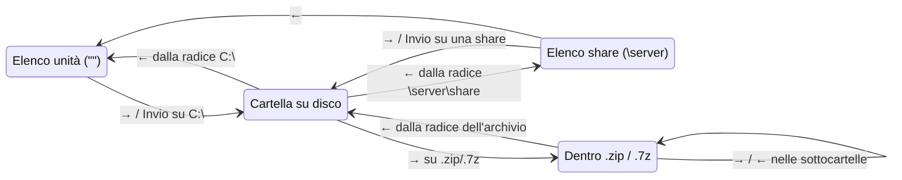
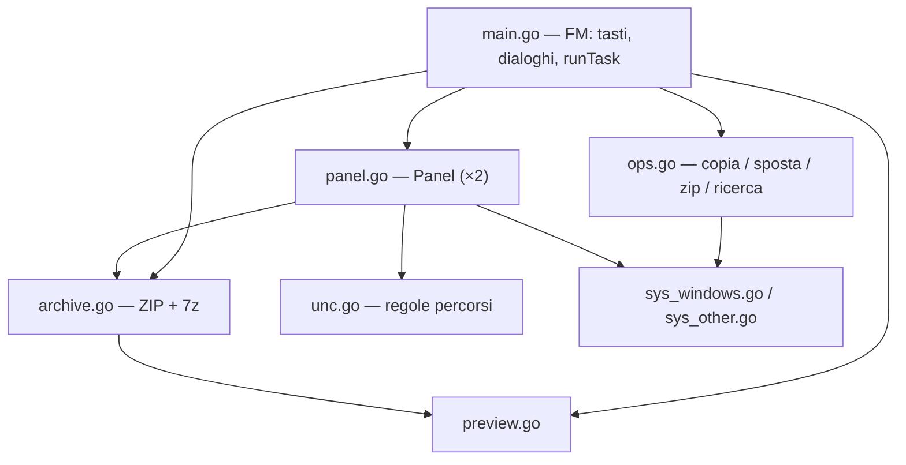

# gofm — Documentazione di progetto e specifiche

**Versione documentata:** 1.14 · **Data:** 30/10/2026 · **Licenza:** MIT, © 2026 rives
**Linguaggio:** Go (minimo 1.24; release compilate con **Go 1.27.3**) · **Piattaforma bersaglio:** Windows 64 bit (x64, ARM64) · **Interfaccia:** inglese

---

## Indice

0. [Regole di lavoro](#0-regole-di-lavoro)
1. [Panoramica](#1-panoramica)
2. [Decisioni di progetto](#2-decisioni-di-progetto)
3. [Interfaccia](#3-interfaccia)
4. [Luoghi e navigazione](#4-luoghi-e-navigazione)
5. [Mappa dei tasti](#5-mappa-dei-tasti)
6. [Specifiche funzionali](#6-specifiche-funzionali)
7. [Architettura del codice](#7-architettura-del-codice)
8. [Dettagli specifici di Windows](#8-dettagli-specifici-di-windows)
9. [Dipendenze e compilazione](#9-dipendenze-e-compilazione)
10. [Test](#10-test)
11. [Limiti noti e parti non verificate](#11-limiti-noti-e-parti-non-verificate)
12. [Storico versioni](#12-storico-versioni)
13. [Prompt per rigenerare il programma](#13-prompt-per-rigenerare-il-programma)

---

## 0. Regole di lavoro

- Risposte in **italiano**; interfaccia del programma e README in **inglese**.
- Prima di implementare, chiarire con domande i punti ambigui.
- **A ogni nuova versione** (regola fissata dall'utente nella v1.10) si aggiornano **sempre e tutte**:
  1. `const version` in `main.go`;
  2. `CHANGELOG.md` (sezione `## <versione> — <data>` in cima: è anche il testo della Release su GitHub);
  3. `README.md` (inglese);
  4. questa documentazione: intestazione, sezioni toccate, test (§10), limiti (§11), storico (§12) e **prompt di rigenerazione** (§13);
  5. le **specifiche compatte** (`gofm-<versione>-specifiche-compatte.md`, il riepilogo per riprendere il lavoro in una nuova chat);
  6. la **pubblicazione su GitHub** (§9.5): commit con **tutti** i file del repository e tag annotato `v<versione>`; il workflow pubblica la Release con il **pacchetto compilato** pronto da scaricare.
- Licenza **MIT**, "Copyright (c) 2026 rives".

---

## 1. Panoramica

`gofm` è un file manager a doppio pannello per il terminale di Windows (Windows Terminal, `cmd.exe`, PowerShell), nello stile di Midnight Commander / Total Commander. È un singolo eseguibile senza dipendenze esterne (`gofm.exe`, circa 7 MB).

Funzioni principali:

- navigazione con frecce (→ entra, ← risale), ricerca digitando, Shift+lettera per cambiare unità;
- copia, spostamento, rinomina, nuova cartella, eliminazione nel **Cestino di Windows**;
- creazione ed estrazione di **ZIP**, anteprima ed estrazione di **7z**;
- **navigazione dentro gli archivi** come se fossero cartelle, con estrazione dei soli elementi selezionati;
- **percorsi UNC** (`\\server\share`) ed **elenco delle share** di un server;
- **barra di avanzamento** con velocità e tempo residuo stimato;
- copia e spostamento **immediati** verso la cartella dell'altro pannello (senza campo destinazione);
- **totale cumulativo della selezione** sul bordo superiore del pannello, con le cartelle misurate ricorsivamente;
- **Ctrl+→ / Ctrl+←** per portare il percorso del pannello corrente in quello opposto;
- **confronto delle due cartelle (F12)** per nome, dimensione e data: seleziona da entrambi i lati i file mancanti nell'altra cartella e la copia più recente dei file presenti in entrambe;
- **copia ottimizzata per la rete**: ogni file è copiato con il motore di Windows (`CopyFileEx`), i file piccoli fino a 4 alla volta, quelli grandi uno alla volta;
- **tema blu scuro** con **colori per tipo di file**, totale della selezione sul bordo del pannello e dimensione ricorsiva delle cartelle selezionate;
- **aggiornamento automatico** dei due pannelli con le notifiche di modifica del sistema;
- **riepilogo di tutti i tasti (Ctrl+F2)** e **barra dei tasti cliccabile** che mostra quante scorciatoie entrano nella larghezza;
- **tre schemi di colori** (navy, scuro, chiaro) con **Ctrl+F9**; **editor esterno** con **F4**; ordinamento **invertibile** (Alt+D) con freccia nel titolo;
- **conflitti file per file** in copia e spostamento (*Skip*, *Skip all*, *Overwrite*, *Overwrite all*, *Cancel*);
- **cancellazione definitiva** sulle unità di rete (niente Cestino), Cestino sulle unità locali;
- **icone delle unità** per tipo: locale, di rete, rimovibile/USB, CD/DVD;
- **pacchetto scaricabile** pubblicato come Release su GitHub a ogni tag di versione, compilato con un compilatore fissato e **riproducibile byte per byte**;
- **metadati di Windows** negli eseguibili: informazioni di versione, manifest (*asInvoker*) e icona;
- **icone per tipo di file** davanti ai nomi (glifi Nerd Font, oppure simboli semplici con Alt+I);
- **profilo per Windows Terminal** (Cascadia Mono NF, schema "gofm Navy", cursore a trattino basso) con script di installazione;
- **vista piatta (Ctrl+B)**: tutti i file di una cartella e delle sue sottocartelle in un'unica lista, con tutte le operazioni;
- **spazio libero** del disco o della share sul bordo inferiore di ogni pannello;
- **memoria delle cartelle**: alla riapertura i pannelli tornano dove erano;
- **pronto per GitHub** con licenza MIT (sezione 9.4).
- ricerca ricorsiva per nome e contenuto, filtro del pannello, anteprima di testo/binari/archivi;
- colonna del nome che si adatta alla larghezza della finestra, date in formato compatto.

Avvio:

```
gofm.exe                        :: entrambi i pannelli nella cartella corrente
gofm.exe C:\Progetti D:\Backup  :: pannello sinistro e destro
gofm.exe \\nas                  :: un pannello sull'elenco delle share di \\nas
gofm.exe -h | --help | /?       :: stampa "gofm 1.14 — usage: gofm [left_folder] [right_folder]"
```

Un argomento non valido (inesistente o non cartella) viene sostituito dalla cartella corrente.

---

## 2. Decisioni di progetto

Ogni scelta è stata presa con l'utente o motivata esplicitamente.

| Tema | Scelta | Motivo |
|---|---|---|
| Linguaggio | **Go** + `rivo/tview` / `gdamore/tcell` | Un solo `.exe` senza CGO, cross-compilabile, librerie TUI mature. Rust era l'alternativa. |
| Layout | **Doppio pannello** | Richiesta dell'utente (stile MC/TC). |
| Eliminazione | **Cestino** con `SHFileOperationW` + `FOF_ALLOWUNDO` | Recuperabile. `FOF_WANTNUKEWARNING` fa avvisare Windows se un file verrebbe distrutto invece che cestinato (share di rete, file troppo grandi). |
| Lingua UI | **Inglese** | Richiesta dell'utente (v1.1). |
| Frecce | → entra / ← risale; → su un file normale **non fa nulla** | Evita di lanciare programmi per errore. Tab resta il cambio pannello. |
| 7z | **Solo lettura** (anteprima, estrazione) | Non esiste un'implementazione Go pura affidabile in scrittura; crearli richiederebbe 7-Zip installato. |
| Tasti | Le lettere **minuscole** servono alla **ricerca digitando**; **Shift+lettera (maiuscola) = unità** (fino alla v1.7 Ctrl+lettera); i comandi stanno su **F2–F10, F12 e Alt+lettera** | L'utente ha scelto Ctrl+lettera per le unità, quindi i comandi non potevano usare Ctrl. |
| Date | `22/10 16:37` se dell'anno corrente, altrimenti `22/10/2024` | Stile `ls`, 11 caratteri. |
| Share di rete | Percorsi UNC digitabili **e** elenco share con `NetShareEnum` | Richiesta dell'utente. |
| Destinazione di F5/F6 | **Sempre la cartella dell'altro pannello, senza campo da confermare** (anche per l'estrazione con F5 dentro un archivio). Resta la domanda sui file omonimi | Richiesta dell'utente (v1.3). La domanda sui conflitti resta perché è l'unica protezione contro la sovrascrittura. |
| Specchio del percorso | **Ctrl+→ nel pannello sinistro, Ctrl+← nel destro**: la freccia indica il pannello che cambia; nella direzione opposta non succede nulla | Richiesta dell'utente (v1.3); gesto direzionale, Alt+E resta come equivalente non direzionale. |
| Confronto cartelle | **F12**, **solo file** (le cartelle sono ignorate). Dalla v1.10 per **nome, dimensione e data**: seleziona i mancanti dall'altro lato e, per i file presenti in entrambi, **solo la copia più recente**; stessa data e dimensione diversa → entrambe. **Tolleranza 2 s** sulla data | Scelte dell'utente (v1.4: solo nome e mancanti; v1.10: nome+data+dimensione, la più recente, 2 s). Selezionare la sola copia più recente rende sicuro F5 subito dopo (come la sincronizzazione di Total Commander). 2 s è la risoluzione delle date su FAT/exFAT e su molti NAS; uno scarto di **1 ora esatta** (ora legale su FAT) resta una differenza: ignorarlo nasconderebbe anche modifiche reali. |
| Aiuto | F1 non fa nulla (dalla v1.4). Riepilogo dei tasti: **Alt+F1** nella v1.10–1.11 (escludeva i tasti della barra), **Ctrl+F2** dalla v1.12, con **tutti** i tasti | Scelte dell'utente (v1.4, v1.10, v1.12). Dalla v1.12 la barra cambia con la larghezza della finestra, quindi escludere i suoi tasti non avrebbe più senso; un test verifica che ogni voce della barra sia nel riepilogo. |
| Barra dei tasti (v1.12) | Voci per **priorità** (operazioni prima: F4 Edit, F6 Move, Del Delete, F9 Zip, F12 Compare, Ctrl+A Select, Ctrl+T Tree, Ctrl+K Prefix (v1.14), Ctrl+B Flat, Alt+F7 Find, Ctrl+F7 Filter, Alt+U Extract, Alt+V Drives, Ctrl+F2 Keys, Alt+O Sort, Alt+D Reverse, Alt+H Hidden, Ctrl+F9 Colours, Alt+I Icons, Shift+X Drive X:, Alt+L Go to), **quante ne entrano**; F2, F3, F5, F7, F10 **mai**; **clic del mouse** su una voce = pressione del tasto | Scelte dell'utente (v1.12). Le voci si fermano alla prima che non entra, così l'ordine resta prevedibile. Shift+X è solo un'indicazione (26 tasti): il clic non fa nulla. |
| Tasti cambiati (v1.12) | Ricerca **Alt+S → Alt+F7**; filtro **Alt+F → Ctrl+F7**; seleziona tutto/inverti **Ctrl+A** (tolti `*` e Alt+A); F8 non cancella più (solo **Canc**); **F4** editor; **Alt+D** inverte l'ordinamento; **Ctrl+F9** schemi di colori | Richieste dell'utente (v1.12). Le combinazioni Ctrl/Alt di un tasto funzione non assegnate non fanno nulla, così Ctrl+F7 non ricade mai su F7. `*` ora va alla ricerca digitando come ogni altro carattere (e non trova nulla). |
| Ctrl+A | Nessuna selezione → **seleziona file e cartelle**; selezione presente → **inverte** | Scelta dell'utente (v1.12): come il vecchio `*` per la selezione completa, con l'inversione di Alt+A al posto della deselezione. |
| Editor (F4) | **Notepad**, oppure `editor` in **`gofm.ini`** (v1.13), oppure il comando nella variabile **`GOFM_EDITOR`**, che prevale (percorso, eventualmente tra virgolette, più argomenti); avviato **staccato** dalla console (`DETACHED_PROCESS`), senza attenderlo | Scelta dell'utente (v1.12). Staccarlo impedisce che un programma da console (es. `code.cmd`) scriva sullo schermo di gofm; per lo stesso motivo gli editor da terminale non sono supportati. Le modifiche salvate compaiono con l'aggiornamento automatico. |
| Ordinamento (v1.12) | **Alt+O** cambia tipo e riparte dal senso naturale (nome A→Z, dimensione e data dal più grande/recente); **Alt+D** inverte; titolo sempre con `sort: <tipo> ↑|↓` (↑ crescente, ↓ decrescente); cartelle sempre prima, `..` in cima | Scelta dell'utente (v1.12). La freccia indica il senso dei valori, non la posizione: ↑ = dal più piccolo/vecchio/A al più grande/recente/Z. |
| Schemi di colori (v1.12) | Tre schemi: **navy** (principale, quello di sempre), **dark** (grigio neutro), **light** (chiaro); **Ctrl+F9** a rotazione; ricordato in `state.json` | Scelte dell'utente (v1.12). Ogni schema ha il proprio colore di selezione riservato (giallo `#FFE14D` nei due scuri, oro scuro `#986800` nel chiaro, perché il giallo su bianco è illeggibile) e rispetta le soglie WCAG: 4,5:1 per il testo, 3:1 per bordi e icone. Nel chiaro il rosso dell'audio/video è `#D80838` invece di `#CF222E`, per restare ad almeno 120 dal colore di selezione: valori trovati con una ricerca numerica sui vincoli. |
| Conflitti in copia/spostamento (v1.12) | Dopo il conteggio, **una domanda per ogni file esistente**, anche dentro le cartelle unite, con dimensione e data delle due copie: **Skip** (predefinito), **Skip all**, **Overwrite**, **Overwrite all**, **Cancel**; gli altri file procedono comunque. Negli spostamenti i file saltati restano nella sorgente | Scelta dell'utente (v1.12). Le domande arrivano tutte **prima** di iniziare a copiare, così i lavoratori paralleli non vanno messi in pausa e un *Cancel* non lascia copie a metà. Il pulsante predefinito non sovrascrive mai. Fino alla v1.11 la domanda era unica e riguardava solo gli elementi di primo livello: dentro le cartelle unite i file venivano sovrascritti senza chiedere. L'estrazione dagli archivi mantiene la domanda unica. |
| Cancellazione sulle unità di rete (v1.12) | Percorsi UNC e unità mappate: **cancellazione definitiva** (`removeTree`), con conferma esplicita (`PERMANENTLY`; pulsante predefinito `Cancel` nella v1.12, `Delete` dalla v1.13, impostabile); unità locali: Cestino | Richiesta dell'utente (v1.12). Le cartelle di rete non hanno Cestino: Windows le cancellerebbe comunque in modo definitivo, ma con un proprio avviso dopo la conferma di gofm; ora la conferma di gofm dice la verità prima. |
| Programma portatile (v1.13) | `gofm.ini` e `state.json` **nella cartella dell'eseguibile** (`os.Executable` + `EvalSymlinks`), non più in `%APPDATA%\gofm`. Se la cartella **non è scrivibile** non si salva nulla (né stato né impostazioni): i file già presenti si leggono, nessuno viene creato o aggiornato, avviso all'avvio. Nessuna migrazione dal vecchio `state.json`. `GOFM_STATE` e `GOFM_CONFIG` sostituiscono i due percorsi | Richiesta dell'utente (v1.13), con le scelte sul ripiego e sulla migrazione. La scrivibilità si verifica **creando un file di prova**: su Windows i permessi (ACL) non si vedono nei bit del file, e con il manifest *asInvoker* la virtualizzazione di UAC è disattivata, quindi una scrittura in `C:\Program Files` fallisce davvero invece di finire nel VirtualStore. Il profilo di Windows Terminal resta nella cartella `Fragments`: Windows Terminal lo legge solo lì. Interpretazione da confermare: un `gofm.ini` messo a mano in una cartella di sola lettura viene letto. |
| File di impostazioni `gofm.ini` (v1.13) | Testo `chiave = valore`, commenti `#`/`;`, sezioni ignorate, chiavi e valori senza maiuscole, virgolette facoltative; **creato commentato** se manca (righe CRLF, molti commenti per ogni parametro), **mai riscritto** da gofm; separato da `state.json`. Chiavi: `editor`, `colorScheme`, `icons`, `showHidden`, `sortBy`, `deleteDefault`, `networkDelete`, `networkDeleteDefault`. Letto all'avvio e con **Alt+R**, che applica **solo i valori cambiati nel file**. `GOFM_EDITOR` prevale su `editor` | Scelte dell'utente (v1.13). Formato INI perché ammette commenti ed è facile da modificare in Notepad (JSON non ha commenti); nessuna libreria aggiuntiva. File separato da `state.json` perché gofm scrive lo stato a ogni cambio di cartella e cancellerebbe i commenti dell'utente. Con Alt+R si applica solo ciò che è cambiato nel file, altrimenti un semplice aggiornamento annullerebbe Alt+H, Alt+O, Ctrl+F9 o Alt+I. `colorScheme` e `icons` non impostati = ultima scelta salvata in `state.json`; impostati = valgono a ogni avvio. Valori sbagliati e chiavi sconosciute: avviso nella barra di stato con il numero di riga, le altre righe valgono. |
| Vista ad albero (Ctrl+T, v1.14) | Il pannello sinistro diventa l'**albero delle cartelle** dell'unità della cartella corrente, aperto fino a quella cartella; il destro mostra la cartella sotto il cursore dell'albero **150 ms dopo** che il cursore si ferma. → apre, ← chiude o sale, Invio/Tab al pannello destro. Ctrl+T di nuovo: due pannelli, **entrambi sulla cartella evidenziata**. Copia, spostamento e confronto rifiutati durante l'albero; Ctrl+T rifiutato da elenco unità, elenco share, archivio e vista piatta; non ricordato all'uscita | Richiesta e scelte dell'utente (v1.14: radice dell'unità, ritardo di 150 ms, F5/F6 disattivati con messaggio, uscita sulla cartella evidenziata, nascosti con Alt+H, rifiuti). Il ritardo evita di leggere ogni cartella attraversata scorrendo (costoso in rete). F5/F6 sono rifiutati perché la destinazione abituale, l'altro pannello, durante l'albero è la cartella da cui si copia. Scelte di Claude, da confermare: rifiuto anche dall'elenco share, nessuna memoria della modalità, sull'albero le operazioni sui file mostrano solo un avviso. L'albero è una tabella propria (non `tview.TreeView`) per avere colori, cursore, bordi e icone uguali ai pannelli. |
| Prefisso ai nomi (Ctrl+K, v1.14) | Testo anteposto ai nomi di **file e cartelle** selezionati (o dell'elemento sotto il cursore), con **anteprima** dei nuovi nomi; testo vuoto = annulla; caratteri non validi rifiutati già alla digitazione; nomi già esistenti **saltati** ed elencati alla fine; nessuna selezione dopo | Richiesta e scelte dell'utente (v1.14). Ctrl+M, chiesto inizialmente, è stato scartato perché nei terminali VT vale CR, cioè Invio: l'utente ha scelto **Ctrl+K**. Le rinomine avvengono in background (finestra ` Working `), come le altre operazioni, così una cartella di rete lenta non blocca l'interfaccia. |
| Cartelle omonime nella destinazione (v1.13) | Copia, spostamento ed estrazione: se nella destinazione esistono già **cartelle con lo stesso nome** di quelle copiate, **una sola domanda** con il loro elenco (max 8, poi `… and N more`): **`Merge`** (predefinito) / **`Cancel`**. *Cancel* o Esc **annullano l'intera operazione** prima che cominci. Dopo *Merge* restano le domande file per file (copia/spostamento) o quella unica dell'estrazione | Richiesta dell'utente (v1.13). Basta controllare il primo livello: le cartelle annidate esistono solo dentro una cartella omonima già segnalata. Predefinito *Merge* perché unire non sovrascrive nulla: ogni file esistente viene comunque chiesto dopo. |
| Pulsante predefinito nelle cancellazioni (v1.13) | Il pulsante selezionato (quello di **Invio**) è quello che **cancella** (`Yes`, `Delete`, `Move to Recycle Bin`, `Delete permanently`), anche per la cancellazione definitiva in rete e per l'avviso sulle sottocartelle; `gofm.ini` può scegliere `cancel`, separatamente per unità locali (`deleteDefault`) e di rete (`networkDeleteDefault`); `networkDelete = off` disattiva Canc sulle unità di rete | Richiesta dell'utente (v1.13). **Rischio segnalato**: con *Delete* predefinito sulla cancellazione definitiva in rete, un Invio di troppo cancella senza rimedio; per questo l'impostazione per la rete è separata. Fino alla v1.12 il predefinito era *Cancel* per la rete e per l'avviso sulle sottocartelle. "Modalità di cancellazione sui dischi di rete" è stata interpretata come `networkDelete` (`permanent`/`off`) più il pulsante predefinito separato. |
| Unità per tipo (v1.12) | Elenco unità con icona ed etichetta per **locale** (`LOCAL`), **di rete** (`NETWORK`), **rimovibile** (`REMOVABLE`: chiavette e dischi USB, schede di memoria) e **CD/DVD** | Richiesta dell'utente (v1.12). `GetDriveType` riconosce rete, rimovibili e ottiche, ma i **dischi USB** risultano "fissi": per questi si interroga il tipo di bus (`IOCTL_STORAGE_QUERY_PROPERTY`, USB, 1394, SD, MMC), senza diritti di amministratore. |
| Cancellazione di cartelle con sottocartelle | Dopo la conferma normale di Canc (F8 fino alla v1.11), una **seconda conferma** con l'**elenco dei nomi** (al massimo 8, poi `… and N more`); pulsante predefinito **Cancel** | Scelta dell'utente (v1.10): solo i nomi, nessun conteggio, così la risposta è immediata anche su share lente. Il controllo legge ogni cartella solo fino alla prima sottocartella, in background. |
| Compilatore | **Go 1.27.3** fissato in `go.mod` (`toolchain go1.27.3`) e in `GO_VERSION` dei due workflow, con `GOTOOLCHAIN=local`; lo script di build rifiuta un altro compilatore e un test controlla che `go.mod` e workflow coincidano. La riga `go 1.24.0` resta come versione **minima** del linguaggio | Richiesta dell'utente (v1.11). Fino alla 1.10 `setup-go` leggeva `go-version-file: go.mod`, cioè la riga `go 1.24.0`, e installava **esattamente Go 1.24.0**, la prima versione della serie, senza le correzioni di sicurezza successive; la serie 1.24 non è più supportata (Go supporta le due ultime versioni maggiori, ora 1.26 e 1.27). Un compilatore esatto rende anche la build **riproducibile**: chiunque può ricompilare gli stessi byte. Scelta la 1.27.3 (ultima stabile) dopo vet, test e race detector superati. |
| Metadati di Windows | Informazioni di versione (`ProductName gofm`, `CompanyName rives`, `FileDescription`, `LegalCopyright`, `OriginalFilename gofm.exe`, `Comments` con il link ai sorgenti, versione `1.11` / `1.11.0.0`), **manifest** (`asInvoker`, nessuna elevazione, `longPathAware`, Windows 10 come sistema supportato) e **icona** (due pannelli nei colori del tema, 256 px e 16 px disegnata a pixel; dalla v1.13 anche **32 e 48 px**, disegnate a pixel da `scripts/make-small-icons.py`). Generati da **go-winres** v0.3.3 (licenza 0BSD), registrato come `tool` in `go.mod`, da `winres/winres.json`; i `.syso` sono creati dallo script di build e non stanno nel repository | Richiesta dell'utente (v1.11) dopo che Defender ha segnalato la 1.10 come `Trojan:Win32/Bearfoos.B!ml`. Gli eseguibili senza firma e senza metadati sono più spesso colpiti dalle euristiche ML degli antivirus: i metadati riducono la probabilità, **non la azzerano**. La soluzione stabile è la **firma del codice** (es. SignPath Foundation, gratuita per l'open source, o Azure Trusted Signing), che richiede un account dell'utente: non ancora attivata. go-winres è uno strumento di build: non finisce nell'eseguibile, quindi non serve in `THIRD_PARTY_NOTICES.md`. |
| Pubblicazione | **Release su GitHub** con lo zip compilato e il suo SHA-256, creata dal workflow `release.yml` al push di un tag `v<versione>`. Commit e tag li prepara Claude nella copia locale, il push lo fa l'utente | Scelta dell'utente (v1.10). Lo zip è compilato da GitHub dai sorgenti pubblicati, quindi verificabile; lo stesso script (`scripts/build-release.sh`) produce il pacchetto in locale e nella CI. |
| Totale della selezione | Cumulativo (in barra di stato fino alla v1.5, sul bordo del pannello dalla v1.6); le cartelle sono misurate **ricorsivamente in background** | Richiesta dell'utente (v1.3); il calcolo asincrono non blocca l'interfaccia su cartelle grandi o di rete. |
| Spostamento tra unità | Copia + eliminazione dell'origine **solo se la copia è riuscita al 100%** | Nessuna perdita di dati possibile. |
| Collegamenti | Symlink e junction **non vengono attraversati** | Evita cicli infiniti (es. "Application Data"). |
| Copia dei file (Windows) | **`CopyFileExW`** invece di un ciclo lettura/scrittura | v1.5, uso principale dell'utente: file grandi tra PC e server e tra server in LAN, a volte in VPN. È il motore di Esplora risorse e robocopy: sceglie l'I/O migliore e, dove server e protocollo lo supportano, delega la copia (copia lato server SMB tra cartelle dello stesso server, ODX sugli storage che lo offrono), così i dati non passano dal PC. Copia anche attributi e date in un solo passaggio. |
| I/O senza cache | `COPY_FILE_NO_BUFFERING` per file **≥ 256 MB** | Raccomandato da Microsoft per trasferimenti molto grandi (equivale a `robocopy /J`): evita di riempire la cache di sistema con dati che non verranno riletti. |
| Parallelismo | **4 file insieme**, ma **un solo file ≥ 64 MB alla volta** | Con molti file piccoli il tempo va nelle attese di rete per ogni file, e il parallelo le sovrappone (come `robocopy /MT`). Più flussi grandi in parallelo non aumentano la banda di un singolo collegamento o disco e su un disco meccanico peggiorano per i salti della testina. |
| Tema | Sfondo **blu scuro `#0A1946`** su tutta l'interfaccia, colori **RGB** (uguali in ogni profilo di terminale; le console a 16 colori usano il colore più vicino) | Richiesta dell'utente (v1.6). |
| Colori dei file | 7 famiglie per estensione; il **giallo `#FFE14D` è riservato** alla selezione e nessuna famiglia gli si avvicina (verificato da un test sulla distanza dei colori) | Richiesta dell'utente (v1.6): il colore di un file non deve mai confondersi con quello di un file selezionato. |
| Totale selezione | Spostato dalla barra di stato al **bordo superiore del pannello**, a destra, sulla stessa riga del percorso | Richiesta dell'utente (v1.6). |
| Tasto `*` | v1.6–1.11: nessuna selezione → seleziona tutto, altrimenti deseleziona tutto. **Tolto nella v1.12**, sostituito da Ctrl+A | Scelte dell'utente (v1.6, v1.12). |
| Cursore | **Trattino basso lampeggiante** (DECSCUSR 3) al posto della barra verticale di Windows Terminal | Scelta dell'utente (v1.6). |
| Font | **Cascadia Mono NF** (dalla v1.9; Cascadia Mono nella v1.6–1.8) tramite un profilo di Windows Terminal: un programma da terminale non può scegliere il font | Scelta dell'utente. La variante **NF** contiene i glifi Nerd Font delle icone; l'utente la installa **a mano** (README, *Font with icons*). Lo script di installazione si limita a segnalarne l'assenza. |
| Icone dei file | Un **carattere** per famiglia di colori (+ cartella, file generico, `..`, unità, share). Insieme predefinito: **glifi Nerd Font**; con **Alt+I** **simboli semplici** della codepage 437, ricordati in `state.json` | Scelta dell'utente (v1.9) fra tre opzioni. Le icone di Esplora risorse sono bitmap e in una cella del terminale non si possono disegnare. Le **emoji** sono state scartate: occupano 2 celle con resa diversa da terminale a terminale e nella console classica diventano `??`, disallineando le colonne. Il Nerd Font dà vere icone ma senza il font mostra quadratini, e un programma da terminale **non può accorgersene**: da qui il tasto esplicito e il ripiego. |
| Colore delle icone | Sempre il **colore della famiglia**, anche sugli elementi selezionati (solo il nome diventa giallo); **sulla riga del cursore del pannello attivo** l'icona prende il colore del testo del cursore `#06122E`; i nascosti hanno l'icona attenuata | Scelta dell'utente (v1.9). Eccezione del cursore: sul ciano `#2AB3C8` **tutte** le famiglie hanno un contrasto fra 1,0:1 e 1,8:1 (illeggibili), mentre `#06122E` arriva a 7,4:1. Sul cursore del pannello inattivo (`#2B3F6E`) le famiglie restano ≥ 3:1 e mantengono il loro colore. |
| Aggiornamento automatico | **Notifiche del sistema** (`ReadDirectoryChangesW` via `fsnotify`) su **entrambi i pannelli**, raggruppate; nessun polling. Alt+R resta per il refresh manuale | Scelta dell'utente (v1.6): costo quasi nullo a cartella ferma; il ritmo si adatta alla lentezza della cartella. |
| Vista piatta | **Ctrl+B** dalla v1.8 (Alt+D nella v1.7); l'elenco delle unità è su **Alt+V** | Scelta dell'utente. |
| Unità su Shift+lettera | La lettera **maiuscola** cambia unità. Il terminale consegna Shift+D come il carattere `D`, senza poterlo distinguere dal Blocco Maiuscole | Scelta dell'utente (v1.8), presa **sapendo le conseguenze**: la ricerca digitando funziona solo con le minuscole (trova comunque i nomi in maiuscolo, perché non distingue maiuscole e minuscole); con il **Blocco Maiuscole attivo** ogni lettera digitata cambia unità. Alternative scartate: Ctrl+lettera (com'era) e Alt+Shift+lettera. |
| Bordo inferiore | Formato compatto ` 12 files 3.4 MB │ 28.5G free (11%) ` | Scelta dell'utente (v1.8) fra tre formati. |
| Copia dalla vista piatta | **Tutti i file nella stessa cartella** di destinazione (`sub\a.txt` → `dest\a.txt`, come Total Commander); nomi doppi nella selezione → **rifiuto** con elenco dei nomi | Scelta dell'utente (v1.7). Il rifiuto evita che due file omonimi si sovrascrivano a vicenda: con la copia parallela l'esito sarebbe casuale. |
| Memoria delle cartelle | Salvataggio a **ogni cambio di cartella** (non solo all'uscita) in `state.json`: in `%APPDATA%\gofm` fino alla v1.12, accanto all'eseguibile dalla v1.13 | Chiudere la finestra del terminale con la X termina il processo senza un'uscita ordinata: salvando subito non si perde nulla. La scrittura avviene solo se qualcosa è cambiato. |
| Avvio con cartelle irraggiungibili | Controllo con **timeout di 3 s** per cartella; poi cartella corrente | Una share su VPN non connessa può bloccare `os.Stat` per decine di secondi. |
| Spazio libero | `GetDiskFreeSpaceExW` (spazio **disponibile all'utente**, rispetta le quote) in background, al massimo ogni 2 s per cartella | Una chiamata su share remota è un giro di rete: non deve bloccare l'interfaccia. |
| Licenza | **MIT**, titolare **rives** | Scelta dell'utente (v1.7). Compatibile con tutte le dipendenze (MIT, BSD-3, Apache-2.0, MPL-2.0). |
| Compressione SMB | **Non attivata** | `COPY_FILE_REQUEST_COMPRESSED_TRAFFIC` richiede Windows 11 / Server 2022 e un server che la supporti; su LAN veloce può rallentare. Possibile opzione futura per la VPN. |

---

## 3. Interfaccia

```
╔ C:\Users\me\Documents ═══ 2 selected · 3.8 MB · 3 files ═╗┌ D:\Backup ──────────────────────────────────┐
║  ↑ ..                                    UP              ║│  ↑ ..                               UP       │
║* ► Progetti                          3.8 MB 22/10 16:37  ║│  ► 2025                    <DIR> 05/03/2025  │
║* ¶ relazione f….pdf                  1.2 MB 21/10 09:12  ║│  ▒ archivio.zip          412.0 KB 22/10 10:01 │
║  ♦ setup.exe                        85.3 MB 02/01/2024  ║│                                              │
╚══════════════════════════════════════════════════════════╝└──────────────────────────────────────────────┘
 Search: rel  relazione finale.pdf                         1.2 MB │ 21/10/2026 09:12 │ ---A │     3 items
 F4Edit F6Move DelDelete F9Zip F12Compare Ctrl+ASelect Ctrl+BFlat Alt+F7Find Ctrl+F7Filter Alt+UExtract
```

Schema navy: sfondo blu scuro su tutto; icona e nome colorati per tipo (§3.5, §3.9); selezione in giallo. Il titolo di ogni pannello finisce con `[sort: name ↑]` (omesso nello schema per brevità). Nello schema le icone sono i simboli semplici (Alt+I): i glifi Nerd Font predefiniti non si vedono senza il font. Una schermata reale (v1.8, senza icone) è nel file `screenshot.png`.

### 3.1 Pannelli

- Titolo (bordo superiore, a sinistra): il percorso del luogo, tagliato a sinistra con `…` se troppo lungo; tra parentesi quadre eventuali `filter: …`, **sempre** `sort: name|size|date ↑|↓` (dalla v1.12; prima solo `sort: size|date` se diverso dal nome), `hidden shown`.
- **Bordo inferiore, a destra** (§6.26): ` 12 files 3.4 MB │ 28.5G free (11%) `, cioè numero e dimensione dei file elencati nel pannello, poi lo spazio libero del disco in forma compatta e la percentuale libera. Se lo spazio manca si toglie prima la parte del disco, poi quella dei file. Negli elenchi unità/share non c'è la parte dei file.
- **Vista piatta**: nel titolo `[flat view]`, con `, first 200000` se l'elenco è troncato e `, updating…` durante una rilettura.
- **Totale della selezione** (bordo superiore, a destra, in giallo): ` N selected · <dimensione> · M files ` più ` · counting…` finché una cartella è in misurazione (§6.18). Il percorso viene accorciato per lasciargli spazio; se il pannello è troppo stretto il totale non viene mostrato.
- Pannello attivo (schema navy; gli altri schemi in §3.6): bordo **giallo** `#FFE14D` (doppio), riga del cursore **sfondo `#2AB3C8`, testo `#06122E`**. Pannello inattivo: bordo `#5A6E9A`, riga del cursore **sfondo `#2B3F6E`, testo bianco**. Sotto il cursore il colore del tipo di file è sostituito da quello del cursore; un elemento selezionato resta riconoscibile dall'asterisco `*`. Eccezione: sul cursore del pannello **inattivo** l'icona conserva il colore della famiglia (§3.9).
- Cinque colonne, separate da uno spazio (comportamento di tview):

| Colonna | Larghezza | Contenuto |
|---|---|---|
| Marca | 1 | `*` se marcato, altrimenti spazio |
| Icona | 1 | icona del tipo (§3.9) |
| Nome | `larghezza_interna − 4 − 9 − 11 − 2` (minimo 6), si espande | il nome, senza prefissi (fino alla v1.8 le cartelle erano precedute da `\`); link seguiti da ` ~` |
| Dimensione | 9, allineata a destra | `UP` per `..`; per le unità il tipo (`LOCAL`, `NETWORK`, `REMOVABLE`, `CD/DVD`, dalla v1.12; prima `DRIVE`); `SHARE`; per una cartella `<DIR>`, ma se è **selezionata** il **totale ricorsivo** del suo contenuto (`…` durante la misurazione); per un file la dimensione leggibile |
| Data | 11 | vedi §6.13; vuota se la data è sconosciuta |

- Colori del nome: vedi §3.5. Nascosti `#7F8FB4`; marcati **giallo grassetto** (prevale su tutto). Marca, nome, dimensione e data usano lo stesso colore; l'icona ha il colore della famiglia (§3.9).
- Ordinamento: cartelle sempre prima; poi per nome (senza distinzione maiuscole), dimensione decrescente o data decrescente. La riga `..` è sempre in cima.

### 3.2 Barra di stato (penultima riga)

Stesse regole delle colonne dei pannelli: **colonne a larghezza fissa a destra**, **colonna del nome che occupa lo spazio rimanente** (accorciata con `…` mantenendo l'estensione). Sfondo `#06122E`, un carattere di margine per lato.

| Colonna | Larghezza | Contenuto |
|---|---|---|
| (ricerca) | variabile | durante la ricerca digitando: badge ` Search: <testo> ` (testo scuro su giallo) ed eventualmente `no match` in rosso; riduce la colonna del nome |
| Nome | resto della riga | nome dell'elemento sotto il cursore; per una share ` — <commento>`; vuoto su `..` |
| Dimensione | 9, a destra | dimensione del file; per una cartella `<DIR>` o, se selezionata e misurata, il totale ricorsivo |
| Data | 16 | `gg/mm/aaaa hh:mm` |
| Attributi | 4 | `RHSA` (Windows) |
| Elementi | 11, a destra | `N items` (escluso `..`) |

Le colonne fisse sono separate da ` │ ` e scritte in `#7F8FB4`; il nome in `#D5DEEE`. Dopo F12, Ctrl+B, Alt+I, Ctrl+F9 o F4 un avviso (testo scuro su `#56D4DD`) **sostituisce l'intera riga** fino al tasto successivo (§6.20). Il totale della selezione non è più qui ma sul bordo del pannello (§3.1).

### 3.3 Barra dei tasti (ultima riga)

Primitiva propria (`keyBar`, `keybar.go`, v1.12). Sfondo della barra dello schema; per ogni voce il tasto (testo `keyFg` su `keyBg`, nello schema navy `#06122E` su `#2AB3C8`) seguito dall'etichetta, poi uno spazio; un carattere di margine a sinistra.

- **Voci in ordine di priorità** (`keybarItems`): `F4 Edit · F6 Move · Del Delete · F9 Zip · F12 Compare · Ctrl+A Select · Ctrl+B Flat · Alt+F7 Find · Ctrl+F7 Filter · Alt+U Extract · Alt+V Drives · Ctrl+F2 Keys · Alt+O Sort · Alt+D Reverse · Alt+H Hidden · Ctrl+F9 Colours · Alt+I Icons · Shift+X Drive X: · Alt+L Go to`.
- **Adattamento alla larghezza** (`keybarLayout`): si aggiungono voci finché entrano; alla prima che non entra ci si ferma (niente voci successive più corte "infilate" dopo, per non cambiare l'ordine). A 80 colonne entrano le prime 8 (fino a Ctrl+F7 Filter esclusa), a 120 le prime 11, a 200 le prime 17; per tutte e 19 servono 215 colonne.
- **Mai mostrati**: F2, F3, F5, F7, F10 (scelta dell'utente); F8 non ha più funzioni. Restano nel riepilogo Ctrl+F2.
- **Clic del mouse** (`MouseHandler`): il clic sinistro su una voce costruisce l'evento del tasto (`tcell.NewEventKey`) e lo passa a `FM.keys`, esattamente come una pressione reale; il focus resta sul pannello. Shift+X è solo un'indicazione: il clic non fa nulla. Con una finestra di dialogo aperta il clic arriva alla finestra, non alla barra.

### 3.4 Finestre di dialogo

- **Messaggio**: `tview.Modal` con pulsante `OK`.
- **Conferma**: `tview.Modal` con pulsanti personalizzati (es. `Overwrite` / `Skip existing` / `Cancel`; `Yes` / `No`; `Replace` / `Cancel`). `confirmDefault` (v1.13) sceglie il pulsante selezionato all'apertura (`Modal.SetFocus`), cioè quello che preme Invio.
- **Prefisso (Ctrl+K, v1.14)**: riquadro 76×14 con bordo, titolo ` Add a prefix to "<nome>" ` / ` Add a prefix to N items `, campo `Prefix: ` (i caratteri non validi non si possono digitare: `SetAcceptanceFunc`), pulsanti `OK` / `Cancel` e sotto l'**anteprima** in colore attenuato, aggiornata a ogni tasto: `<nome> → <prefisso><nome>` per i primi 6, poi `… and N more`; a campo vuoto `Type the text to put before the names.` + `An empty text cancels.`. Invio come in §3.4 (azione rimandata con `QueueUpdateDraw`), Esc annulla.
- **Cartelle omonime (v1.13)**: `A folder with the same name already exists in` / `N folders with the same name already exist in` + destinazione + elenco dei nomi (max 8, `… and N more`) + `Merge the contents? <seguito>` + `Cancel stops the whole operation.`; seguito `Files that exist in both are asked about one by one.` (copia/spostamento) oppure `You will then be asked about existing files.` (estrazione); pulsanti **`Merge`** (predefinito) / `Cancel`; Esc = Cancel.
- **Richiesta di testo**: Form 76×7 con un campo e i pulsanti `OK` / `Cancel`; Invio conferma, Esc annulla.
- **Avanzamento**: riquadro 72×12 intitolato ` Working ` con testo e pulsante `Cancel` (anche Esc).
- Tutto il testo derivato da nomi di file passa per `tview.Escape`, altrimenti `[x].txt` verrebbe interpretato come tag di colore.
- Le finestre sono una pila: chiudendo una finestra il focus torna a quella sotto, o al pannello attivo. **Dettaglio tecnico** (bug corretto nella v1.10): `Pages.RemovePage` restituisce il focus alla pagina principale, il cui `Flex` lo passa al primo elemento, cioè al pannello **sinistro**, e il gestore del focus di quel pannello lo rende attivo. `closeModal` memorizza quindi il pannello attivo **prima** di `RemovePage` e poi lo riattiva con `setActive(active, true)`. Fino alla v1.9 la chiusura di qualsiasi finestra aperta dal pannello destro (avanzamento di Ctrl+B, F5, F8, conferme, F3) spostava il focus a sinistra.
- **Riepilogo dei tasti (Ctrl+F2, v1.12; Alt+F1 nella v1.10–1.11)**: TextView con bordo, titolo ` Keys — Esc to close `, sezioni *Navigation*, *Search and selection*, *Files*, *View*, *Program*; larghezza adattata al testo (righe ≤ 76 celle, quindi entra in 80 colonne), altezza limitata allo schermo con scorrimento (titolo ` Keys — ↑↓ to scroll, Esc to close `). Si chiude con Esc, Invio, F2 o `q`. Dalla v1.12 elenca **tutti** i tasti, compresi quelli della barra (che cambia con la larghezza); un test verifica che ogni voce della barra vi compaia e che i tasti tolti (Alt+F1, Alt+S, Alt+F, `*`, Alt+A, F8) non ci siano. Titoli delle sezioni nel colore di selezione, tasti nel colore delle etichette dello schema.
- **Conflitti in copia/spostamento (v1.12)**: Modal con `A file with this name already exists (i of n):`, il percorso relativo alla destinazione, `New: <dimensione> · <data>` e `Existing: <dimensione> · <data>` (con ` (newer)` sulla copia più recente di oltre 2 s), pulsanti **`Skip`** (primo, quindi predefinito), `Skip all`, `Overwrite`, `Overwrite all`, `Cancel`; Esc = Cancel. La domanda parte dal lavoro in background con `askSync` (`QueueUpdateDraw` + canale) mentre la finestra di avanzamento resta sotto.
- Colori dal tema (§3.6): riquadro dei messaggi `#1E3A78` con pulsanti su `#0A1946`; moduli su `#0A1946` con campi e pulsanti `#1E3A78`; etichette `#8FD3FF`; pulsante attivo invertito.
- **Cursore di testo** nei campi: trattino basso lampeggiante (§3.7).

### 3.5 Colori per tipo di file

Il colore dipende dall'estensione (senza distinzione di maiuscole). In **ogni schema** le famiglie distano almeno 60 tra loro e almeno 120 dal colore di selezione nello spazio RGB, e hanno contrasto ≥ 4,5:1 sullo sfondo e ≥ 3:1 sul cursore del pannello inattivo (controllato dai test per tutti e tre gli schemi). La tabella riporta lo schema **navy**; gli altri in §3.6.

| Famiglia | Colore | Estensioni |
|---|---|---|
| Cartelle | bianco grassetto `#FFFFFF` | — |
| Archivi | rosa `#FF79C6` | `.zip .7z .rar .tar .gz .tgz .bz2 .xz .zst .cab .iso .lz .lzma` |
| Programmi e script | verde `#5AF78E` | `.exe .msi .bat .cmd .ps1 .com .vbs .scr .appx .msix .reg` |
| Immagini | orchidea `#C792EA` | `.jpg .jpeg .png .gif .bmp .tif .tiff .svg .webp .ico .heic .raw .cr2 .nef .psd .ai` |
| Documenti | azzurro `#79C0FF` | `.pdf .doc .docx .odt .rtf .txt .md .xls .xlsx .xlsm .ods .csv .ppt .pptx .odp .msg .eml .one` |
| Audio e video | rosso `#FF6B6B` | `.mp3 .wav .flac .aac .ogg .m4a .wma .mp4 .mkv .avi .mov .wmv .webm .m4v .mpg .mpeg` |
| Codice, configurazione, log | acquamarina `#4EE6C8` | `.go .py .js .ts .c .cpp .h .hpp .cs .java .rs .json .xml .yaml .yml .ini .cfg .conf .toml .html .htm .css .sql .sh .log` |
| File di sistema e di supporto | grigio-blu `#9AA3B5` | `.dll .sys .bak .tmp .old .dat .db .lnk` |
| Altri file | `#D5DEEE` | — |
| Nascosti/di sistema (attributi) | `#7F8FB4` | prevale sul tipo |
| **Selezionati** | **giallo `#FFE14D` grassetto** | prevale su tutto; riservato |

### 3.6 Schemi di colori (v1.12)

Tre schemi (`schemes` in `theme.go`), scelti con **Ctrl+F9** a rotazione navy → dark → light → navy, con l'avviso `Colours: <nome> — Ctrl+F9 for the next scheme`; la scelta è salvata in `state.json` (`colorScheme`, assente per navy). `applyScheme(i)` imposta le variabili dei colori, i colori delle famiglie e i valori predefiniti di tview (letti quando si crea un elemento: valgono per le finestre aperte dopo); `FM.recolor()` ricolora gli elementi già esistenti (pagine, layout, pannelli con il colore del titolo, barra di stato, barra dei tasti) e ridisegna i pannelli.

| Ruolo | navy (principale) | dark | light |
|---|---|---|---|
| Sfondo | `#0A1946` | `#1E1E1E` | `#F6F8FA` |
| Campi, pulsanti, messaggi | `#1E3A78` | `#333333` | `#E6EAEF` |
| Testo | `#D5DEEE` | `#D4D4D4` | `#1F2328` |
| Secondario / nascosti | `#7F8FB4` | `#8C8C8C` | `#636C76` |
| Cartelle | `#FFFFFF` | `#FFFFFF` | `#000000` |
| Titoli dei pannelli | `#FFFFFF` | `#FFFFFF` | `#1F2328` |
| Bordo inattivo / attivo | `#5A6E9A` / `#FFE14D` | `#707070` / `#FFE14D` | `#808994` / `#0969DA` |
| **Selezione (riservato)** | `#FFE14D` | `#FFE14D` | `#986800` |
| Cursore attivo (sfondo / testo) | `#2AB3C8` / `#06122E` | `#5FA8E8` / `#111111` | `#0969DA` / `#FFFFFF` |
| Cursore inattivo (sfondo / testo) | `#2B3F6E` / `#FFFFFF` | `#3C3C3C` / `#FFFFFF` | `#D8DEE4` / `#1F2328` |
| Barre in basso | `#06122E` | `#121212` | `#E6EAEF` |
| Tasti nella barra (testo / sfondo) | `#06122E` / `#2AB3C8` | `#111111` / `#5FA8E8` | `#FFFFFF` / `#0969DA` |
| Avvisi (testo / sfondo) | `#06122E` / `#56D4DD` | `#111111` / `#7FD1C7` | `#FFFFFF` / `#0969DA` |
| Etichette dei moduli | `#8FD3FF` | `#9CDCFE` | `#0550AE` |
| Errori | `#FF7B72` | `#F48771` | `#B42318` |
| Archivi | `#FF79C6` | come navy | `#BF3989` |
| Programmi e script | `#5AF78E` | come navy | `#1A7F37` |
| Immagini | `#C792EA` | come navy | `#8250DF` |
| Documenti | `#79C0FF` | come navy | `#0550AE` |
| Audio e video | `#FF6B6B` | come navy | `#D80838` |
| Codice, configurazione, log | `#4EE6C8` | come navy | `#0E7C86` |
| Sistema e supporto | `#9AA3B5` | come navy | `#57606A` |

**Soglie verificate dai test per ogni schema** (rapporto di contrasto WCAG): testo, titoli, cartelle, selezione, etichette, testo dei cursori, delle barre, dei tasti, degli avvisi, delle finestre e degli errori ≥ 4,5:1; colonne secondarie della barra di stato, bordi, selezione sul cursore inattivo e icone sul cursore inattivo ≥ 3:1. I colori codificati nei testi con tag di tview (riepilogo dei tasti, avvisi) sono generati dallo schema corrente (`tagColor`).

Tutti i colori sono RGB: in Windows Terminal appaiono esattamente; nella console classica a 16 colori tcell sceglie il colore di tavolozza più vicino (lo sfondo navy diventa il blu scuro standard, e alcune famiglie possono coincidere). Il profilo di Windows Terminal resta con lo schema "gofm Navy": gofm dipinge ogni cella, quindi lo schema del terminale si vede solo nel bordo di 2 pixel.

### 3.7 Cursore

Prima di ogni ridisegno gofm imposta lo stile **trattino basso lampeggiante** (`CursorStyleBlinkingUnderline`, sequenza `ESC [3 q`). Il cursore è visibile solo nei campi di testo. All'uscita tcell ripristina lo stile predefinito del terminale.

### 3.8 Font e profilo di Windows Terminal

Il font è una scelta del terminale. In `windows-terminal/` ci sono:
- `gofm-terminal-profile.json`, un *fragment* di Windows Terminal che aggiunge il profilo **gofm**: avvia `%LOCALAPPDATA%\Programs\gofm\gofm.exe`, font **Cascadia Mono NF 11**, schema **gofm Navy** (sfondo `#0A1946` e 16 colori coerenti con il tema), cursore `underscore`, niente acrilico;
- `install-gofm.ps1`, che copia l'eseguibile giusto (x64 o ARM64) in `%LOCALAPPDATA%\Programs\gofm`, mette il fragment in `%LOCALAPPDATA%\Microsoft\Windows Terminal\Fragments\gofm\gofm.json` e, con `-AddToPath`, aggiunge la cartella al PATH dell'utente. Controlla anche che **Cascadia Mono NF** sia installato (file `CascadiaMonoNF*` in `%WINDIR%\Fonts` o `%LOCALAPPDATA%\Microsoft\Windows\Fonts`) e, se manca, stampa in giallo dove scaricarlo e il suggerimento di Alt+I; **non installa font**. Non servono diritti di amministratore.

Uso: `powershell -ExecutionPolicy Bypass -File install-gofm.ps1 [-AddToPath]`, poi riavviare Windows Terminal e scegliere il profilo **gofm**. File scaricati da Internet possono essere bloccati da Windows: "Proprietà → Sblocca" sullo zip prima di estrarlo, oppure `-ExecutionPolicy Bypass` come sopra.

**Installazione del font (a mano, una volta).** Da <https://github.com/microsoft/cascadia-code/releases> scaricare `CascadiaCode-<versione>.zip`, aprire la cartella `ttf`, clic destro su **`CascadiaMonoNF.ttf`** → **Installa** (o *Installa per tutti gli utenti*). Verificato sulla release 2407.24: il file contiene tutti i 12 glifi usati da gofm, ciascuno largo esattamente una cella (avanzamento 1200 unità come la lettera `M`); il normale `CascadiaMono.ttf` non ne contiene nessuno. Se il profilo indica un font non installato, Windows Terminal lo segnala e usa il font predefinito: le icone appaiono come quadratini finché non si installa il font o si preme Alt+I.

### 3.9 Icone dei file

Davanti a ogni nome c'è un'icona di **una cella**, nella colonna *Icona* (§3.1). Il tipo è quello dei colori (§3.5): stessa tabella di estensioni, senza distinzione di maiuscole.

| Tipo | Nerd Font (predefinito) | Simbolo semplice (Alt+I) | Colore dell'icona |
|---|---|---|---|
| Cartella | `U+F07B` nf-fa-folder | `►` | bianco |
| `..` | `U+F062` nf-fa-arrow_up | `↑` | bianco |
| Unità locale | `U+F0A0` nf-fa-hdd_o | `■` | colore delle cartelle |
| Unità di rete (v1.12) | `U+F0E8` nf-fa-sitemap | `≈` | colore delle cartelle |
| Unità rimovibile / USB (v1.12) | `U+F287` nf-fa-usb | `▬` | colore delle cartelle |
| Unità CD/DVD (v1.12) | `U+F192` nf-fa-dot_circle_o | `○` | colore delle cartelle |
| Share | `U+F233` nf-fa-server | `≡` | bianco (attenuato per `C$`, `ADMIN$`) |
| Archivi | `U+F1C6` nf-fa-file_archive_o | `▒` | `#FF79C6` |
| Programmi e script | `U+F120` nf-fa-terminal | `♦` | `#5AF78E` |
| Immagini | `U+F1C5` nf-fa-file_image_o | `☼` | `#C792EA` |
| Documenti | `U+F0F6` nf-fa-file_text_o | `¶` | `#79C0FF` |
| Audio e video | `U+F144` nf-fa-play_circle | `♫` | `#FF6B6B` |
| Codice, configurazione, log | `U+F1C9` nf-fa-file_code_o | `§` | `#4EE6C8` |
| Sistema e supporto | `U+F013` nf-fa-cog | `◘` | `#9AA3B5` |
| Altri file | `U+F016` nf-fa-file_o | `·` | `#D5DEEE` |

- **Glifi Nerd Font**: dall'intervallo Font Awesome (`U+F000`–`U+F2E0`), che i Nerd Font mantengono invariato dalla v2; sono nell'area a uso privato di Unicode, quindi esistono **solo** nei font patchati. Nella variante *Mono* di un Nerd Font sono larghi una cella; la colonna *Icona* è comunque seguita da uno spazio, così anche un glifo che sborda leggermente non copre il nome.
- **Simboli semplici**: tutti della codepage 437 (presenti in Cascadia Mono, Consolas, Lucida Console), quindi funzionano anche nella **console classica**. Nessuno ha una forma emoji predefinita.
- **Larghezza**: entrambi gli insiemi misurano 1 cella con `uniseg` (verificato dai test), la stessa misura usata da tview per allineare le colonne.
- **Colore**: quello della famiglia anche quando l'elemento è **selezionato** (solo marca e nome diventano gialli); icona **attenuata** (`#7F8FB4`) per gli elementi nascosti, come il loro nome; sulla **riga del cursore del pannello attivo** colore del testo del cursore `#06122E`, perché sul ciano tutte le famiglie scendono sotto 2:1 di contrasto; sulla riga del cursore del pannello **inattivo** colore della famiglia su `#2B3F6E` (contrasto ≥ 3:1, verificato dai test).
- **Alt+I** passa da un insieme all'altro, ridisegna i due pannelli, mostra l'avviso `Icons: basic symbols — Alt+I for Nerd Font icons` (o `Icons: Nerd Font (needs e.g. Cascadia Mono NF) — Alt+I for basic symbols`) e salva subito la scelta in `state.json` (§6.27).
- **Implementazione**: tview colora tutta la riga del cursore con il colore di primo piano della tabella, a meno che la cella abbia un proprio `SelectedStyle`. Prima di ogni disegno `Panel.styleCursorIcon()` imposta lo `SelectedStyle` della sola cella icona della riga del cursore in base al pannello attivo: costo costante, nessuna ricostruzione delle righe al cambio di pannello.

---

## 4. Luoghi e navigazione

Un pannello si trova sempre in uno di quattro tipi di luogo:



| Luogo | Campo `dir` | Operazioni su file |
|---|---|---|
| Elenco unità | `""` (solo Windows) | no |
| Elenco share | `\\server` (solo Windows) | no |
| Cartella | percorso assoluto, anche `\\server\share\…` | sì |
| Archivio | cartella che contiene l'archivio + stato `arch` (percorso, voci, cartella interna) | sola lettura: anteprima ed estrazione |

### 4.1 Regole del "padre"

Calcolate con pura manipolazione di stringhe (testabili ovunque):

| Da | A | Selezione dopo il salto |
|---|---|---|
| `C:\Users\me` | `C:\Users` | `me` |
| `C:\Users` | `C:\` | `Users` |
| `C:\` | elenco unità | `C:\` |
| `\\nas\docs\a\b` | `\\nas\docs\a` | `b` |
| `\\nas\docs\a` | `\\nas\docs\` | `a` |
| `\\nas\docs\` | `\\nas` (share) | `docs` |
| `\\nas` | elenco unità | — |
| dentro archivio `sub/x` | `sub` | `x` |
| radice dell'archivio | cartella che lo contiene | il nome dell'archivio |

Su Linux/macOS (solo per sviluppo e test) il padre è `filepath.Dir` e la radice `/` non ha padre.

### 4.2 Memoria per unità

A ogni cambio di cartella riuscito su un percorso con lettera di unità, `lastDir[lettera] = cartella`. Shift+lettera porta all'ultima cartella visitata su quell'unità se esiste ancora, altrimenti alla radice. All'avvio vengono registrate le cartelle iniziali dei due pannelli.

### 4.3 Cambio cartella sicuro

`chdir` salva lo stato (cartella, filtro, archivio, marcati), prova a caricare e, se fallisce, ripristina e mostra `Cannot open folder:` (o `Cannot open share list:`) con l'errore. Entrando in una nuova cartella filtro e marcati si azzerano. Se un `reload` fallisce (cartella eliminata da fuori), il pannello risale finché trova un luogo caricabile.

---

## 5. Mappa dei tasti

> Le lettere semplici servono alla ricerca digitando: per questo nessun comando usa una lettera da sola.

### 5.1 Navigazione

| Tasto | Azione |
|---|---|
| ↑ ↓ PgUp PgDn Home End | muovono il cursore (gestiti da `tview.Table`) |
| → | entra in cartella / unità / share / `..`; su `.zip`/`.7z` (solo su disco) apre l'archivio; su altri file nulla |
| ← | padre (o esce dall'archivio) |
| Backspace | se la ricerca digitando è attiva cancella un carattere, altrimenti padre |
| Invio | cartelle come →; file dentro un archivio → anteprima; altri file → apertura con il programma associato |
| Tab / Shift+Tab | cambia pannello attivo |
| Shift+*lettera* (lettera maiuscola) | va a quell'unità (vedi §4.2); messaggio se non esiste; fuori da Windows `Shift+<letter> switches drive on Windows only.` + `Type lower-case letters to search by name.`. Con il Blocco Maiuscole attivo ogni lettera è un cambio di unità |
| Ctrl+B | **vista piatta** on/off (§6.25) |
| Ctrl+T | **vista ad albero** on/off (§6.34, v1.14) |
| Ctrl+altre lettere | nessuna funzione, tranne Ctrl+A (§5.2) (fino alla v1.7 cambiavano unità) |
| Alt+L | `Go to`: digita un percorso (vedi §6.12) |
| Alt+V | elenco unità, con il cursore sull'unità corrente; icona ed etichetta per tipo di unità (§6.30) |
| Ctrl+→ | **solo nel pannello sinistro**: il pannello destro mostra lo stesso luogo (vedi §6.19); nel pannello destro non fa nulla |
| Ctrl+← | **solo nel pannello destro**: il pannello sinistro mostra lo stesso luogo; nel pannello sinistro non fa nulla |
| Alt+E | come sopra, verso l'altro pannello in qualunque direzione |
| Alt+R | aggiorna entrambi i pannelli, rimisura le cartelle selezionate e **rilegge `gofm.ini`** (v1.13, §6.33; l'aggiornamento dei pannelli è comunque automatico, §6.22) |
| Alt+I | icone: glifi Nerd Font ↔ simboli semplici (§3.9); la scelta è ricordata |
| Mouse | clic per selezionare e attivare un pannello; clic su una voce della barra dei tasti = quel tasto (§3.3) |

### 5.2 Selezione

| Tasto | Azione |
|---|---|
| Spazio | marca/smarca e scende; aggiorna il totale cumulativo sul bordo del pannello (§6.18); durante una ricerca digitando inserisce uno spazio nel testo |
| Ins | marca/smarca e scende (sempre) |
| Ctrl+A | nessuna selezione → seleziona **tutti** i file e le cartelle; altrimenti **inverte** la marcatura (§6.23). Sostituisce `*` e Alt+A (tolti nella v1.12) |
| Esc | nell'ordine: termina la ricerca digitando → toglie il filtro → toglie le marcature |

### 5.3 Operazioni

Agiscono sugli elementi marcati; se non ce ne sono, sull'elemento sotto il cursore.

| Tasto | Su disco | Dentro un archivio |
|---|---|---|
| F2 | Rinomina | messaggio sola lettura |
| F3 | Anteprima / proprietà | Anteprima della voce |
| F5 | Copia **subito** nella cartella dell'altro pannello | **Estrae subito** la selezione nella cartella dell'altro pannello |
| F6 | Sposta **subito** nella cartella dell'altro pannello | rifiutato: `Archives are read-only here: use F5 to extract instead of moving.` |
| F7 | Nuova cartella (accetta `a\b\c`) | messaggio sola lettura |
| Ctrl+K | **Prefisso** ai nomi dei selezionati o dell'elemento sotto il cursore (§6.35, v1.14) | messaggio sola lettura |
| F4 | **Modifica** il file sotto il cursore con l'editor esterno (§6.28) | `Files inside an archive cannot be edited.` |
| Canc | Cestino sulle unità locali, **cancellazione definitiva** sulle unità di rete; seconda conferma se ci sono cartelle con sottocartelle (§6.6) | messaggio sola lettura |
| F8 | nessuna funzione (cancellava fino alla v1.11) | — |
| F9 | Comprimi in ZIP | messaggio sola lettura |
| F10 / Alt+Q | Esci | Esci |
| F12 | Confronta le due cartelle (§6.20) | Confronta (funziona anche dentro gli archivi) |
| F1 | nessuna funzione (l'aiuto è stato eliminato in v1.4) | — |
| Ctrl+F2 | Riepilogo di tutti i tasti (§3.4; Alt+F1 nella v1.10–1.11) | uguale |
| Alt+U | Estrae tutto l'archivio sotto il cursore | Estrae la selezione |

Messaggio di sola lettura: `Archives are read-only here.\nUse F5 or Alt+U to extract the selected items.` In elenco share: `Open a share first (→ or Enter).`; in elenco unità: `Open a drive first (→ or Enter).`

### 5.4 Vista e ricerca

| Tasto | Azione |
|---|---|
| Alt+F7 | Ricerca ricorsiva (solo su disco; Alt+S fino alla v1.11) |
| Ctrl+F7 | Filtro del pannello (anche dentro archivi ed elenco share; Alt+F fino alla v1.11) |
| Alt+O | Ordina: nome → dimensione → data, ripartendo dal senso naturale (nome ↑, dimensione e data ↓) |
| Alt+D | Inverte il senso dell'ordinamento (v1.12); il titolo mostra `sort: <tipo> ↑` o `↓` |
| Ctrl+F9 | Schema di colori successivo: navy → dark → light (§3.6) |
| Alt+H | Mostra/nasconde file nascosti e di sistema e le share amministrative (`C$`, `ADMIN$`) |

### 5.5 Decodifica dei tasti (dettaglio tecnico)

- **Shift+lettera** arriva come il carattere maiuscolo (`KeyRune` `'A'…'Z'`, senza modificatori: tcell toglie `ModShift` dai caratteri stampabili), identico a una lettera digitata con il Blocco Maiuscole. Si riconosce solo `A`–`Z` ASCII; le lettere accentate maiuscole (`À`) restano alla ricerca digitando.
- **Ctrl+lettera** (usato per Ctrl+B) arriva da tcell in due forme e vanno gestite entrambe:
  1. console classiche / VT: `KeyCtrlA…KeyCtrlZ` con `ModCtrl`;
  2. Windows Terminal (*win32-input-mode*): `Key('A'…'Z')` con `ModCtrl`. Solo questa forma distingue Ctrl+H, Ctrl+I, Ctrl+M da Backspace, Tab e Invio.
  Va scartato Ctrl+Alt, che è AltGr sulle tastiere europee.
- **Alt+lettera**: `KeyRune` con `ModAlt` e senza `ModCtrl`; la lettera viene portata in minuscolo.
- **Tasti funzione con Ctrl o Alt** (v1.12): `KeyF1…KeyF64` con `ModCtrl` e/o `ModAlt`, controllati **prima** dei tasti funzione semplici: Alt+F7 ricerca, Ctrl+F7 filtro, Ctrl+F2 riepilogo, Ctrl+F9 schemi; ogni altra combinazione viene consumata senza effetto, così Ctrl+F7 non apre mai la richiesta di F7.
- I caratteri AltGr (`@ # [ ]` sulla tastiera italiana) arrivano come rune semplici e finiscono nella ricerca digitando.
- La cattura dei tasti avviene a livello di applicazione e solo quando la pagina in primo piano è `main`; con una finestra di dialogo aperta i tasti vanno alla finestra.
- Ctrl+C viene consumato dalla cattura senza effetto e non chiude il programma.

---

## 6. Specifiche funzionali

### 6.1 Elenco dei file

- Lettura con `os.ReadDir`; per ogni voce `Info()`. Le voci sparite nel frattempo vengono saltate.
- Un elemento con `ModeSymlink` o `ModeIrregular` (le junction in Go ≥ 1.23) è un collegamento; con `os.Stat` si verifica se punta a una cartella.
- **Nascosto** = attributo Windows H o S, oppure nome che inizia con `.`. I nascosti sono esclusi salvo Alt+H.
- Il filtro si applica a tutti i luoghi tranne l'elenco unità.
- I marcati che non compaiono più dopo un ricaricamento vengono dimenticati.
- Dopo il caricamento il cursore va sull'elemento richiesto: corrispondenza esatta, altrimenti senza distinzione di maiuscole; se non c'è, sulla prima riga.

### 6.2 Ricerca digitando

- Ogni rune stampabile senza Ctrl/Alt si aggiunge al testo di ricerca. Se sono passati più di **1,5 s** dall'ultimo tasto, la ricerca riparte da capo.
- Salto: prima voce (esclusa `..`) il cui nome **inizia** con il testo, senza distinzione di maiuscole; se non c'è, la prima che lo **contiene**.
- Se non c'è corrispondenza il carattere viene ignorato e la barra mostra `no match`; il cursore resta sull'ultima corrispondenza valida.
- Backspace toglie l'ultimo carattere e risalta; con il testo vuoto torna a essere "padre".
- Esc e qualunque altro tasto di comando o navigazione chiudono la ricerca. Anche cambiare pannello la azzera.

### 6.3 Copia e spostamento (F5 / F6)

1. **Nessuna richiesta di destinazione** (da v1.3): la destinazione è sempre la cartella mostrata dall'altro pannello. Se l'altro pannello non mostra una cartella su disco (elenco unità, elenco share, interno di un archivio) l'operazione non parte e appare `The destination is the other panel:\nopen a folder on disk there first.` (titolo `Copy` o `Move`).
2. Ogni elemento va dentro la destinazione con lo stesso nome. Copiare con un nome nuovo non è più possibile da F5/F6: si copia e poi si rinomina con F2.
3. Se nel frattempo la cartella dell'altro pannello è stata eliminata: `Destination folder does not exist:` e l'altro pannello viene ricaricato.
4. Controlli preventivi, ciascuno bloccante:
   - origine e destinazione coincidono → `Source and destination are the same:`;
   - cartella dentro sé stessa → `Cannot copy a folder into itself:`;
   - esiste già un elemento di tipo diverso con lo stesso nome → `An item of a different type with the same name already exists:`.
5. **Cartelle omonime (v1.13)**: `sameNameFolders` elenca le destinazioni che esistono già come cartelle per gli elementi che sono cartelle (`Lstat`: i collegamenti non contano). Se ce ne sono, `askMerge` mostra la domanda di §3.4 **prima** di avviare il lavoro: *Merge* prosegue, *Cancel*/Esc annullano tutto (nulla viene copiato o spostato). Vale per F5 e F6.
6. Esecuzione in background (§6.10). Fase `Counting files…`: si calcola la dimensione di ogni elemento (`treeSize`, senza seguire link) e il totale.
7. **Conflitti, file per file (v1.12)**. Fase `Checking the destination…`: `findConflicts` visita la selezione e trova ogni **file** che esiste già nella destinazione, al primo livello e **dentro le cartelle con lo stesso nome** (che vengono unite). Per ciascuno, in ordine, una domanda (§3.4) con dimensione e data delle due copie: **`Skip`** (predefinito), `Skip all`, `Overwrite`, `Overwrite all`, `Cancel`/Esc (annulla l'intera operazione prima che inizi la copia). Le domande arrivano **tutte prima** della copia: i lavoratori paralleli non vanno fermati e un annullamento non lascia nulla a metà. Fino alla v1.11 c'era una sola domanda (`Overwrite` / `Skip existing` / `Cancel`) per gli elementi di primo livello, e dentro le cartelle unite i file venivano sovrascritti senza chiedere.
8. I file da saltare finiscono in `opCtx.skip`: il motore non li copia e aggiunge la loro dimensione all'avanzamento. Tutto il resto passa a **un unico motore di copia** condiviso dall'intera selezione (§6.21), così il parallelismo vale anche tra file marcati singolarmente.
9. **Copia** (`copyAll`), visita in ordine di ogni elemento:
   - cartella: `MkdirAll` con permessi originali più `0700`, poi visita del contenuto; la data delle cartelle viene impostata alla fine, dalla più interna;
   - file: messo in coda ai lavoratori, copiato con `copyFileNative` (§8.4 su Windows; altrove buffer da 1 MB, permessi più `0200`, `Chtimes`); in caso di errore o annullamento il file parziale viene rimosso;
   - symlink: viene ricreato; se non è possibile (tipico di Windows senza privilegi) e punta a un file, si copia il contenuto, altrimenti errore `link not copied`;
   - junction / reparse point verso cartelle: saltati con `folder link (junction) skipped`.
10. **Spostamento** (`moveAll`): un file di primo livello saltato non si muove. Per ogni altro elemento che non sia una fusione cartella→cartella esistente si prova `os.Rename` (che sostituisce un file esistente scelto con *Overwrite*), istantaneo sulla stessa unità; la sua dimensione si aggiunge subito all'avanzamento. Gli elementi che non si possono rinominare (unità diverse, fusioni) passano al motore di copia condiviso. Dopo la copia, l'origine di **ciascun elemento** viene eliminata **solo se tutti i suoi file sono stati copiati senza errori e senza annullamento**; altrimenti `source NOT deleted because the copy is incomplete`. L'errore su un elemento non blocca l'eliminazione degli altri, completi. Se in un elemento sono stati **saltati** dei file (v1.12), dalla sorgente si cancella tutto **tranne** quei file e le cartelle che li contengono (`removeExcept`): i file saltati restano dove sono.
11. Al termine: marcati azzerati, entrambi i pannelli ricaricati, eventuali errori mostrati (§6.11).

### 6.4 Rinomina (F2)

Richiesta `New name:` con il nome attuale. Rifiuta `\` e `/` (`use F6 to move`), `.` e `..`. Su Windows rifiuta anche `: * ? " < > |`. Rifiuta un nome già esistente, tranne un cambio solo di maiuscole sullo stesso file. Dopo la rinomina il cursore va sul nuovo nome.

### 6.5 Nuova cartella (F7)

Richiesta `Name:`. Usa `MkdirAll`, quindi accetta percorsi annidati e assoluti; il cursore va sul primo segmento creato.

### 6.6 Cancellazione (Canc)

F8 non cancella più (v1.12): resta solo **Canc**. Il comportamento dipende dal luogo (`isNetworkLocation`: percorso UNC, oppure lettera di un'unità di tipo rete, §6.30).

**Unità locali → Cestino.** Conferma `Move "<nome>" to the Recycle Bin?` con `Yes` / `No` (`Move N items …` per più elementi).

**Pulsante predefinito (v1.13)**: in tutte le conferme di Canc il pulsante che cancella viene **prima** e il secondo è `No`/`Cancel`; quello selezionato all'apertura (Invio) dipende da `gofm.ini`: `deleteDefault` per le unità locali, `networkDeleteDefault` per quelle di rete, `delete` (predefinito) o `cancel` (`deleteDefaultIndex`). Vale anche per la seconda conferma. Con `networkDelete = off` Canc su un'unità di rete mostra solo `Deleting on network drives is turned off` + `(networkDelete = off in gofm.ini).`

**Unità di rete → cancellazione definitiva** (v1.12). Conferma `Delete "<nome>" PERMANENTLY?` + `This is a network drive: the Recycle Bin is not used,` + `the deleted items cannot be restored.`, con `Delete` e `Cancel` (fino alla v1.12 `Cancel` era il primo e predefinito). Poi `deleteAll` in background (` Working `, `Deleting N items permanently`): per ogni elemento `removeTree`, cioè `os.RemoveAll`; se fallisce (file o cartelle di sola lettura) toglie la sola lettura a tutto l'albero (`Chmod`, senza seguire collegamenti) e riprova. Collegamenti e junction vengono rimossi, mai seguiti. Errori raccolti come le altre operazioni.

**Seconda conferma (v1.10)** se fra gli elementi ci sono **cartelle che contengono almeno una sottocartella**:
- il controllo (`foldersWithSubfolders`) gira in una goroutine, così una share lenta non blocca l'interfaccia; per ogni elemento che è una cartella vera (`os.Lstat`: collegamenti e junction esclusi, il Cestino sposta il collegamento e non il contenuto) legge le voci a blocchi di 256 e si ferma alla prima sottocartella;
- se nessuna cartella ha sottocartelle si procede subito, senza altre domande (anche cartelle con soli file);
- altrimenti appare `WARNING: this folder contains subfolders:` (oppure `WARNING: N folders contain subfolders:`), l'elenco dei nomi (al massimo 8, poi `… and N more`) e `They will go to the Recycle Bin with everything inside them.` (in rete: `They will be deleted PERMANENTLY with everything inside them.`), con i pulsanti `Move to Recycle Bin` (in rete `Delete permanently`) e `Cancel`, predefinito secondo `gofm.ini` (fino alla v1.12 sempre `Cancel`); Esc annulla.

Cestino: un'unica chiamata di sistema con tutti i percorsi (§8.2), nella fase `Waiting for Windows…`. Su Linux/macOS segue in forma semplificata la specifica freedesktop (`~/.local/share/Trash/files` + `.trashinfo`).

### 6.7 Compressione ZIP (F9)

- Richiesta `Archive:` con `<cartella altro pannello>\<nome>.zip`. Il nome è il file senza estensione se l'elemento è uno solo, altrimenti il nome della cartella corrente. Se manca, viene aggiunta l'estensione `.zip`.
- Se l'archivio esiste: `The archive already exists:\n<percorso>\nReplace it?` con `Replace` / `Cancel`.
- Nomi interni relativi alla cartella corrente, con `/`. File in **Deflate**, cartelle in **Store** con `/` finale. Il flag UTF-8 viene impostato automaticamente da `archive/zip`: compatibile con Esplora risorse.
- L'archivio non include sé stesso. Symlink e junction vengono saltati con `link not added to the archive`.
- In caso di errore o annullamento lo ZIP parziale viene eliminato.

### 6.8 Archivi: lettura comune ZIP / 7z

- Un'interfaccia unica (`openArchive`) restituisce le voci: nome, cartella sì/no, link sì/no, dimensione, data, permessi, funzione di apertura.
- **ZIP**: `archive/zip`. I nomi non UTF-8 (`NonUTF8` e non validi) vengono decodificati con la **codepage OEM** di sistema (`GetOEMCP`: 850, 852, 858, 866, altrimenti 437; su Linux 437). Gli ZIP creati da vecchie versioni di Windows in italiano usano CP850.
- **7z**: `github.com/bodgit/sevenzip`, sola lettura; supporta LZMA, LZMA2, BZip2, Deflate, Brotli, Zstandard e LZ4, anche *solid*. Gli archivi cifrati producono `archive is password-protected (not supported)`, riconosciuto da `ReadError.Encrypted` o dalla parola "password" nell'errore.
- `cleanArchName`: barre convertite in `/`, nessuna barra iniziale o finale.

### 6.9 Estrazione

**Archivio intero (Alt+U su un file su disco):**
- Destinazione predefinita: se tutte le voci stanno sotto **un'unica cartella radice**, la cartella dell'altro pannello; altrimenti `<altro pannello>\<nome archivio senza estensione>`. Si evita così `progetto\progetto`.
- **Cartelle omonime (v1.13)**: prima di tutto la domanda *Merge*/*Cancel* (§3.4) se esistono già la destinazione stessa (quando non è la cartella dell'altro pannello, cioè una sottocartella `<nome archivio>` già presente e non vuota) oppure, dentro la destinazione, cartelle con il nome delle **cartelle di primo livello dell'archivio** (`archiveTopFolders`: voci cartella o primo componente di un percorso; nomi senza maiuscole). *Cancel* annulla l'estrazione.
- Poi, se la destinazione esiste e non è vuota: `The destination folder is not empty.\nWhat about files that already exist?` con `Overwrite` / `Skip existing` / `Cancel`.

**Selezione dentro un archivio (F5 / Alt+U):**
- **Nessuna richiesta di destinazione** (da v1.3): si estrae subito nella cartella dell'altro pannello, con lo stesso messaggio di §6.3 se l'altro pannello non mostra una cartella su disco (titolo `Extract`). L'estrazione dell'archivio intero (Alt+U su un file) mantiene invece il suo campo `Extract to:`, perché propone una sottocartella.
- Ogni elemento selezionato finisce nella destinazione **con il proprio nome base**, come in una copia: estraendo `progetto/sub` si ottiene `dest\sub\…`.
- Cartelle omonime (v1.13): per le cartelle della selezione che esistono già nella destinazione, prima la domanda *Merge*/*Cancel*; poi, se ci sono elementi esistenti (sui nomi base), `N items already exist at the destination.\nWhat about files that already exist?` con `Overwrite` / `Skip existing` / `Cancel`.

**Regole comuni:**
- **Protezione Zip Slip**: una voce che risulterebbe assoluta, con lettera di unità o fuori dalla destinazione viene saltata con `unsafe path, skipped`.
- Cartelle create con `MkdirAll`; le cartelle implicite (presenti solo come prefisso) si creano dai percorsi dei file.
- Symlink nell'archivio: saltati con `symbolic link in archive skipped`.
- File esistenti senza `Overwrite`: saltati, ma i loro byte contano nell'avanzamento.
- File scritti con permessi dell'archivio (o `0644`) più `0200`; data impostata a quella della voce; i file parziali vengono rimossi.
- Il totale per la barra è la somma delle dimensioni non compresse delle voci scelte.
- Su un archivio cifrato, dopo il primo errore di password l'estrazione si interrompe.

### 6.10 Avanzamento e stima del tempo

- `runTask` apre il riquadro ` Working ` ed esegue il lavoro in una goroutine. Su Windows il thread di sistema viene bloccato (`LockOSThread`) perché `SHFileOperation` può mostrare finestre.
- Contatori atomici: `total` (byte attesi), `bytes` (byte elaborati: incrementati dal lettore che controlla anche l'annullamento oppure, su Windows, dal callback di avanzamento di `CopyFileEx`), `files`, `cur` (ultimo file iniziato; con la copia parallela possono esserne in corso fino a 4), `phase` (es. `Counting files…`).
- Un ticker ogni **250 ms** aggiorna il testo:
  - con `phase` impostata: titolo + fase;
  - con `total = 0`: `N files processed` + file corrente;
  - altrimenti:

```
Copy "huge.bin"

█████████████████████████████████████░░░░░░░░░░░░░░░░░░░░░░░  61%
1.7 GB of 2.8 GB · 742.0 MB/s · 0:01 left

…\scratchpad\t3\big\huge.bin
```

- Barra: larghezza 60 (`█` pieni, `░` vuoti); percentuale intera.
- **Velocità**: campioni (istante, byte) negli ultimi **5 s**, velocità = Δbyte/Δt tra il primo e l'ultimo campione. Serve un intervallo di almeno 0,75 s, altrimenti appare `estimating time left…`. Con il 100% e nessuna stima appare `finishing…`.
- **Tempo residuo** = (totale − fatto) / velocità, formato `m:ss` oppure `h:mm:ss`.
- Il file corrente è troncato a sinistra con `…` a 66 caratteri.
- `Cancel` o Esc impostano l'annullamento e il testo diventa `Cancelling…`. Le operazioni lo controllano tra un file e l'altro e durante ogni lettura.
- Alla fine: chiusura del riquadro, ricaricamento dei pannelli, callback dell'operazione, poi resoconto (§6.11).

### 6.11 Errori

Le operazioni proseguono e raccolgono gli errori come `percorso: messaggio`; l'annullamento non conta come errore. Al termine:
- nessun errore e annullato → `Cancelled` / `Operation cancelled.`;
- altrimenti `Errors` / `N errors:` con al massimo 12 righe, più `… and N more errors`.

### 6.12 Percorsi digitati (`expandPath`)

Usato da Alt+L e da tutti i campi di destinazione:
1. rimuove spazi e virgolette esterne;
2. `~`, `~\…`, `~/…` → cartella home;
3. `%VARIABILE%` → variabile d'ambiente (se esiste);
4. non Windows: `$VARIABILE` e `filepath.Clean`;
5. Windows, percorso UNC (`\\` o `//`): normalizzato a mano, **senza** `filepath.Clean`, che rovinerebbe un `\\server` isolato:
   - `\\server` → `\\server`;
   - `\\server\share` → `\\server\share\`;
   - il resto rimane con `\`;
   - `\\?\` e `\\.\` non sono considerati UNC;
6. Windows: `D:` → `D:\` (altrimenti significherebbe "cartella corrente dell'unità D"); poi `filepath.Clean`.

**Alt+L (`Go to`)**: etichetta `Path (also \\server or \\server\share):`, precompilata con la cartella corrente.
- `\\server` apre l'elenco delle share.
- Un percorso relativo viene risolto rispetto alla cartella corrente.
- Una cartella viene aperta; un file apre la sua cartella con il cursore sul file.
- Se un percorso UNC dà errore, al messaggio si aggiunge il suggerimento di collegarlo una volta con `net use \\server\share` o da Esplora risorse.

### 6.13 Date e nomi

- **Data in colonna**: `02/01 15:04` se l'anno coincide con l'anno corrente, altrimenti `02/01/2006` (ora locale).
- **Data in barra di stato e anteprima**: completa (`02/01/2006 15:04` in barra, `2006-01-02 15:04:05` in anteprima).
- **Troncamento del nome**, misurando in celle con `uniseg`, quindi corretto anche per caratteri larghi CJK:
  - se il testo sta nella larghezza, resta invariato;
  - altrimenti, se l'estensione occupa al massimo 6 celle e la larghezza è almeno estensione + 4, si tiene l'estensione: `testa….ext`;
  - altrimenti si tronca con `…` finale.
- Il ridisegno avviene da solo quando cambia la larghezza interna del pannello: un `Draw` personalizzato confronta la larghezza con quella dell'ultimo disegno.

### 6.14 Ricerca ricorsiva (Alt+F7; Alt+S fino alla v1.11)

- Form ` Find files in <cartella> ` con i campi `Name (text or *.ext):`, `Containing text (optional):`, `Include hidden:` e i pulsanti `Find` / `Cancel`. Invio in un campo di testo avvia subito la ricerca.
- Corrispondenza del nome come il filtro (§6.15). Il contenuto è cercato a blocchi da 256 KB con sovrapposizione, senza distinzione di maiuscole (ASCII).
- I nascosti (e le loro sottocartelle) vengono saltati se non richiesti; le cartelle senza permessi sono ignorate in silenzio.
- Limite di 2000 risultati. Durante la ricerca: `N found — <cartella>`.
- Risultati in una lista ` N results — Enter to go there, Esc to close `; Invio porta il pannello alla cartella del risultato con il cursore sul file, attivando la visualizzazione dei nascosti se necessario. Nessun risultato: `No results.`
- Non disponibile fuori dalle cartelle su disco: `Search works in folders on disk.\nUse Ctrl+F7 to filter the current list.`

### 6.15 Filtro (Ctrl+F7; Alt+F fino alla v1.11)

Richiesta `Show only (text or *.ext, empty = all):`; vuoto = nessun filtro. Se il testo contiene `* ? [` si usa `filepath.Match` in minuscolo, altrimenti la ricerca "contiene" senza distinzione di maiuscole.

### 6.16 Anteprima (F3)

Riquadro a tutto schermo, scorrevole, intitolato ` <nome> — Esc/F3 to close ` (si chiude con Esc, F3 o q).

- **File su disco**: intestazione `Path / Type (File|Folder|Link → destinazione) / Size / Modified / Created (Windows) / Attributes (R=read-only H=hidden S=system A=archive)`, una riga di 60 `─`, poi il contenuto:
  - `.zip`/`.7z` → elenco con intestazione `<ZIP|7z> archive: N entries, <dimensione> uncompressed`; per ogni voce dimensione, data `2006-01-02 15:04` e nome; massimo 1000 voci;
  - si leggono al massimo **512 KB**: BOM UTF-16 LE/BE → decodifica; un byte NUL nei primi 8 KB → binario, mostrato come dump esadecimale dei primi 512 byte; UTF-8 valido → testo (BOM rimosso, CRLF→LF, un carattere multibyte tagliato a metà dal limite viene scartato); altrimenti **Windows-1252**;
  - file vuoto → `(empty file)`; file troncato → `… preview truncated at X of Y`.
- **Cartella su disco**: `Calculating contents…`, poi in modo asincrono e annullabile `Contains: N files, N folders\nTotal size: …`.
- **Voce di un archivio**: `Archive / Entry / Size / Modified`, quindi il contenuto con le stesse regole. Per una cartella dell'archivio: numero di file e dimensione totale.

### 6.17 Share di rete

- L'elenco usa `NetShareEnum` (livello 1). Mostra solo le share di tipo disco (`STYPE_DISKTREE`); stampanti e IPC sono esclusi.
- Le share speciali (`STYPE_SPECIAL`: `C$`, `ADMIN$`) sono nascoste salvo Alt+H.
- Colonna dimensione `SHARE`; il commento della share appare in barra di stato.
- Credenziali: si usa il login di Windows; le share con altre credenziali vanno collegate prima.

### 6.18 Totale cumulativo della selezione

- Ogni volta che la marcatura cambia (Spazio, Ins, Ctrl+A) il **bordo superiore del pannello**, a destra e sulla stessa riga del percorso, mostra ` N selected · <dimensione> · M files ` in giallo.
- Una **cartella selezionata** mostra nella colonna dimensione il proprio **totale ricorsivo** (`…` durante la misurazione); smarcata torna `<DIR>`.
- **File**: contano 1 e la loro dimensione.
- **Cartelle**: alla marcatura parte una misurazione **ricorsiva in background** (`treeStats`: solo file regolari, i collegamenti non vengono seguiti, gli errori di permesso vengono ignorati). Finché non termina, la cartella non contribuisce al totale, che mostra ` · counting…`; all'arrivo del risultato riga e totale si aggiornano da soli.
- Smarcando una cartella la sua misurazione viene **annullata**. Una cartella rimarcata riusa il risultato se è ancora in memoria.
- Dentro un archivio la misura delle cartelle è immediata, calcolata dall'elenco delle voci in memoria (dimensioni non compresse).
- Le misure in memoria vengono azzerate (e quelle in corso annullate) quando il pannello **cambia luogo** e con **Alt+R**; i ricaricamenti nello stesso luogo, compresi quelli automatici (§6.22), **le conservano** per non rimisurare di continuo. Dopo una copia o uno spostamento le marcature vengono comunque tolte.
- Il risultato viene accettato solo se nel frattempo la misura non è stata sostituita: il controllo è sull'identità dell'oggetto `dirSize` nella mappa. Le misure di un elenco ormai abbandonato vengono quindi scartate.
- Le unità `UP`, `DRIVE` e `SHARE` non si possono marcare.

### 6.19 Specchio del percorso (Ctrl+→ / Ctrl+←, Alt+E)

- La freccia indica il pannello che cambia: Ctrl+→ funziona solo dal pannello sinistro, Ctrl+← solo dal destro. Nella direzione opposta il tasto viene consumato senza effetto, così non arriva alla tabella. Alt+E fa lo stesso in entrambe le direzioni.
- L'altro pannello va nello stesso luogo (cartella, elenco unità o elenco share) e posiziona il cursore sull'elemento con lo stesso nome di quello corrente, se esiste.
- Se il pannello di partenza è dentro un archivio, l'altro apre lo stesso archivio alla stessa cartella interna.
- Il focus resta sul pannello di partenza.
- Decodifica: tcell riporta Ctrl+freccia come `KeyRight`/`KeyLeft` con `ModCtrl`, sia dalla console Windows sia dalle sequenze VT (`ESC [1;5C`/`ESC [1;5D`). Il controllo avviene prima di Ctrl+lettera.

### 6.20 Confronto delle cartelle (F12)

- Confronta i **file** elencati nei due pannelli per **nome, dimensione e data di modifica** (v1.10; fino alla v1.9 solo per nome) e **sostituisce la selezione** di ciascun pannello con ciò che conviene copiare nell'altro:

| Il file è… | Selezionato |
|---|---|
| solo da questo lato | qui |
| in entrambi, modificato **più di 2 s dopo** qui | qui (la copia **più recente**) |
| in entrambi, stessa data (±2 s) ma **dimensione diversa** | in **entrambi** i pannelli (non si sa quale sia giusta) |
| in entrambi, stessa dimensione e data (±2 s) | in nessuno |

- **Tolleranza di 2 s** (`dateTolerance`): FAT/exFAT e molti NAS salvano le date con risoluzione di 2 secondi. Uno scarto di **1 ora esatta** (ora legale su FAT) è considerato una differenza. Una data sconosciuta (zero, possibile in alcuni archivi) non rende mai un file "più recente": conta solo la dimensione.
- La data più recente vince **anche se la dimensione è diversa** (es. un file rimpicciolito ma modificato dopo).
- Il contenuto non viene letto.
- **Solo file**: cartelle, `..`, unità e share vengono ignorate e non vengono mai selezionate.
- Su Windows il confronto **non distingue maiuscole e minuscole** (`Report.PDF` = `report.pdf`), come il file system; altrove le distingue.
- Si confronta **ciò che è elencato**: il filtro (Ctrl+F7) e l'impostazione dei nascosti (Alt+H) di ciascun pannello contano. In vista piatta si confrontano i percorsi relativi.
- Le selezioni precedenti dei due pannelli vengono **sostituite**, e le misure delle cartelle in corso annullate.
- Funziona con cartelle su disco, share UNC aperte e interno di archivi, anche misti (es. cartella contro contenuto di uno zip). Con un elenco unità o un elenco share appare `Both panels must show a folder (or the inside of an archive).`
- Esito in barra di stato, fino al tasto successivo: `Compare: left N only here, M newer · right P only here, Q newer`, più ` · K same date, different size` se ce ne sono; se non c'è nulla da selezionare `Compare: same files on both sides (name, size, date ±2 s)`.
- Uso tipico: F12, poi F5 in ciascun pannello: ogni lato riceve i file che gli mancano e le versioni più recenti, senza che un file nuovo venga sovrascritto da uno vecchio. F5 chiede comunque conferma prima di sovrascrivere.
- Implementazione: `compareSides(left, right, foldCase) compareResult` (pura, testata) con `markL`, `markR` e i contatori `onlyL`, `onlyR`, `newerL`, `newerR`, `sizeOnly`; `newer(a, b)` = entrambe le date note e `a − b > 2 s`.

### 6.21 Motore di copia parallelo

- Un **visitatore** percorre gli elementi in ordine (nel goroutine dell'operazione): crea le cartelle e mette i file in una coda (capacità 64).
- **4 lavoratori** (`copyWorkers`) prendono i file dalla coda e li copiano. Un **gettone unico** fa sì che un solo file **≥ 64 MB** (`bigFileLimit`) sia in copia in ogni momento; i file piccoli continuano a scorrere sugli altri lavoratori.
- Effetto: con molti file piccoli le attese di rete di ciascun file (apertura, creazione, chiusura, attributi) si sovrappongono; con file grandi c'è un solo flusso, che `CopyFileEx` gestisce già con letture e scritture ottimizzate.
- Errori: raccolti in modo concorrente (mutex in `opCtx.fail`). Ogni file è associato all'elemento di primo livello da cui proviene, così uno spostamento sa quali origini sono state copiate per intero.
- Annullamento: il visitatore smette di accodare; i lavoratori scartano i file in coda; la copia in corso si interrompe (su Windows il callback restituisce `PROGRESS_CANCEL` e Windows elimina il file parziale).
- La fase `Counting files…` e la lettura delle cartelle durante la copia restano separate: in rete il conteggio iniziale costa un giro per cartella (miglioramento possibile ma non implementato).

### 6.22 Aggiornamento automatico

- Le cartelle mostrate nei **due pannelli** sono osservate con le notifiche del sistema (`github.com/fsnotify/fsnotify`: `ReadDirectoryChangesW` su Windows, che funziona anche sulle share SMB; inotify su Linux). Elenchi unità e share e l'interno degli archivi non sono osservati.
- Nessun polling: una cartella ferma non costa nulla.
- **Raggruppamento**: il primo evento avvia un timer; gli eventi successivi vengono accumulati; allo scadere ogni pannello la cui cartella ha avuto modifiche viene riletto **una volta**. Il ritardo è `max(400 ms, 2 × durata dell'ultima lettura)`: una cartella di rete lenta viene riletta meno spesso, e durante una copia di centinaia di file la cartella di destinazione si aggiorna circa 2 volte al secondo invece che a ogni file.
- Un errore delle notifiche (es. buffer saturo, eventi persi) fa rileggere entrambi i pannelli.
- La rilettura conserva **cursore** (regola di §6.24), **scorrimento**, **marcature** ancora presenti e **totali** delle cartelle selezionate.
- L'insieme delle cartelle osservate viene riallineato dopo ogni lettura (`syncWatches`): si aggiunge la nuova cartella e si rimuove quella abbandonata; una cartella mostrata da entrambi i pannelli è osservata una volta sola.
- Se le notifiche non sono disponibili (es. NAS che non le supporta) non compare alcun errore: resta **Alt+R**.

### 6.23 Seleziona tutto / inverti (Ctrl+A, v1.12)

- Se nel pannello non c'è nessuna selezione, Ctrl+A seleziona **tutti gli elementi elencati** (file e cartelle; mai `..`, unità, share) e avvia la misurazione delle cartelle.
- Se c'è almeno una selezione, Ctrl+A la **inverte** (`invertMarks`): i selezionati si deselezionano, gli altri si selezionano, con misurazioni avviate e annullate di conseguenza. Con tutto selezionato, quindi, Ctrl+A deseleziona tutto.
- Interrompe una ricerca digitando in corso. Funziona anche dentro un archivio.
- Fino alla v1.11: `*` selezionava tutto o deselezionava tutto, Alt+A invertiva; entrambi tolti. `*` ora finisce nella ricerca digitando come qualunque carattere.

### 6.24 Posizione del cursore dopo una rilettura

Dopo ogni rilettura (fine di una copia, spostamento, cestino, aggiornamento automatico, Alt+R):
1. se l'elemento sotto il cursore esiste ancora, il cursore resta lì;
2. altrimenti va sul **primo elemento che lo seguiva** e che esiste ancora;
3. se non ce ne sono (era in fondo all'elenco), sul **primo elemento precedente** ancora presente;
4. lo scorrimento della lista viene mantenuto.

Esempio: cursore su `photo.jpg`, Canc → il cursore passa a `plain`, il file che seguiva. Con più file selezionati e cancellati insieme vale la stessa regola: si salta al primo superstite dopo la posizione del cursore.

### 6.25 Vista piatta (Ctrl+B)

- **Attivazione**: Ctrl+B (Alt+D nella v1.7) in una cartella su disco (anche UNC). Negli elenchi unità/share e negli archivi: `The flat view works in folders on disk.`
- **Costruzione**: in una finestra di avanzamento annullabile (` Working `, `Flat view of <cartella>`, contatore dei file). Visita ricorsiva (`flatScan`):
  - elenca solo i **file**, con nome **relativo** alla cartella (`src\deep\util.go`);
  - le cartelle sono attraversate ma non elencate;
  - **collegamenti e junction non vengono seguiti**, e un collegamento verso una cartella non è elencato;
  - file e cartelle nascosti sono esclusi (con tutto il loro contenuto) salvo Alt+H;
  - le cartelle illeggibili vengono saltate in silenzio;
  - limite di **200 000 file** (`maxFlatEntries`): oltre, l'elenco si ferma e il titolo lo segnala.
- **Avviso** in barra di stato: `Flat view: N files in <cartella> and its subfolders — Ctrl+B to go back`.
- **Uscita**: Ctrl+B di nuovo, cursore sull'elemento di primo livello che conteneva il file corrente. Ogni **cambio di luogo** (←, Backspace, `..`, Shift+lettera, Alt+L, Alt+V, Ctrl+→/←, Alt+E sull'altro pannello, apertura di un archivio) chiude la vista piatta; se il cambio fallisce, la vista piatta viene ripristinata.
- **Operazioni**: il percorso completo di ogni voce è cartella + nome relativo, quindi funzionano tutte:
  - **F5/F6**: ogni file va **direttamente** nella cartella di destinazione (`dest\util.go`). Se due file selezionati hanno lo stesso nome: `These names are selected more than once (from different subfolders) and would overwrite each other in one folder:` + elenco (al massimo 8) + `Unmark the duplicates and try again.`; nulla viene copiato.
  - **Canc**, **F3**, **F4**, Invio: come per un file normale.
  - **F2**: il campo mostra solo il nome del file; il file resta nella sua sottocartella e la voce viene aggiornata subito.
  - **F9** (ZIP): l'archivio conserva i percorsi relativi.
  - **F7**: crea la cartella sotto la cartella radice (non compare nell'elenco, che mostra solo file).
  - **F12**: confronta i **percorsi relativi**; con due viste piatte confronta due alberi.
  - Selezione, Ctrl+A, filtro (sul percorso relativo), ordinamento (sull'intero albero, es. i file più grandi), ricerca digitando (sul **nome del file**, poi sul percorso).
- **Aggiornamento**: dopo un'operazione, con Alt+R, Alt+H o una notifica sulla cartella radice, l'albero viene riletto **in background**. L'elenco precedente resta visibile (`updating…`) e, all'arrivo, il cursore segue la regola di §6.24. Le notifiche osservano solo la cartella radice: le modifiche fatte da altri programmi dentro le sottocartelle compaiono con Alt+R.

### 6.26 Bordo inferiore: file della cartella e spazio libero

- **File della cartella**: numero e dimensione totale dei **file elencati** nel pannello. Le cartelle non contano e non c'è calcolo ricorsivo; il conteggio rispetta filtro e file nascosti. In vista piatta valgono tutti i file dell'albero elencati, dentro un archivio i file della cartella interna (dimensioni non compresse). Formato: `12 files 3.4 MB` (`1 file` al singolare).
- **Spazio libero**: per ogni pannello su una cartella o dentro un archivio (si misura il volume che contiene l'archivio): `GetDiskFreeSpaceExW` su Windows (percorso con `\` finale, obbligatorio per le share UNC), `statfs` altrove. Si mostra lo spazio **disponibile all'utente** (`FreeBytesAvailableToCaller`, che tiene conto delle quote) in **forma compatta** e la percentuale libera: `28.5G free (11%)`. La forma compatta è la dimensione leggibile senza spazio e senza `B` (`512`, `900.0K`, `28.5G`).
- **Composizione**: ` <file> │ <spazio> `, allineata a destra sul bordo inferiore, colore `#D5DEEE`. Se non entra nella larghezza del pannello meno 4 celle si toglie prima lo spazio libero, poi la parte dei file. Se lo spazio libero non è noto (errore, misura in corso) resta solo la parte dei file.
- **Misura dello spazio**: in una goroutine dopo ogni lettura; una sola misura alla volta per pannello; la stessa cartella non viene rimisurata prima di 2 s. Se il pannello si sposta durante la misura, la misura si ripete per la nuova cartella.

### 6.27 Memoria delle cartelle

- **File** (v1.13): `state.json` **nella cartella dell'eseguibile** (§6.32); `GOFM_STATE` lo sostituisce (test). Fino alla v1.12: `%APPDATA%\gofm\state.json`, non importato. Se la cartella non è scrivibile non viene mai scritto.
- **Contenuto** (JSON, `version: 1`): `left`, `right` (cartella del pannello; per un archivio la cartella che lo contiene, per la vista piatta la radice; `""` = elenco unità; `\\server` = elenco share), `active` (`left`/`right`), `driveDirs` (ultima cartella per lettera di unità, usata da Shift+lettera), `basicIcons` (v1.9: `true` = simboli semplici; assente = glifi Nerd Font, quindi i file delle versioni precedenti restano validi senza cambiare `version`), `colorScheme` (v1.12: `dark` o `light`; assente = navy; un nome sconosciuto vale navy).
- **Precedenza** (v1.13): `colorScheme` e `icons` di `gofm.ini`, se impostati, prevalgono su quelli di `state.json` all'avvio.
- **Salvataggio**: alla fine di ogni lettura di un pannello, a ogni Alt+I e Ctrl+F9 e all'uscita, **solo se qualcosa è cambiato**, in modo atomico (file temporaneo + rinomina). Durante la costruzione iniziale dei pannelli non si salva nulla. Gli errori di scrittura sono ignorati.
- **Ripristino** all'avvio, prima degli argomenti della riga di comando (che hanno la precedenza):
  - elenco unità ed elenco share: ripristinati così come sono (se l'elenco share non si legge, il pannello ripiega da solo sulla cartella corrente);
  - cartella: controllata con **timeout di 3 s**; se non risponde → cartella corrente; se non esiste più → la **prima cartella padre esistente** (solo per percorsi locali); altrimenti la cartella corrente;
  - pannello attivo e memoria per unità ripristinati.

### 6.28 Editor esterno (F4, v1.12)

- Modifica il **file sotto il cursore** (non la selezione). Su `..`, unità e share non fa nulla; su una cartella `F4 edits files, not folders.`; dentro un archivio `Files inside an archive cannot be edited.\nExtract them first (F5 or Alt+U).`; in vista piatta usa il percorso completo del file.
- Comando: variabile d'ambiente **`GOFM_EDITOR`**, altrimenti `editor` di `gofm.ini` (v1.13), altrimenti `notepad.exe` (fuori da Windows nessun predefinito). `editorCommand` lo divide così: un programma tra virgolette seguito da argomenti (`"C:\Program Files\Microsoft VS Code\Code.exe" --reuse-window`); un percorso senza virgolette che esiste come file anche se contiene spazi (`C:\Program Files\Notepad++\notepad++.exe`); altrimenti il primo campo è il programma e il resto sono argomenti. Il file da modificare è sempre l'ultimo argomento.
- Avvio con `exec.Command`, cartella di lavoro = cartella del file, flag `DETACHED_PROCESS` su Windows (nessuna console condivisa: un programma da console come `code.cmd` non può scrivere sullo schermo di gofm), poi `Process.Release`: gofm **non attende** l'editor. Avviso `Editing <nome> with <programma>`.
- Errore di avvio: `Cannot start the editor <programma>:` + errore + `Set editor in gofm.ini (next to gofm.exe) to the path of a windowed editor.` (fino alla v1.12 il testo indicava `GOFM_EDITOR`). Comando vuoto: `no editor: set editor in gofm.ini to the path of a windowed editor`; virgoletta non chiusa: `editor command: missing closing quote`.
- Gli editor da terminale (vim, micro…) **non sono supportati**: non avrebbero una console.

### 6.29 Conflitti in copia e spostamento (v1.12)

Vedi §6.3, punti 5–8. In sintesi: `findConflicts` elenca i file della selezione che esistono già nella destinazione, anche dentro le cartelle unite (stesso tipo: file contro file; i tipi diversi annidati restano errori della copia); `resolveConflicts` pone una domanda per file finché una risposta "all" decide il resto; il motore salta i file scelti con *Skip*; negli spostamenti `removeExcept` cancella dalla sorgente tutto tranne i file saltati e le cartelle che li contengono.

### 6.30 Tipi di unità (v1.12)

- `driveKind(radice)` (Windows): `GetDriveType` → `DRIVE_REMOTE` = **rete**, `DRIVE_REMOVABLE` = **rimovibile**, `DRIVE_CDROM` = **CD/DVD**; `DRIVE_FIXED` = **locale**, salvo che il disco sia su bus **USB, 1394, SD o MMC** (`busType`): allora **rimovibile** (i dischi USB esterni Windows li dichiara fissi). Gli altri tipi (RAM disk, sconosciuto) = locale.
- `busType`: apre `\\.\X:` con accesso 0 (nessun diritto di amministratore), `DeviceIoControl(IOCTL_STORAGE_QUERY_PROPERTY = 0x002D1400)` con `StorageDeviceProperty` / `PropertyStandardQuery`, legge `BusType` all'offset 28 di `STORAGE_DEVICE_DESCRIPTOR`; in caso di errore 0 (= locale).
- Nell'elenco unità: icona (§3.9) ed etichetta nella colonna dimensione `LOCAL`, `NETWORK`, `REMOVABLE`, `CD/DVD`.
- `isNetworkLocation(cartella)`: `true` per i percorsi UNC e per le cartelle di un'unità di rete; usato da Canc (§6.6). Fuori da Windows sempre `false`.

### 6.31 Ordinamento (v1.12)

- `entryLess(a, b, tipo, crescente)`: `..` prima, poi le cartelle, poi i file; dentro ciascun gruppo per tipo e senso; a parità di chiave per nome A→Z (senza maiuscole), sempre.
- Senso iniziale a ogni Alt+O (`defaultAsc`): nome crescente, dimensione e data decrescenti (come fino alla v1.11). Alt+D lo inverte. Il senso è per pannello e non viene salvato.
- Titolo: `sort: name ↑`, `sort: size ↓`, ecc., sempre presente (↑ crescente: A→Z, dal più piccolo, dal più vecchio; ↓ decrescente).

### 6.32 File del programma e portabilità (v1.13)

- `appDir()`: cartella di `os.Executable()` dopo `filepath.EvalSymlinks`. `appDirInfo` (`sync.OnceValues`) la calcola **una volta** insieme alla scrivibilità.
- `dirWritable(dir)`: crea e cancella `.gofm-write-test-*` con `os.CreateTemp`; è l'unica prova affidabile su Windows (ACL, cartelle protette).
- `findStorage()`: `statePath` = `<cartella>\state.json` o `GOFM_STATE`; `configPath` = `<cartella>\gofm.ini` o `GOFM_CONFIG`; i percorsi delle variabili si considerano sempre scrivibili; `readOnlyDir` è la cartella non scrivibile.
- **Cartella non scrivibile**: `saveState` non scrive, `gofm.ini` non viene creato; i file già presenti vengono letti; avviso all'avvio `The gofm folder is read-only: settings and folders are not saved` (dopo l'eventuale avviso sugli errori di `gofm.ini`, che ha la precedenza). Ogni avvio riparte quindi dai valori predefiniti.
- Nessuna migrazione da `%APPDATA%\gofm\state.json`: quella cartella si può cancellare a mano.
- Lo script di installazione copia solo `gofm.exe` in `%LOCALAPPDATA%\Programs\gofm` (scrivibile): reinstallando, `gofm.ini` e `state.json` restano.

### 6.33 Impostazioni: `gofm.ini` (v1.13)

- **Sintassi** (`parseSettings`): una riga `chiave = valore`; righe vuote, `#`, `;` e `[sezione]` ignorate; BOM UTF-8 iniziale e `\r` finali tolti; chiavi senza maiuscole; valori a scelta senza maiuscole (`showHidden` accetta anche `true/false`, `on/off`, `1/0`); un valore interamente tra virgolette (una sola coppia) perde le virgolette, mentre `"programma" argomenti` resta intatto per `editorCommand`; `chiave =` senza valore = non impostata. Problemi: `line N: expected key = value`, `line N: unknown setting "x"`, `line N: <chiave> must be a or b`; la riga viene ignorata, le altre valgono.
- **Chiavi** (valore predefinito per primo; vuoto = non impostata):

| Chiave | Valori | Effetto |
|---|---|---|
| `editor` | testo (predefinito `notepad.exe`) | editor di F4; `GOFM_EDITOR` prevale |
| `colorScheme` | `navy`, `dark`, `light` | schema a ogni avvio; non impostata = ultimo Ctrl+F9 (`state.json`) |
| `icons` | `nerd`, `basic` | icone a ogni avvio; non impostata = ultimo Alt+I (`state.json`) |
| `showHidden` | `no`, `yes` | nascosti nei due pannelli all'avvio |
| `sortBy` | `name`, `size`, `date` | ordinamento dei due pannelli all'avvio, nel senso naturale |
| `deleteDefault` | `delete`, `cancel` | pulsante di Invio nelle conferme di Canc su unità locali |
| `networkDelete` | `permanent`, `off` | Canc sulle unità di rete: cancellazione definitiva dopo conferma, oppure solo un messaggio |
| `networkDeleteDefault` | `delete`, `cancel` | pulsante di Invio nelle conferme di Canc su unità di rete |

- **Creazione** (`loadSettings`): se il file manca e la cartella è scrivibile viene scritto `defaultConfigText()`: intestazione con sintassi, regole di Alt+R e posizione dei file, poi per ogni chiave un blocco di commenti (valori, predefinito, esempi) e la riga `#chiave = <predefinito>`; righe CRLF. Tutte commentate: il file appena creato non cambia nulla. gofm non lo riscrive mai.
- **Avvio** (`newFM`): lettura prima di creare i pannelli; `colorScheme`/`icons` prevalgono su `state.json`; `applyViewSettings` imposta `showHidden` e `sortBy` nei due pannelli; un problema nel file diventa l'avviso della barra di stato (`gofm.ini line N: …: ignored`, con ` (and N more problems)`).
- **Alt+R** (`reloadSettings`, prima della rilettura dei pannelli): rilegge (e ricrea, se manca); applica **solo le chiavi il cui valore è cambiato nel file** rispetto all'ultima lettura e che hanno un valore: schema (`applyScheme` + `recolor`), icone, nascosti e ordinamento nei due pannelli; `editor` e le chiavi della cancellazione valgono subito perché lette al momento dell'uso. Avviso `Settings reloaded from gofm.ini` se qualcosa è cambiato, oppure il problema trovato. Togliere un valore (commentarlo) non cambia lo stato corrente.
- Funzioni di supporto: `settings.deleteDefaultButton(rete)`, `settings.networkDeleteMode()`, `deleteDefaultIndex`, costanti `defDeleteDefault`, `defNetworkDelete`, `defNetworkDeleteDefault`.

### 6.34 Vista ad albero (Ctrl+T, v1.14)

- **Avvio** (`toggleTree`): dal pannello attivo, se è una cartella su disco; altrimenti messaggio (titolo `Tree`): archivio `The tree is not available inside an archive:\nleave it first (←).`, vista piatta `… in the flat view:\nleave it first (Ctrl+B).`, elenco unità `The tree starts from a folder:\nopen a drive first (→ or Enter).`, elenco share `… open a share first …`. La radice (`treeRoot`) è `VolumeName + \` (`C:\`, `\\server\share\`; `/` fuori da Windows); l'albero si apre fino alla cartella (`reveal`) con il cursore su di essa. Nel layout la tabella dell'albero prende il posto del pannello sinistro (`panelsBox.Clear` + `AddItem`); il pannello destro va su quella cartella; il focus va all'albero. Avviso `Tree: → ← open and close folders · Tab or Enter to the files · Ctrl+T back to two panels`.
- **Nodi** (`treeNode`): percorso, nome, profondità, padre, figli letti **alla prima apertura** (`os.ReadDir`, solo cartelle, anche i collegamenti a cartelle con ` ~`, nascosti secondo `showHidden` del pannello sinistro, ordine per nome senza maiuscole). Una cartella illeggibile risulta senza figli.
- **Righe**: una cella per riga, `2 spazi × profondità` + marcatore + icona della cartella + nome, nel colore delle cartelle (attenuato se nascosta). Marcatore: chiuso `U+F054`, aperto `U+F078` (Nerd Font), `+`/`-` con i simboli semplici, spazio se la cartella è stata aperta e non ha sottocartelle. Titolo ` Tree  <radice> ` (+ `  [hidden shown]`). Colori, bordo attivo/inattivo e cursore come i pannelli (`FM.viewOf` restituisce la tabella mostrata per il pannello sinistro).
- **Tasti con il focus sull'albero** (`treeKeys`, prima di ogni altro tasto): ↑ ↓ PgUp PgDn Home End alla tabella; → (`open`): apre un ramo chiuso, su un ramo aperto va alla prima sottocartella; ← (`close`): chiude un ramo aperto, altrimenti va al padre; Backspace padre; Invio/Tab/Shift+Tab: aggiornamento immediato del pannello destro e focus su di esso; Shift+lettera: albero di quell'unità sull'ultima cartella usata (`driveTarget`, la stessa logica di Shift+lettera); Alt+H nascosti e rilettura; Alt+R `gofm.ini` + rilettura dell'albero (mantiene rami aperti e cursore) + rilettura del pannello destro; Alt+I, Ctrl+F9, Ctrl+F2, F10, Alt+Q come sempre; Ctrl+T esce. Ogni altro tasto (F2…F12, Canc, Ctrl+K, Ctrl+A, Ctrl+B, Alt+F7…) mostra solo l'avviso `Tree: Tab or Enter moves to the files on the right · Ctrl+T back to two panels`; nessuna ricerca digitando.
- **Pannello destro che segue il cursore**: a ogni cambio di riga (`SetSelectionChangedFunc`) `schedule` annulla l'aggiornamento in sospeso (contatore `gen` + `Timer.Stop`) e ne programma uno dopo `treeDelay` = **150 ms**; allo scadere, sul thread dell'interfaccia, se nel frattempo non è arrivato un movimento più recente, `apply` porta il pannello destro sulla cartella (`tryChdir`, che non mostra finestre: un errore va nella barra di stato come `Cannot open <nome>: <errore>`). I movimenti fatti da gofm stesso (apertura, rilettura, `reveal`) usano il flag `quiet` e non spostano il pannello.
- **Albero che segue il pannello destro** (`Panel.followTree`, da `load`): se il pannello destro va in un'altra cartella su disco (non vista piatta), l'albero la rivela (anche su un'altra unità: nuova radice); se rilegge la stessa cartella (operazione, aggiornamento automatico), l'albero rilegge quel ramo, così le cartelle create o cancellate compaiono subito. Alt+E e Ctrl+← dal pannello destro rivelano la sua cartella nell'albero.
- **Con il focus sul pannello destro** tutto funziona come sempre, salvo F5, F6, F12 e l'estrazione della selezione di un archivio, che mostrano `This needs the two panels:\nleave the tree view with Ctrl+T first.`; `destFolder` non restituisce destinazioni (F9 e Alt+U propongono la cartella corrente). Tab torna all'albero.
- **Uscita** (`closeTree`, Ctrl+T da qualunque lato): annulla l'aggiornamento in sospeso, rimette il pannello sinistro nel layout, porta **entrambi i pannelli sulla cartella evidenziata** nell'albero, mantiene attivo il lato che lo era.
- **Stato**: la modalità non viene salvata; durante l'albero `state.json` registra come cartella sinistra quella evidenziata. La barra di stato, con il focus sull'albero, mostra il percorso della cartella evidenziata.

### 6.35 Prefisso ai nomi (Ctrl+K, v1.14)

- **Elementi** (`selectedNames`): i nomi elencati dei selezionati, altrimenti l'elemento sotto il cursore (mai `..`, unità, share); file e cartelle. Fuori da una cartella su disco i messaggi di `readOnlyHere` (archivio, elenco unità, elenco share).
- **Finestra** (`promptPreview`, §3.4): testo vuoto → nulla; prefisso con `\ /` (su Windows anche `: * ? " < > |`, la regola di F2: `badNameChars`) non digitabile e, se incollato, rifiutato con `The prefix cannot contain …`.
- **Esecuzione** in background (`runTask`, ` Working `, `Adding "<prefisso>" to …`): `opCtx.addPrefix(cartella, nomi, prefisso)` rinomina ciascun elemento in `<prefisso><nome>` **nella sua cartella** (in vista piatta la sottocartella resta); se il nuovo nome esiste già (`Lstat`, quindi senza maiuscole su Windows) l'elemento è **saltato**; altri errori nell'elenco degli errori. Annullabile tra un elemento e l'altro.
- **Dopo**: nessun elemento selezionato; in vista piatta i nomi dell'elenco vengono aggiornati; il cursore resta sull'elemento che aveva (con il nuovo nome). Se qualcosa è stato saltato: messaggio `Add prefix` con `Renamed N of M items.` + `Not renamed, because an item with the new name already exists:` + i nomi (max 8, poi `… and N more`); altrimenti avviso `Renamed N items`.
- **Tasto**: Ctrl+K arriva come `KeyCtrlK` con `ModCtrl` (VT) oppure come `K` con `ModCtrl` (win32-input-mode di Windows Terminal), entrambi gestiti da `ctrlLetter`.

---

## 7. Architettura del codice

```
gofm/
├── main.go          UI: FM, tasti, finestre, runTask/progress, azioni, confronto, expandPath
├── panel.go         Panel: luoghi, caricamento, rendering adattivo, totale sul bordo, navigazione, marcatura, cursore dopo rilettura
├── theme.go         tre schemi di colori, applyScheme, famiglie per estensione (colore + tipo di icona)
├── icons.go         icone: tipi, glifi Nerd Font, simboli semplici, colore dell'icona
├── help.go          riepilogo di tutti i tasti (Ctrl+F2)
├── keybar.go        barra dei tasti: voci per priorità, adattamento alla larghezza, clic del mouse (v1.12)
├── editor.go        editor esterno (F4): GOFM_EDITOR, editor di gofm.ini, avvio staccato (v1.12)
├── config.go        file accanto all'eseguibile, scrivibilità, gofm.ini: lettura, creazione, valori (v1.13)
├── tree.go          vista ad albero (Ctrl+T): nodi, apertura, pannello destro che segue con ritardo, tasti (v1.14)
├── prefix.go        prefisso ai nomi (Ctrl+K): anteprima, rinomina, nomi saltati (v1.14)
├── drives.go        tipi di unità, etichette, isNetworkLocation (v1.12)
├── statusbar.go     barra di stato a colonne fisse
├── watch.go         aggiornamento automatico (fsnotify), raggruppamento degli eventi
├── flat.go          vista piatta: visita ricorsiva, attivazione, rilettura in background, nomi doppi
├── state.go         memoria delle cartelle (state.json accanto all'eseguibile): salvataggio atomico e ripristino con timeout
├── ops.go           opCtx (annullamento/contatori/errori), percorsi, zip, ricerca
├── copy.go          motore di copia/spostamento: visitatore, 4 lavoratori, un file grande alla volta
├── archive.go       lettura ZIP/7z, estrazione (intera/selettiva) sicura, albero virtuale, anteprima voci
├── preview.go       intestazione, rilevamento testo/binario, dump esadecimale, statistiche cartelle
├── unc.go           regole di percorso Windows/UNC in pura logica di stringhe, driveLetter, shareEntry
├── sys_windows.go   unità, attributi, data di creazione, ShellExecute, Cestino, codepage OEM, NetShareEnum, CopyFileEx
├── sys_other.go     equivalenti per Linux/macOS (sviluppo e test)
├── ops_test.go      test operazioni su file, zip, 7z, ricerca, decodifica
├── new_test.go      test UNC, padre, tasti, troncamento, date, avanzamento, archivi
├── copy_test.go     test del motore di copia: parallelismo, file grandi, annullamento, spostamento parziale
├── v16_test.go      test: cursore dopo rilettura, barra di stato, colori, ritmo dell'aggiornamento
├── v17_test.go      test: vista piatta, nomi doppi, stato, ripristino, spazio libero
├── v19_test.go      test: icone (larghezza, insiemi, tipi, colori, contrasto, layout della riga, memoria)
├── v110_test.go     test: confronto nome/dimensione/data, cartelle con sottocartelle, riepilogo dei tasti, focus alla chiusura delle finestre
├── v111_test.go     test: compilatore fissato uguale in go.mod e nei workflow, risorse Windows (manifest, versione, icone)
├── v112_test.go     test: schemi leggibili, unità, ordinamento, tasti nuovi e tolti, barra e clic, editor, conflitti, cancellazione definitiva
├── v114_test.go     test: albero (radice, apertura/chiusura, nascosti, tasti rifiutati, Tab, F5/F6/F12, albero che segue il pannello, uscita, ritardo di 150 ms, rifiuti), prefisso (anteprima, rinomina con nomi saltati e vista piatta, finestra e caratteri non digitabili)
├── v113_test.go     test: gofm.ini (sintassi, file creato, avvio, Alt+R), file accanto all'eseguibile, cartella di sola lettura, pulsanti predefiniti di Canc, cartelle omonime, dimensioni dell'icona
├── scripts/build-release.sh  pacchetto scaricabile (risorse Windows, zip, SHA-256, note di rilascio dal CHANGELOG)
├── scripts/make-small-icons.py  icone a 32 e 48 px disegnate a pixel (v1.13)
├── winres/          winres.json, icon.png, icon48.png, icon32.png, icon16.png (metadati Windows, go-winres)
├── windows-terminal/ profilo di Windows Terminal (fragment JSON) e install-gofm.ps1
├── testdata/        single.7z, multi.7z, secret.7z (fixture)
└── third_party/go4  go4.org/syncutil e readerutil (solo libreria standard, Apache 2.0)
```



### 7.1 Tipi principali

| Tipo | Ruolo | Campi chiave |
|---|---|---|
| `FM` | applicazione | `app`, `pages`, `left`, `right`, `active`, `status`, pila `modals` + `focus`, `lastDir map[byte]string`, `notice` (avviso in barra di stato), `basicIcons` (Alt+I), `qs`, `qsTime`, `qsMiss`, `watch *watcher`, `saved` (ultimo stato scritto), `restoring`; `status` è uno `statusBar` |
| `statusBar` | barra di stato | `*tview.Box` con `Draw` che legge lo stato corrente: nessun testo memorizzato |
| `watcher` | aggiornamento automatico | `fsnotify.Watcher`, `watched` (cartelle osservate), `dirty` + timer, `cost` (durata dell'ultima lettura) |
| `Panel` | un pannello | `table *panelView`, `dir`, `arch *archView`, `entries`, `marked map[string]bool`, `filter`, `showHidden`, `sortMode`, `width`, `sizes map[string]*dirSize`, `sizesLoc` (luogo a cui si riferiscono le misure), `lastLoad` (durata dell'ultima lettura), `flat`, `flatEntries`, `flatTrunc`, `flatRescan *opCtx`, `diskText`, `diskKey`, `diskAt`, `diskBusy` |
| `savedState` | stato salvato | `Version`, `Left`, `Right`, `Active`, `DriveDirs`, `BasicIcons` |
| `dirSize` | totale ricorsivo di una cartella marcata | `files, size int64`, `done bool`, `o *opCtx` (per annullare) |
| `panelView` | `*tview.Table` con `Draw` che ridisegna al cambio di larghezza | `p *Panel` |
| `entry` | una riga | `name, isDir, isLink, isUp, isDrive, isShare, inArchive, hidden, size, mod, attrs, remark` |
| `archView` | stato "dentro l'archivio" | `path, entries []archEntry, closer, inner` |
| `archEntry` | voce di archivio | `name, isDir, isLink, size, mod, mode, open()` |
| `opCtx` | operazione lunga | `cancel atomic.Bool`, `errs` + `errMu`, `total/bytes/files atomic.Int64`, `cur/phase atomic.Value` |
| `copier` | motore di copia | coda `jobs`, `wg`, gettone `big`, `failed map[int]bool` (per elemento), `dirs` (date da applicare) |
| `copyPair` | elemento di primo livello | `from`, `to`, `size` |
| `rateMeter` | velocità su finestra mobile | `samples []rateSample` |
| `shareEntry` | share di rete | `name, remark, special` |

### 7.2 Concorrenza

- La UI gira nel loop di tview. Il lavoro lungo gira in una goroutine e comunica solo tramite i contatori atomici di `opCtx`.
- Il ticker usa `QueueUpdateDraw`; il completamento chiude il riquadro con `QueueUpdateDraw`.
- `errs` viene scritto dalle goroutine di lavoro sotto `errMu` (i lavoratori della copia sono concorrenti) e letto solo dopo la loro fine.
- La funzione di copia del singolo file è una variabile (`copyOneFile`) che i test sostituiscono per misurare il parallelismo.
- **Bug di focus da evitare**: dopo il `DoneFunc` di un `InputField`, `tview.Form` sposta il focus sul pulsante successivo. Se in quel momento si chiude la finestra e se ne apre un'altra, il focus finisce su un form chiuso. Soluzione: con Invio, l'azione viene rimandata con `go app.QueueUpdateDraw(accept)` e una guardia `closed` impedisce la doppia esecuzione.

---

## 8. Dettagli specifici di Windows

### 8.1 API usate

| Funzione | DLL / pacchetto | Uso |
|---|---|---|
| `GetLogicalDrives` | `x/sys/windows` | elenco unità `A:\`…`Z:\` |
| `Win32FileAttributeData` | `syscall` (da `FileInfo.Sys()`) | attributi R/H/S/A, data di creazione |
| `ShellExecute(…, "open", …, SW_SHOWNORMAL)` | `x/sys/windows` | apertura con il programma associato |
| `SHFileOperationW` | `shell32.dll` | Cestino |
| `CopyFileExW` + callback (`syscall.NewCallback`) | `kernel32.dll` | copia di ogni file (§8.4) |
| `GetOEMCP` | `kernel32.dll` | codepage OEM per i nomi ZIP legacy |
| `NetShareEnum` + `NetApiBufferFree` | `netapi32.dll` / `x/sys/windows` | elenco share |
| `GetDriveType` | `x/sys/windows` | tipo di unità: rete, rimovibile, CD/DVD, fissa (v1.12) |
| `CreateFile` (accesso 0) + `DeviceIoControl(IOCTL_STORAGE_QUERY_PROPERTY)` | `x/sys/windows` | tipo di bus dei dischi fissi: USB/1394/SD/MMC = rimovibile (v1.12) |
| `CreateProcess` con `DETACHED_PROCESS` | `os/exec` + `syscall.SysProcAttr` | editor esterno di F4 (v1.12) |

### 8.2 Cestino

`SHFILEOPSTRUCTW` (layout a 64 bit; su 386 la struttura è *packed* e il programma rifiuta con `Recycle Bin supported on 64-bit Windows only`):

```go
type shFileOpStruct struct {
    hwnd                  uintptr
    wFunc                 uint32   // FO_DELETE = 3
    pFrom                 *uint16  // percorsi assoluti UTF-16, ciascuno terminato da 0, lista terminata da un altro 0
    pTo                   *uint16
    fFlags                uint16   // ALLOWUNDO 0x40 | NOCONFIRMATION 0x10 | SILENT 0x4 | NOERRORUI 0x400 | WANTNUKEWARNING 0x4000
    fAnyOperationsAborted int32
    hNameMappings         uintptr
    lpszProgressTitle     *uint16
}
```

Un valore di ritorno diverso da 0 produce `SHFileOperation returned code 0x%X`; con `fAnyOperationsAborted` impostato: `operation aborted (some items may not have been recycled)`.

### 8.3 Share

`SHARE_INFO_1` a 64 bit: `{netname *uint16; typ uint32; remark *uint16}`. Chiamata con `MAX_PREFERRED_LENGTH = 0xFFFFFFFF`; accettati i codici 0 e `ERROR_MORE_DATA`; filtro `typ & 0xFF == 0` (disco); `typ & 0x80000000` = speciale. In caso di errore: `cannot list shares of \\server: <errore Windows>`.

### 8.4 Copia dei file con CopyFileExW

```go
CopyFileExW(longPath(src), longPath(dst), copyCallback, id, NULL /* pbCancel */, flags)
// flags: COPY_FILE_NO_BUFFERING (0x1000) se il file è >= 256 MB, altrimenti 0
```

- **Percorsi lunghi**: `longPath` rende il percorso assoluto e aggiunge `\\?\` (o `\\?\UNC\server\share\…` per le share), così si superano i 260 caratteri.
- **Callback di avanzamento** (`LPPROGRESS_ROUTINE`): creato **una volta sola** con `syscall.NewCallback`, perché i callback sono una risorsa limitata. Tutti i parametri sono larghi un registro a 64 bit (`LARGE_INTEGER` passato per valore). Il parametro `lpData` è un identificativo che porta allo stato della singola copia in una `sync.Map`; serve perché 4 copie possono essere in corso insieme. A ogni chiamata aggiunge a `bytes` la differenza di `TotalBytesTransferred` e restituisce `PROGRESS_CANCEL` (1) se l'operazione è annullata, altrimenti `PROGRESS_CONTINUE` (0).
- **Esito**: valore 0 = errore. `ERROR_REQUEST_ABORTED` (1235), o l'annullamento, diventa "annullato" (non è un errore); qualunque altro codice viene riportato. A copia riuscita i byte mancanti vengono completati, nel caso l'ultimo callback non sia arrivato.
- **Sovrascrittura**: `CopyFileEx` sostituisce la destinazione (non si passa `COPY_FILE_FAIL_IF_EXISTS`): la scelta *Overwrite/Skip* è già stata fatta prima. Una destinazione **in sola lettura** non viene sostituita: errore di accesso negato.
- **Cosa copia**: contenuto, flussi alternativi (ADS), attributi e date, come Esplora risorse. Non copia i permessi NTFS (ACL): la destinazione eredita quelli della cartella, come in una normale copia da Esplora.
- **Delega della copia**: con origine e destinazione sullo stesso server SMB, o su uno storage con ODX, Windows può eseguire la copia sul server senza far passare i dati dal PC. Dipende da server, protocollo e configurazione; gofm non lo forza né lo rileva. **Tra due server diversi** i dati passano comunque dal PC.

---

## 9. Dipendenze e compilazione

### 9.1 Moduli

| Modulo | Versione | Uso |
|---|---|---|
| `github.com/rivo/tview` | v0.42.0 | widget TUI |
| `github.com/gdamore/tcell/v2` | v2.13.10 | terminale, tasti, mouse |
| `github.com/rivo/uniseg` | v0.4.7 (indiretta) | larghezza dei caratteri |
| `github.com/bodgit/sevenzip` | v1.6.0 | lettura 7z |
| `golang.org/x/sys` | v0.38.0 | API Windows |
| `golang.org/x/text` | v0.31.0 | codepage (CP850, Windows-1252), UTF-16 |
| `github.com/fsnotify/fsnotify` | v1.8.0 | notifiche di modifica delle cartelle (aggiornamento automatico) |
| `github.com/tc-hib/go-winres` | v0.3.3 (`tool`, solo per la build) | risorse Windows: versione, manifest, icona; dipendenze solo dello strumento: `tc-hib/winres`, `urfave/cli/v2`, `golang.org/x/image`, `nfnt/resize`… |

**Compilatore**: `go 1.24.0` in `go.mod` è la versione minima del linguaggio; `toolchain go1.27.3` è il compilatore delle release. Con `GOTOOLCHAIN=auto` (predefinito) un `go` più vecchio scarica da solo la 1.27.3; i workflow usano `GOTOOLCHAIN=local` con Go 1.27.3 installato da `setup-go`.

### 9.2 Moduli e `go.sum`

Il `go.mod` pubblicato è quello standard: nessuna redirezione, tranne `replace go4.org => ./third_party/go4`. Quella cartella contiene solo `syncutil` e `readerutil`, i due pacchetti di go4.org usati da sevenzip, copiati senza modifiche: così si evita l'intero grafo di dipendenze di go4.org (`cloud.google.com/go`…). Provenienza e licenza sono in `third_party/go4/README.md`.

**Come è stato prodotto `go.sum`.** L'ambiente di sviluppo non raggiungeva `golang.org`, `gopkg.in` né il database dei checksum (`sum.golang.org`). Per questo i moduli `golang.org/x/*`, `gopkg.in/yaml.v3` e `gopkg.in/check.v1` sono stati ricostruiti dai loro mirror GitHub, con `git archive` della stessa revisione e `golang.org/x/mod/zip.CreateFromDir`, in un proxy locale (`GOPROXY=file://…`). Poi `go mod tidy` ha calcolato i checksum. Il metodo è stato **verificato**: ricostruendo allo stesso modo tre moduli GitHub (tview, fsnotify, sevenzip) si ottengono esattamente i checksum che Go calcola scaricandoli direttamente, sia `h1:` sia `/go.mod`. Al primo `go build` su una macchina normale Go confronta comunque `go.sum` con `sum.golang.org`, e il comando `go mod verify` della CI lo controlla.

Per lo sviluppo in quella sandbox restano in uso le vecchie `replace` verso i mirror; non fanno parte del repository. Dalla v1.11 la sandbox usa invece un proxy locale (`GOPROXY=file://…,direct`) con i moduli `golang.org/x/*` e `gopkg.in/*` ricostruiti dai mirror GitHub, senza toccare `go.mod`; nella v1.11 vi sono stati aggiunti `golang.org/x/image` v0.15.0 e `golang.org/x/text` v0.14.0 per go-winres. I checksum di `go.sum` sono verificati da GitHub contro `sum.golang.org` al primo download: un errore farebbe fallire la CI, non passerebbe in silenzio.

### 9.3 Comandi

```bash
go vet ./...
go test ./...
GOOS=windows GOARCH=amd64 go build -trimpath -ldflags="-s -w" -o gofm.exe .   # senza metadati Windows
bash scripts/build-release.sh                                                  # pacchetto completo, con metadati
```

Le risorse Windows si generano con `go tool go-winres make --arch amd64,arm64 --product-version <v> --file-version <v>` (crea `rsrc_windows_amd64.syso` e `rsrc_windows_arm64.syso`, che `go build` incorpora automaticamente per `GOOS=windows`). La generazione è deterministica: due build consecutive producono gli stessi byte (verificato).

Il programma compila e funziona anche su Linux/macOS, ma senza unità, share e attributi; questo serve solo per lo sviluppo.

### 9.4 Repository open source

Struttura pronta per GitHub (zip `gofm-repo`):

```
LICENSE                     MIT, Copyright (c) 2026 rives
README.md                   uso (inglese), con schermata
CHANGELOG.md                versioni 1.0 → 1.10 (la sezione di ogni versione è anche il testo della Release)
THIRD_PARTY_NOTICES.md      dipendenze incluse nell'eseguibile, licenze e testi completi
.gitignore                  eseguibili, file di editor, gofm.ini e state.json di una compilazione locale
.github/workflows/ci.yml    CI a ogni push su un ramo e pull request: go mod verify, vet e test su Windows e Linux (race detector su Linux), pacchetto come artifact
.github/workflows/release.yml  Release al push di un tag v<versione>: verifiche, pacchetto, pubblicazione
scripts/build-release.sh    pacchetto scaricabile, usato in locale, dalla CI e dalla Release
winres/                     winres.json (versione, manifest), icon.png (256 px), icon48.png, icon32.png (v1.13), icon16.png
scripts/make-small-icons.py  disegna a pixel icon32.png e icon48.png (Pillow)
docs/                       questa documentazione e la schermata
windows-terminal/           profilo e script di installazione
third_party/go4/            sottoinsieme di go4.org (Apache 2.0) con README di provenienza
testdata/                   archivi 7z per i test
*.go, go.mod, go.sum
```

- **Licenze delle dipendenze** (tutte compatibili con MIT): MIT (tview, uniseg, go-colorful, brotli), BSD-3-Clause (x/sys, x/text, x/term, sevenzip e collegati, fsnotify, lz4, xz, klauspost/compress con parti Apache/MIT), Apache-2.0 (tcell, gdamore/encoding, go4.org), MPL-2.0 (hashicorp errwrap, go-multierror, golang-lru, usati senza modifiche). Chi distribuisce l'eseguibile deve includere `LICENSE` e `THIRD_PARTY_NOTICES.md`, come fa l'artifact della CI.
- **Test su Windows nella CI**: tre test dipendono da Linux e su Windows vengono saltati: cestino freedesktop, socket Unix come elemento non copiabile, collegamenti simbolici che richiedono privilegi.
- **Repository pubblico**: <https://github.com/rives1/goFm_src> (ramo `main`).
- **Percorso del modulo**: `gofm`. Per permettere `go install github.com/<utente>/gofm@latest` va cambiato in `github.com/<utente>/gofm` nella prima riga di `go.mod`; nessun import interno va modificato, perché il programma è un solo pacchetto.

### 9.5 Pubblicazione di una versione (Release con pacchetto scaricabile)

**Pacchetto** (`scripts/build-release.sh [tag]`, bash: Linux, macOS, Git Bash):
- legge la versione da `const version` in `main.go`; con un tag come argomento si ferma se il tag non è `v<versione>`; si ferma anche se `CHANGELOG.md` non ha la sezione `## <versione> ` o se `go env GOVERSION` non è il `toolchain` di `go.mod` (v1.11);
- genera le risorse Windows con go-winres (versione = quella di `main.go`) e le cancella alla fine;
- compila `gofm.exe` (x64) e `gofm-arm64.exe` con `-trimpath -ldflags="-s -w"`;
- crea `dist/gofm-<versione>-windows.zip` con la cartella `gofm-<versione>/` che contiene i due eseguibili, `README.md`, `CHANGELOG.md`, `LICENSE`, `THIRD_PARTY_NOTICES.md` e `windows-terminal/` (lo script di installazione trova l'eseguibile un livello sopra);
- crea `dist/gofm-<versione>-windows.zip.sha256` e `dist/release-notes.md` (la sezione del CHANGELOG più le istruzioni di download, il font, Alt+I e, dalla v1.11, compilatore, commit e SHA-256 dei due eseguibili).

**Workflow** `.github/workflows/release.yml`, al push di un tag `v*`: checkout, Go `GO_VERSION` (1.27.3, `GOTOOLCHAIN=local`), `go mod verify`, `go vet` (anche con `GOOS=windows`), test, `bash scripts/build-release.sh "$GITHUB_REF_NAME"`, poi `gh release create <tag> <zip> <sha256> --title "gofm <versione>" --notes-file dist/release-notes.md --verify-tag` con il token del workflow (`permissions: contents: write`). La CI (`ci.yml`) gira sui rami, non sui tag, per non compilare due volte. Gli script sono lanciati con `bash` perché il repository nasce su Windows (`core.filemode=false`) e il permesso di esecuzione non verrebbe registrato.

**Procedura** a ogni versione (regola di §0):
1. aggiornare versione, CHANGELOG, README, documentazione e specifiche compatte;
2. copiare **tutti** i file nella copia locale del repository (`goFm_src`), comprese le cartelle nascoste `.github/` e il file `.gitignore`, e controllare con `git status` che nulla resti fuori;
3. `git add -A`, commit `versione <x>`, tag **annotato** `git tag -a v<x> -m "gofm <x>"`;
4. `git push --follow-tags` (spinge solo i tag annotati);
5. su GitHub, scheda *Actions*: il workflow *Release* deve finire in verde; lo zip compare in *Releases*.

**Verifica della 1.10 (riproducibilità)**: dopo la segnalazione di Defender sono stati scaricati dalla Release gli eseguibili della 1.10 (SHA-256 `b2b5eafa…4398f` x64, `1e77b1e9…9063` ARM64); le informazioni di build incorporate indicano Go 1.24.0, commit `febe430`, `vcs.modified=false`. Ricompilando quel commit, clonato da GitHub, con Go 1.24.0 ufficiale e le dipendenze verificate da `go mod verify`, si ottengono **gli stessi byte** per entrambi: gli eseguibili pubblicati contengono solo il codice del repository.

**Segnalazione dei falsi positivi**: a Microsoft su <https://www.microsoft.com/en-us/wdsi/filesubmission> (tipo *Incorrectly detected*), allegando lo zip della Release e indicando nome della rilevazione, link al repository, SHA-256 e la riproducibilità della build. Il testo pronto è in `microsoft-false-positive-submission.md` accanto alle specifiche compatte.

Nota storica: il commit "versione 1.9" del repository non conteneva gli aggiornamenti della 1.9 a documentazione, profilo e script, né `.github/` e `.gitignore` (mai aggiunti a git, quindi la CI non era mai partita); la v1.10 li include. Per la 1.9 non esiste una Release.

---

## 10. Test

Eseguiti su Linux; su Windows è stata verificata solo la compilazione (`go vet` e `go test -c` con `GOOS=windows`).

| Area | Test |
|---|---|
| Copia/sposta | copia di un albero; fusione con spostamento (origine rimossa solo se completa); rinomina; conteggio di byte e file |
| Motore di copia | 12 file marcati singolarmente copiati **4 alla volta** (tempo < 150 ms contro 240 ms in sequenza); con 3 file > 64 MB (file sparsi) e 6 piccoli **mai più di un grande** insieme e piccoli in parallelo; annullamento che ferma la coda senza segnalare errori; spostamento di due cartelle in fusione, una con un file non copiabile (socket Unix) → **la sua origine resta**, l'altra viene spostata; 30 file reali con contenuto verificato. Tutti eseguiti con il rilevatore di race (`go test -race`) |
| ZIP | andata e ritorno con nomi accentati; *Skip existing* contro *Overwrite*; archivio che non include sé stesso; **Zip Slip** bloccato |
| 7z | estrazione *solid* LZMA2 con nomi accentati e un file da 244 KB; radice unica contro radici multiple; anteprima; archivio cifrato → errore "password" |
| Archivi | albero virtuale (radice e sottocartella) su 7z e ZIP; estrazione selettiva (`progetto/sub` + `solo.txt`) con avanzamento uguale al totale |
| Ricerca | per nome con caratteri jolly, con e senza nascosti, per contenuto; ago a cavallo di due blocchi |
| Testo | UTF-16 con BOM, Windows-1252, rilevamento dei binari |
| Percorsi | `isWithin`, `matchName`, `uncParts`, `normalizeUNC`, `windowsParent` (8 casi), `driveLetter` |
| Tasti | Ctrl+lettera nelle due codifiche, Ctrl+H/I/M, Backspace/Tab/Invio non scambiati, AltGr escluso, Alt+lettera |
| Selezione | `treeStats` (file regolari e byte, ricorsivo), `plural` |
| Confronto | `onlyOnOneSide`: cartelle e `..` ignorate, maiuscole indifferenti e distinte, cartella identica senza differenze |
| v1.14 | `TestTreeRoot`; `TestTreeView` (FM reale: Ctrl+T dalla cartella `a/b` → albero al posto del pannello sinistro, cursore su `b`, pannello destro su `b`, focus sull'albero, titolo; nascosti esclusi; → apre senza spostare, → di nuovo va alla prima sottocartella e il pannello destro la segue; foglia senza marcatore; ← al padre, ← chiude, ← sale; Alt+H mostra `.hid` e `hidden shown`; F2 sull'albero = solo avviso; Tab al pannello destro; F5, F6, F12 rifiutati; il pannello destro entra in `b` e l'albero lo segue; cartella creata a destra visibile nell'albero dopo la rilettura; Tab di nuovo all'albero e `state.json` con la cartella dell'albero; Ctrl+T: entrambi i pannelli sulla cartella evidenziata); `TestTreeDelay` (due movimenti rapidi: il pannello destro non si muove prima del ritardo e alla fine è sull'ultima cartella; un aggiornamento vecchio non sovrascrive il nuovo); `TestTreeRefused` (vista piatta, elenco unità, archivio); `TestPrefixPreview` (vuoto, caratteri non validi, 6 righe + `… and 2 more`); `TestAddPrefix` (file, cartella, file in sottocartella della vista piatta; nome esistente saltato e non sovrascritto; testo del messaggio); `TestPrefixDialog` (elementi selezionati, cursore, `..` escluso; Ctrl+K apre la finestra; `/` e `\` non digitabili; Esc non rinomina) |
| v1.13 | `TestMain` (i test non scrivono `gofm.ini` accanto al binario di prova: `GOFM_CONFIG` temporaneo); `TestParseSettings` (BOM, CRLF, commenti `#`/`;`, sezione, maiuscole, virgolette, sinonimi di `yes/no`, `chiave =` vuota; editor con argomenti che conserva le virgolette; 4 problemi con numero di riga e righe valide applicate); `TestDefaultConfigText` (file creato senza effetti né errori, CRLF, ogni chiave documentata con tutti i valori, righe commentate uguali ai predefiniti, valori predefiniti validi una volta tolti i commenti); `TestStorage` (cartella dell'eseguibile per `gofm.ini` e `state.json`, `GOFM_STATE`/`GOFM_CONFIG`); `TestDirWritable` (nessun file di prova lasciato; cartella in sola lettura); `TestLoadSettingsCreatesFile` (non creato senza permesso, creato con il testo predefinito, problemi segnalati, file esistente mai riscritto); `TestReadOnlyProgramFolder` (cartella non scrivibile: nessun file scritto dopo cambio cartella e Ctrl+F9, avviso `read-only`, `gofm.ini` esistente letto); `TestSettingsAtStart` (schema e icone del file prevalgono su `state.json`, nascosti e ordinamento nei due pannelli, editor; senza impostazioni decide `state.json`; avviso per un valore sbagliato); `TestReloadSettings` (Alt+R applica schema, nascosti, editor; una seconda Alt+R senza modifiche al file non annulla Ctrl+F9 e Alt+H; file ricreato se cancellato); `TestDeleteDefaults` (6 combinazioni locale/rete, ordine dei pulsanti, `networkDelete`); `TestDeleteEnter` (FM reale: pulsante selezionato `Yes`/`No` secondo `deleteDefault`; Invio su `No` non cancella); `TestMergeQuestion` (`sameNameFolders` ignora file e cartelle nuove, testo con uno e 10 nomi, `askMerge` senza cartelle parte subito, Invio = Merge, Esc = annulla; F5 e F6 reali chiedono e Esc non sposta nulla); `TestArchiveTopFolders` (voci cartella, percorsi, file alla radice esclusi, maiuscole); `TestIconSizes` (16, 32, 48, 256 px elencati in `winres.json`) |
| v1.12 | `TestSchemesReadable` (3 schemi, nomi unici, navy principale; contrasto di testo, titoli, cartelle, selezione, cursori, barre, tasti, avvisi, etichette, finestre, errori ≥ 4,5:1; bordi, colonne secondarie, selezione sul cursore inattivo ≥ 3:1; `schemeIndex`); i test di colori e icone delle versioni precedenti girano per **ogni schema** (`forEachScheme`); `TestDriveKinds` (icona per tipo, etichette ≤ 9 celle e diverse, `isNetworkLocation` fuori da Windows); `TestSortDirection` (6 combinazioni tipo/senso con `..` e cartelle prima, sensi iniziali, frecce); `TestKeysV112` (FM reale: titolo `sort: name ↑`, Ctrl+A seleziona tutto e poi inverte, `*` e Alt+A senza effetto, Alt+D e Alt+O con la freccia nel titolo, Alt+F7/Ctrl+F7/Ctrl+F2/Canc/F7 aprono una finestra, F8, Alt+F1, Alt+S, Alt+F, Ctrl+Alt+F7 e Ctrl+F5 no); `TestKeyBar` (ordine di priorità, voci che entrano e spaziatura a 0–400 colonne, nessun tasto escluso, `itemAt`; **clic simulati** sulla barra di un FM reale: Alt+D, Ctrl+F2, Ctrl+F9 eseguiti senza spostare il focus, Shift+X senza effetto); `TestColourSchemeSwitch` (tre Ctrl+F9: colori di pannelli e barra, salvataggio in `state.json`, avviso; avvio con lo schema salvato); `TestEditorCommand` (7 casi: predefinito, vuoto, virgolette con argomenti, virgoletta non chiusa, percorso con spazi esistente, comando con argomenti); `TestEditFile` (F4 avvia uno script come editor con argomento e percorso del file senza attenderlo; `..`; editor inesistente → messaggio); `TestConflicts` (copia e spostamento con conflitti al primo livello e annidati: *Overwrite*, *Skip*, *Overwrite*; file saltato intatto nella destinazione e rimasto nella sorgente, gli altri copiati/spostati; testo della domanda con `(newer)`); `TestResolveConflicts` (Skip all, Overwrite all, Cancel, Esc, pulsante predefinito); `TestDeletePermanently` (cartella e file di sola lettura cancellati; avviso `PERMANENTLY`) |
| v1.11 | `TestPinnedToolchain` (riga `toolchain` in `go.mod`, `tool github.com/tc-hib/go-winres`, `GO_VERSION` uguale nei due workflow, nessun `go-version-file`); `TestWindowsResources` (manifest `as invoker` senza ui-access né auto-elevate e con long-path-aware, campi di versione, esistenza delle icone). Tutti i test, vet (anche `GOOS=windows`) e race detector superati con **Go 1.27.3** |
| v1.10 | `compareSides`: solo nome come prima (maiuscole indifferenti e distinte, stessa cartella senza differenze); nome+dimensione+data con stessa data, arrotondamento FAT (2 s → uguali), più recente a sinistra e a destra (anche con dimensione diversa), stessa data e dimensione diversa → entrambi, 1 ora → differenza, data sconosciuta con dimensione uguale e diversa, cartelle ignorate, contatori e testo dell'avviso; `foldersWithSubfolders` (cartella con soli file, con sottocartella, vuota, file, inesistente, 600 file prima della sottocartella, collegamento a cartella escluso) e `subfolderWarning` (singolare, 11 cartelle → `… and 3 more`); riepilogo dei tasti senza voci della barra, con le voci attese, righe ≤ 76 celle; **focus**: con `newFM` reale, per destro → sinistro → destro, due finestre aperte e chiuse, il pannello attivo, il focus e i colori dei bordi restano quelli di partenza |
| v1.9 | insiemi di icone (una cella con `uniseg`, nessun doppione, Nerd Font nell'area a uso privato e simboli fuori); una famiglia = un tipo di icona (7 tipi distinti); `entryKind` (`..`, unità, share, cartella anche con nome da archivio, maiuscole, nome della vista piatta, estensione sconosciuta); colore dell'icona (famiglia anche se selezionato, mai giallo, attenuato se nascosto); **contrasto WCAG** (≥ 4,5:1 sullo sfondo, ≥ 3:1 sul cursore inattivo, testo del cursore ≥ 4,5:1 sul cursore attivo); layout della riga a 40/60/100 colonne (larghezza, cartella senza `\`, colonna marca, estensione conservata, insieme predefinito, simboli dopo Alt+I, icona della cartella selezionata bianca, `SelectedStyle` del cursore attivo e inattivo); `basicIcons` salvato anche quando cambia solo lui |
| v1.8 | `bottomLabel` (formato completo, spazio sconosciuto, elenco unità, pannello stretto, nessuno spazio); `compactSize`; `driveKey` (solo `A`–`Z`: minuscole, accentate, cifre, `*`, spazio esclusi) |
| v1.7 | `flatScan` (solo file, nomi relativi, nascosti esclusi e inclusi con Alt+H, collegamento a cartella non elencato, dimensioni, limite di voci); `duplicateTargets`; stato salvato e riletto (nessuna riscrittura se invariato, nessun salvataggio durante l'avvio); `restoreDir` (cartella esistente, padre più vicino, elenco unità fuori da Windows); `diskSpace` e `diskLabel`. Il modulo pulito per GitHub è stato verificato con `go mod tidy`, build, vet e test in modalità sola lettura |
| v1.6 | `nextSurvivor` (7 casi: stesso elemento, successivo, più rimossi, ultimo rimosso → precedente, nuovo file prima, tutti rimossi); `layoutStatus` (larghezza esatta della riga a 80/120/200 colonne, colonne fisse invariate, estensione conservata); colori: nessuna famiglia vicina al giallo della selezione, famiglie distinte tra loro, selezione sempre gialla, estensioni senza maiuscole; `refreshDelay` |
| UI | troncamento (estensione, caratteri larghi, estensione lunga), date compatte, velocità e tempo residuo (50% → `10.0 MB/s`, `0:05 left`), `formatDuration` |
| Cestino | spostamento freedesktop su Linux |

Le fixture 7z sono generate con `py7zr`:
- `single.7z`: `progetto/città.txt`, `progetto/sub/big.txt` (50 000 righe "riga");
- `multi.7z`: come `single.7z` più `solo.txt` ("S");
- `secret.7z`: `solo.txt` con password `pw`.

Prova reale (v1.14) in `tmux` a 110×40: Ctrl+T da `…/t/w/proj` → albero da `/` aperto fino a `proj`, evidenziata e visibile in fondo all'elenco, pannello destro su `proj`; Alt+I → marcatori `+`/`-` e icone semplici; Ctrl+K su `a.txt` e `b.txt` con `x_b.txt` già presente → anteprima `a.txt → x_a.txt`, `b.txt → x_b.txt`, poi messaggio `Renamed 1 of 2 items.` con `b.txt` tra i non rinominati, nessuna selezione. **Non verificabili qui**: Ctrl+T e Ctrl+K nei terminali Windows, albero su unità di rete lente.

Prova reale (v1.13) in `tmux` a 120×30, con l'eseguibile Linux in una cartella vuota: al primo avvio compaiono accanto all'eseguibile `gofm.ini` (intestazione `# gofm settings (version 1.13)`) e, all'uscita, `state.json`; F5 su una cartella `docs` già presente nell'altro pannello → finestra `A folder with the same name already exists in … docs … Merge the contents? Files that exist in both are asked about one by one. Cancel stops the whole operation.` con `Merge` evidenziato, Esc chiude senza copiare; Canc su una cartella → `Yes` evidenziato. Le icone a 32 e 48 px sono state controllate ingrandite. **Non verificabili qui**: comportamento in `C:\Program Files` (sola lettura reale), icona nelle viste di Esplora risorse.

Prova reale (v1.12) in `tmux` a 120×24: titolo `[sort: name ↑]`; barra con `F4Edit F6Move DelDelete F9Zip F12Compare Ctrl+ASelect Ctrl+BFlat Alt+F7Find Ctrl+F7Filter Alt+UExtract Alt+VDrives`; Ctrl+A seleziona `dir`, `solo.txt`, `top.txt`; F5 verso una cartella con `top.txt`, `dir/a.txt` e `dir/deep/b.txt` già presenti → domande `(1 of 3)` `dir/a.txt` con *Skip* evidenziato e i dati delle due copie, Invio = *Skip*, poi *Overwrite all* → `a.txt` resta quello vecchio, `b.txt` e `top.txt` sovrascritti, `solo.txt` copiato; Alt+D → `sort: name ↓`; Ctrl+F9 → avviso `Colours: dark — Ctrl+F9 for the next scheme` e `"colorScheme": "dark"` nel file di stato. **Non verificabili qui** (solo compilati): tipi di unità reali e bus USB, cancellazione su unità di rete, Notepad con F4, clic del mouse in Windows Terminal, decodifica di Alt+F7, Ctrl+F7, Ctrl+F2, Ctrl+F9 e Ctrl+A nei terminali Windows.

Prova reale (v1.11): eseguibile x64 analizzato con `pefile`: `StringFileInfo` con `ProductName gofm`, `FileVersion 1.11`, `CompanyName rives`, `LegalCopyright`, `OriginalFilename gofm.exe`, `Comments` con il link; versione fissa `1.11.0.0`; risorse `RT_ICON`, `RT_GROUP_ICON`, `RT_VERSION`, `RT_MANIFEST`; manifest con `requestedExecutionLevel level="asInvoker" uiAccess="false"`, `longPathAware true` e Windows 10 tra i sistemi supportati; sottosistema console. Due build consecutive (con risorse rigenerate) identiche byte per byte. Icona controllata a vista a 256 e 16 px. **Non verificato**: come Windows mostra icona e proprietà, e se Defender segnala ancora la 1.11.

Prova reale (v1.10) in `tmux` a 120×30: Ctrl+B dal pannello destro → vista piatta nel destro e il bordo attivo resta a destra (prima della correzione passava a sinistra), di nuovo Ctrl+B → resta a destra; Alt+F1 → riepilogo, in 30 righe limitato all'altezza dello schermo con il titolo di scorrimento, End mostra la fine, Esc lo chiude; F8 su `proj` (con `sub/`) → prima conferma, poi l'avviso con il nome e `Cancel` predefinito: Invio annulla e la cartella resta; F8 su `flat` (solo file) → una sola conferma; F8 su `proj` con `Move to Recycle Bin` → spostata; F12 con `same.txt` (uguale), `newer.txt` (più recente a sinistra), `onlyleft.txt`/`onlyright.txt`, `clash.txt` (data 10:00:00 contro 10:00:01, dimensioni 2 e 3 byte) → a sinistra `clash`, `newer`, `onlyleft`; a destra `clash`, `onlyright`. Pacchetto: `scripts/build-release.sh v1.10` produce zip, `.sha256` (verificato con `sha256sum -c`) e note; con `v1.9` si ferma con `tag v1.9 does not match the version in main.go (1.10)`. I file YAML dei workflow sono validati; **i workflow non sono stati eseguiti su GitHub**.

Prova reale (v1.9) in `tmux` a 110 colonne: righe allineate con marca, icona, nome, dimensione e data; cartelle senza `\`; file selezionato con `*` prima dell'icona; nome lungo troncato mantenendo `.pdf`; i byte dei glifi Nerd Font presenti nell'output (es. `U+F062` su `..`); Alt+I mostra i simboli `↑ ► ¶ ▒ ◘ § ☼ · ♦ ♫`, l'avviso in barra di stato e scrive `"basicIcons": true` in `state.json`. Font: `CascadiaMonoNF.ttf` della release 2407.24 analizzato con fontTools (§3.8). **La resa in Windows Terminal non è stata vista**.

Prova reale (v1.8) in `tmux`: `r` minuscola avvia la ricerca (`Search: r` → `readme.md`); `D` maiuscola chiama il cambio di unità (su Linux il messaggio dedicato); Ctrl+B apre e chiude la vista piatta; Alt+D non fa più nulla; il bordo inferiore mostra `1 file 2 B │ 27.2G free (10%)`, e `5 files 13 B │ …` in vista piatta.

Prova reale (v1.7) in `tmux`:
- (Con il tasto della v1.7, oggi Ctrl+B.) Alt+D su una cartella con sottocartelle elenca 5 file con percorsi relativi e mostra l'avviso; lo spazio libero compare sul bordo di entrambi i pannelli.
- Due `main.go` di sottocartelle diverse selezionati e F5: rifiuto con il nome doppio.
- Copia di due file dalla vista piatta: arrivano direttamente nella cartella di destinazione.
- F8 sul file sotto il cursore: il cursore passa al file seguente.
- File creato da fuori in una sottocartella: compare con Alt+R.
- ← esce dalla vista piatta; Alt+D di nuovo la riapre e la richiude.
- Uscita con F10 e riavvio **senza argomenti**: i pannelli riaprono le ultime cartelle, e `state.json` contiene le cartelle e il pannello attivo.
- Alt+V mostra il messaggio dell'elenco unità (su Linux).

Prova reale (v1.6) in `tmux` con terminale a 24 bit: sfondo `#0A1946` presente in tutte le celle; colori per tipo verificati nell'output; cartella selezionata con totale `3.8 MB` nella colonna e sul bordo; `*` deseleziona e riseleziona tutto (10 elementi, 11 file); F8 su `photo.jpg` → cursore su `plain`; file creato e cancellato da fuori → entrambi i pannelli aggiornati in circa 1 s senza tasti. Il JSON del profilo è validato; **lo script PowerShell non è stato eseguito** (nessun PowerShell nell'ambiente).
Prova reale (v1.5): copia da F5 di un file da 2 GB e di una cartella con 500 file da 20 KB (dati casuali), verificata con `cmp` e `diff -r`: identici; barra di avanzamento attiva durante la copia parallela.
Prove dell'interfaccia in `tmux` (v1.4): F12 con file e cartelle presenti da un solo lato (selezionati solo i file, 2 a sinistra e 1 a destra, avviso in barra di stato che sparisce al tasto successivo); F12 con lo stesso percorso nei due pannelli dopo Ctrl+→ (nessuna differenza); F1 senza effetto.
Prove dell'interfaccia in `tmux` (v1.3): totale cumulativo con cartella annidata da 1,9 MB, archivio e cartella vuota; F5 che copia subito 3 elementi; domanda sui conflitti ancora presente; F5 rifiutato con l'altro pannello dentro un archivio; Ctrl+→ dal sinistro e Ctrl+← dal destro (anche dentro un 7z), direzione opposta senza effetto; F5 dentro un 7z che estrae subito.
Prove precedenti: navigazione con le frecce, ricerca digitando, larghezza delle colonne a 100 colonne di terminale, navigazione ed estrazione da un 7z, barra di avanzamento durante la copia di un file da 3 GB, messaggi di Ctrl+lettera e Alt+lettera.

---

## 11. Limiti noti e parti non verificate

**Limiti di progetto**
- ZIP/7z protetti da password non supportati; nessuna creazione di 7z; nessun RAR o altri formati.
- La ricerca per contenuto è testuale semplice: non trova testo nei file UTF-16, nei `.docx`/`.pdf` (compressi), né lettere accentate scritte con maiuscole diverse.
- Solo Windows a 64 bit.
- **Shift+lettera = unità**: la ricerca digitando funziona solo con le minuscole, e con il **Blocco Maiuscole attivo** ogni lettera cambia unità (limite del terminale, scelta consapevole).
- Nessuna richiesta di credenziali per le share.
- Vista piatta: limite di 200 000 file; le modifiche esterne nelle sottocartelle compaiono solo con Alt+R.
- Eseguibili **non firmati**: alcuni antivirus (es. Defender, rilevazioni `!ml`) possono segnalarli come falsi positivi; la firma del codice non è ancora attiva.
- Albero: i rami si leggono quando si aprono e non si aggiornano da soli (solo con Alt+R o quando il pannello destro rilegge quella cartella); copia e spostamento richiedono di uscire dall'albero.
- Cartella del programma non scrivibile: nulla viene salvato (scelta dell'utente), quindi ogni avvio riparte dai valori predefiniti.
- `gofm.ini`: con Alt+R, commentare un valore non ripristina il predefinito nella sessione corrente (vale dal riavvio).
- Icone: senza un Nerd Font i glifi appaiono come quadratini e gofm non può rilevarlo: serve Alt+I. Un'icona per famiglia, non per singola estensione.
- `go.sum` costruito con un metodo verificato ma senza accesso a `sum.golang.org` (§9.2): la prima compilazione su una macchina normale, o la CI, lo confermano.

**Non verificato su Windows reale** (logica testata solo dove è portabile):
- v1.14: decodifica di Ctrl+T e Ctrl+K in Windows Terminal e nella console classica; ritardo dell'albero su share lente (la lettura di un ramo all'apertura è sincrona, come il cambio di cartella dei pannelli);
- v1.13: rilevamento della cartella non scrivibile in `C:\Program Files` (atteso: scrittura negata perché il manifest *asInvoker* disattiva la virtualizzazione di UAC); `os.Executable` avviato da un collegamento o dal PATH; `gofm.ini` aperto e salvato con Notepad (BOM e CRLF gestiti nei test); resa delle icone a 32 e 48 px nelle viste di Esplora risorse (la cache delle icone di Windows può mostrare la vecchia icona fino al suo rinnovo);
- v1.12: riconoscimento dei tipi di unità (`GetDriveType`, bus USB via `DeviceIoControl`); cancellazione definitiva su unità mappate e UNC; F4 con Notepad e con editor in `GOFM_EDITOR` (avvio staccato); clic sulla barra dei tasti; decodifica di Alt+F7, Ctrl+F7, Ctrl+F2, Ctrl+F9 e Ctrl+A in Windows Terminal e nella console classica (nella console classica Ctrl+A potrebbe essere intercettato dalla selezione del testo della finestra);
- Alt+F1 nei vari terminali (decodifica di F1 con il modificatore Alt) e la seconda conferma di F8 con il Cestino reale;
- l'aspetto di icona e proprietà del file in Esplora risorse; l'effetto dei metadati sulle segnalazioni degli antivirus (riducono la probabilità di un falso positivo, non la escludono);
- Cestino (`SHFileOperationW`), elenco share (`NetShareEnum`), unità, attributi, data di creazione, `ShellExecute`;
- **copia con `CopyFileExW`** (callback, annullamento, I/O senza cache, percorsi lunghi) e il **guadagno reale di velocità** in rete: il motore parallelo è testato su Linux con la copia Go, la parte Windows è solo compilata. Su Windows reale va verificato in particolare che l'annullamento elimini il file parziale e che la copia lato server si attivi tra cartelle dello stesso server.
- codifica effettiva di Ctrl+B e Shift+lettera nei vari terminali (analizzata sul codice di tcell, coperta da test unitari);
- resa grafica in `cmd.exe` / conhost legacy, compresi i simboli semplici delle icone;
- resa delle icone Nerd Font in Windows Terminal con Cascadia Mono NF (glifi e larghezze verificati sul file del font, non a schermo) e controllo del font nello script di installazione;
- spazio libero con `GetDiskFreeSpaceExW` su share UNC; tempo di avvio con una share non raggiungibile.

---

## 12. Storico versioni

| Versione | Contenuto |
|---|---|
| 1.0 | Doppio pannello, operazioni di base, Cestino, ZIP, ricerca, filtro, anteprima; interfaccia in italiano |
| 1.1 | Frecce ←/→, interfaccia in inglese, anteprima ed estrazione 7z |
| 1.14 | **Vista ad albero (Ctrl+T)**: albero delle cartelle a sinistra, contenuto della cartella evidenziata a destra (dopo 150 ms), → ← per aprire e chiudere, uscita con entrambi i pannelli sulla cartella evidenziata; **prefisso ai nomi (Ctrl+K)** con anteprima, nomi esistenti saltati ed elencati |
| 1.13 | **Programma portatile**: `gofm.ini` e `state.json` accanto a `gofm.exe` (nulla salvato se la cartella non è scrivibile; nessuna migrazione da `%APPDATA%`); **file di impostazioni `gofm.ini`** commentato (editor, schema, icone, nascosti, ordinamento, pulsante predefinito e modalità della cancellazione, anche per le unità di rete), riletto con Alt+R; **domanda Merge/Cancel** per le cartelle omonime in copia, spostamento ed estrazione; **pulsante predefinito = cancella** nelle conferme di Canc (impostabile); icona anche a **32 e 48 px** |
| 1.12 | **Tasti**: Ctrl+A seleziona tutto / inverte (tolti `*` e Alt+A), **F4** editor esterno (Notepad o `GOFM_EDITOR`), F8 non cancella più (solo Canc), ricerca **Alt+F7**, filtro **Ctrl+F7**, riepilogo **Ctrl+F2** con tutti i tasti, **Alt+D** inverte l'ordinamento con freccia ↑/↓ nel titolo, **Ctrl+F9** tre schemi di colori (navy, dark, light); **barra dei tasti** per priorità secondo la larghezza, senza F2 F3 F5 F7 F10, **cliccabile**; **conflitti file per file** in copia/spostamento (Skip, Skip all, Overwrite, Overwrite all, Cancel), anche dentro le cartelle unite; **cancellazione definitiva** sulle unità di rete; **icone ed etichette per tipo di unità** (locale, rete, rimovibile/USB, CD/DVD) |
| 1.11 | **Compilatore aggiornato a Go 1.27.3**, fissato in `go.mod` e nei workflow (la 1.10 era stata compilata con Go 1.24.0); **metadati di Windows** negli eseguibili (versione, manifest *asInvoker*, icona) con go-winres; note di rilascio con compilatore, commit e SHA-256; README con verifica dei download e avvisi degli antivirus; verificata la riproducibilità degli eseguibili della 1.10 segnalati da Defender |
| 1.10 | Correzione: chiudendo una finestra aperta dal pannello destro il focus passava al sinistro (visibile con Ctrl+B); **seconda conferma di F8** per cartelle con sottocartelle (elenco dei nomi, `Cancel` predefinito); **Alt+F1** riepilogo dei tasti non presenti nella barra; **F12 per nome, dimensione e data** (±2 s; selezionata la copia più recente, entrambe se stessa data e dimensione diversa); **Release su GitHub** con pacchetto compilato e SHA-256 (`release.yml`, `scripts/build-release.sh`); regola di lavoro sugli aggiornamenti a ogni versione; nel repository i file della 1.9 che mancavano |
| 1.9 | **Icone per tipo di file** davanti ai nomi (una per famiglia di colori, più cartella, file generico, `..`, unità, share): glifi Nerd Font, oppure simboli semplici con **Alt+I** (ricordato in `state.json`); colore della famiglia anche sui selezionati, colore del cursore sulla riga del cursore attivo; cartelle senza prefisso `\`; profilo Windows Terminal con **Cascadia Mono NF** e controllo del font nello script |
| 1.8 | Unità su **Shift+lettera** (lettera maiuscola; ricerca digitando con le minuscole); vista piatta su **Ctrl+B**; bordo inferiore con file e dimensione della cartella e spazio libero compatto (` 12 files 3.4 MB │ 28.5G free (11%) `) |
| 1.7 | Memoria delle cartelle (`%APPDATA%\gofm\state.json`, ripristino con timeout); spazio libero sul bordo inferiore di ogni pannello; vista piatta su Alt+D (copia/sposta nella stessa cartella con controllo dei nomi doppi); elenco unità spostato su Alt+V; repository open source: licenza MIT (rives), note di terze parti, CHANGELOG, CI, `go.mod`/`go.sum` standard |
| 1.6 | Totale ricorsivo nella colonna dimensione delle cartelle selezionate; colori per tipo di file (giallo riservato alla selezione); cursore sul file seguente dopo spostamento/cancellazione; totale della selezione sul bordo del pannello; `*` seleziona tutto / niente; cursore a trattino basso lampeggiante; barra di stato a colonne fisse; tema blu scuro; profilo Windows Terminal con Cascadia Mono e script di installazione; aggiornamento automatico con le notifiche del sistema |
| 1.5 | Copia ottimizzata per la rete: `CopyFileExW` su Windows (delega della copia dove supportata, I/O senza cache per file ≥ 256 MB, percorsi lunghi), motore condiviso da tutta la selezione con 4 copie in parallelo e un solo file ≥ 64 MB alla volta; spostamenti che rinominano subito ciò che possono e copiano il resto in un unico lotto |
| 1.4 | F12 confronta le due cartelle per nome e seleziona da entrambi i lati i file presenti da una sola parte; aiuto (F1) eliminato |
| 1.3 | Ctrl+→ / Ctrl+← per specchiare il percorso nel pannello opposto; F5/F6 (ed estrazione con F5 dentro un archivio) senza campo destinazione, verso la cartella dell'altro pannello; totale cumulativo della selezione con misura ricorsiva in background delle cartelle |
| 1.2 | UNC ed elenco share, Ctrl+lettera per le unità con memoria dell'ultima cartella, comandi su Alt+lettera, ricerca digitando, barra di avanzamento con velocità e tempo residuo, date compatte, colonna nome adattiva, navigazione dentro ZIP/7z con estrazione selettiva |

---

## 13. Prompt per rigenerare il programma

Il prompt seguente è autosufficiente: incollato a un assistente di programmazione con accesso a Go, dovrebbe produrre un programma equivalente alla versione 1.14. Le stringhe dell'interfaccia sono indicate testualmente.

````text
Crea "gofm", un file manager a doppio pannello per il terminale di Windows, in Go (go.mod:
"go 1.24.0" e "toolchain go1.27.3"; le release si compilano con Go 1.27.3),
compilabile in un unico gofm.exe (GOOS=windows, amd64 e arm64, senza CGO) con
github.com/rivo/tview v0.42 e github.com/gdamore/tcell/v2 v2.13, golang.org/x/sys/windows,
golang.org/x/text (charmap CP437/850/852/858/866 e Windows1252, unicode UTF-16),
github.com/rivo/uniseg e github.com/bodgit/sevenzip v1.6 (7z in sola lettura).
Interfaccia interamente in INGLESE. Deve compilare e girare anche su Linux per i test
(file sys_windows.go e sys_other.go con build tag). Scrivi test unitari per tutta la
logica portabile. Versione "1.14".

AVVIO: gofm [left_folder] [right_folder]; -h/--help//? stampa
"gofm 1.14 — usage: gofm [left_folder] [right_folder]". Argomento non valido -> cartella corrente.
Un argomento \\server apre l'elenco share.
MEMORIA (state.go): stato JSON {version:1, left, right, active "left"|"right", driveDirs
{lettera: cartella}, basicIcons bool omitempty, colorScheme "dark"|"light" omitempty} in state.json NELLA CARTELLA DELL'ESEGUIBILE
(os.Executable + EvalSymlinks; GOFM_STATE lo sostituisce), mai scritto se quella cartella non
è scrivibile (prova: os.CreateTemp e Remove, calcolata una volta con sync.OnceValues);
nessuna migrazione dal vecchio %APPDATA%\gofm\state.json;
scritto in modo atomico (tmp + rename) alla fine di ogni load(), a ogni Alt+I e Ctrl+F9 e
all'uscita, solo se cambiato (basicIcons e colorScheme compresi), mai durante la costruzione iniziale.
IMPOSTAZIONI (config.go): gofm.ini nella stessa cartella (GOFM_CONFIG lo sostituisce),
scritto dall'utente; se manca e la cartella è scrivibile gofm lo crea con un testo
interamente commentato (CRLF; intestazione "# gofm settings (version 1.13)" con sintassi,
regola di Alt+R e posizione dei file; per ogni chiave un blocco di commenti con valori,
predefinito ed esempi e la riga "#chiave = predefinito") e non lo riscrive mai. Sintassi:
"chiave = valore", righe vuote/#/;/[sezione] ignorate, BOM e \r tolti, chiavi e valori senza
maiuscole, valore tutto tra una coppia di virgolette -> virgolette tolte, "chiave =" = non
impostata. Chiavi: editor (testo), colorScheme navy|dark|light, icons nerd|basic, showHidden
yes|no (anche true/false, on/off, 1/0), sortBy name|size|date, deleteDefault delete|cancel,
networkDelete permanent|off, networkDeleteDefault delete|cancel (predefiniti delete,
permanent, delete). Problemi "line N: expected key = value" / "line N: unknown setting \"x\""
/ "line N: <chiave> must be a or b": riga ignorata; avviso nella barra di stato "gofm.ini
<primo problema>[ (and N more problems)]: ignored". All'avvio: colorScheme e icons, se
impostati, prevalgono su state.json; showHidden e sortBy (senso naturale) nei due pannelli
prima della prima lettura. Se la cartella non è scrivibile avviso "The gofm folder is
read-only: settings and folders are not saved" (i file già presenti si leggono). Alt+R, prima
di rileggere i pannelli, rilegge gofm.ini (ricreandolo se manca) e applica SOLO le chiavi il
cui valore è cambiato nel file rispetto all'ultima lettura e che hanno un valore (schema con
recolor, icone, nascosti e ordinamento nei due pannelli); avviso "Settings reloaded from
gofm.ini" se qualcosa è cambiato. All'avvio, prima degli argomenti (che
vincono): "" (unità) e \\server ripristinati come sono; una cartella è controllata con
os.Stat in goroutine e timeout di 3 s (timeout -> cartella corrente; inesistente e locale
-> primo padre esistente; altrimenti cartella corrente); pannello attivo e memoria per unità
ripristinati.

SCHEMI DI COLORI (theme.go, tutti RGB): struct scheme {name, background, panelBorder,
activeBorder, title, text, dim, folder, marked, cursorBg, cursorFg, cursorOffBg, cursorOffFg,
contrastBg, barBg, keyFg, keyBg, noticeFg, noticeBg, label, err, families [7]}; tre schemi
(nell'ordine dei campi):
navy (principale) #0A1946 #5A6E9A #FFE14D #FFFFFF #D5DEEE #7F8FB4 #FFFFFF #FFE14D #2AB3C8 #06122E
  #2B3F6E #FFFFFF #1E3A78 #06122E #06122E #2AB3C8 #06122E #56D4DD #8FD3FF #FF7B72,
  famiglie #FF79C6 #5AF78E #C792EA #79C0FF #FF6B6B #4EE6C8 #9AA3B5;
dark #1E1E1E #707070 #FFE14D #FFFFFF #D4D4D4 #8C8C8C #FFFFFF #FFE14D #5FA8E8 #111111 #3C3C3C
  #FFFFFF #333333 #121212 #111111 #5FA8E8 #111111 #7FD1C7 #9CDCFE #F48771, famiglie come navy;
light #F6F8FA #808994 #0969DA #1F2328 #1F2328 #636C76 #000000 #986800 #0969DA #FFFFFF #D8DEE4
  #1F2328 #E6EAEF #E6EAEF #FFFFFF #0969DA #FFFFFF #0969DA #0550AE #B42318,
  famiglie #BF3989 #1A7F37 #8250DF #0550AE #D80838 #0E7C86 #57606A.
applyScheme(i) (anche da init(), e in newFM PRIMA di creare le primitive con lo schema salvato)
imposta le variabili col*, i colori di fileTypes e tview.Styles (PrimitiveBackground =
background, ContrastBackground = contrastBg, MoreContrastBackground = cursorOffBg, Border e
Graphics = panelBorder, Title = title, PrimaryText = text, SecondaryText = label, TertiaryText
= noticeBg, InverseText = background, ContrastSecondaryText = activeBorder). CTRL+F9 passa allo
schema successivo, FM.recolor() reimposta lo sfondo di pages, layout, pannelli (e il colore
del titolo), barra di stato e barra tasti e ridisegna; avviso "Colours: <nome> — Ctrl+F9 for
the next scheme"; salva lo stato. I colori nei tag di tview sono generati (tagColor).
Colori per estensione (senza maiuscole): archivi, programmi/script, immagini, documenti,
audio/video, codice/config/log, sistema/supporto (.dll .sys .bak .tmp .old .dat .db .lnk);
cartelle colore folder grassetto, altri colore text, nascosti dim. Il colore MARKED grassetto è
RISERVATO ai selezionati (prevale su tutto). Test per OGNI schema: famiglie >=120 dal colore di
selezione e >=60 tra loro in RGB; contrasto WCAG >= 4,5 per testo, titoli, cartelle,
selezione, etichette, testo dei cursori, delle barre, dei tasti, degli avvisi, delle finestre
ed errori; >= 3 per bordi, colonne secondarie, icone e selezione sul cursore inattivo.
Cursore di testo: prima di ogni draw screen.SetCursorStyle(
tcell.CursorStyleBlinkingUnderline).
LAYOUT: due pannelli affiancati (tview.Table selezionabile per riga, bordo, titolo a
sinistra), sotto una barra di stato e una barra tasti. Pannello attivo: bordo activeBorder,
riga cursore cursorBg/cursorFg; inattivo: bordo panelBorder, riga cursore
cursorOffBg/cursorOffFg. Sul bordo superiore, a destra (stessa riga del percorso, che si accorcia per
fargli posto), in giallo: " N selected · <dimensione> · M files " + " · counting…" se una
cartella è in misurazione; nascosto se il pannello è troppo stretto.
Mouse attivo. Titolo = percorso (tagliato a sinistra con "…" se lungo) + "  [filter: X,
sort: name|size|date ↑|↓, hidden shown]" (sort sempre presente).
Colonne: marca (1: "*" se marcato, altrimenti spazio), icona (1), nome (si espande),
dimensione (9, a destra), data (11). tview separa le colonne con uno spazio: il nome va
troncato a larghezza_interna-4-9-11-2 (min 6) misurando in celle
con uniseg; se l'estensione è <=6 celle e c'è spazio (w>=ext+4) mantienila: "testa….ext",
altrimenti "…" finale. Ricalcola quando cambia la larghezza: incapsula la Table in un tipo
con Draw() che confronta la larghezza interna con l'ultima e ridisegna le righe.
Riga: nome senza prefissi (nessun "\" davanti alle cartelle); link con " ~".
ICONE (icons.go): tipi kindFile, kindArchive, kindProgram, kindImage, kindDocument,
kindMedia, kindCode, kindSystem, kindFolder, kindUp, kindDrive, kindShare; ogni famiglia di
theme.go porta il suo tipo (struct {kind, color, exts}); entryKind: isUp > isDrive > isShare
> isDir > famiglia dell'estensione > kindFile. Glifi Nerd Font (predefiniti) nello stesso
ordine: U+F016 U+F1C6 U+F120 U+F1C5 U+F0F6 U+F144 U+F1C9 U+F013 U+F07B U+F062 U+F0A0
U+F233; simboli semplici (codepage 437): · ▒ ♦ ☼ ¶ ♫ § ◘ ► ↑ ■ ≡. Colore dell'icona: colore
della famiglia ANCHE se l'elemento è marcato; colore folder per cartelle/../unità/share; dim
se nascosto; #D5DEEE per gli altri file. Riga del cursore: tview ricolora tutta la riga con
il selectedStyle della tabella; prima di ogni Draw imposta il SelectedStyle della SOLA cella
icona della riga del cursore: pannello attivo sfondo cursorBg testo cursorFg, inattivo
sfondo cursorOffBg testo = colore dell'icona. Alt+I alterna glifi/simboli, ridisegna i pannelli,
avviso "Icons: basic symbols — Alt+I for Nerd Font icons" oppure "Icons: Nerd Font (needs
e.g. Cascadia Mono NF) — Alt+I for basic symbols", salva lo stato. Colonna dimensione: "UP" per "..", per le unità "LOCAL"/"NETWORK"/"REMOVABLE"/"CD/DVD", "SHARE"; cartella
"<DIR>" ma, se SELEZIONATA, il suo totale ricorsivo ("…" durante la misurazione); file:
dimensione leggibile (B, KB, MB… base 1024, una cifra decimale).
Data: "02/01 15:04" se dell'anno corrente, altrimenti "02/01/2006"; vuota se sconosciuta.
Colori: vedi SCHEMI; tutta la riga usa il colore dell'elemento. Ordinamento (entryLess): ".."
in cima, cartelle prima, poi per tipo (nome senza maiuscole | dimensione | data) nel senso del
pannello (sortAsc), a parità per nome A→Z. ALT+O cambia tipo nome→dimensione→data e riparte
dal senso naturale (nome crescente, dimensione e data decrescenti); ALT+D inverte il senso;
freccia ↑ crescente, ↓ decrescente.
Barra di stato (statusbar.go, Box con Draw che legge lo stato corrente; sfondo barBg,
margine di 1 cella): colonne FISSE a destra "%9s │ %-16s │ %-4s │ %11s" = dimensione
(file; cartella "<DIR>" o totale se selezionata e misurata) │ data "02/01/2006 15:04" │
attributi RHSA │ "N items"; colonna NOME che prende il resto (truncateName, estensione
conservata), "nome — commento" per le share, vuota su "..". Prima del nome, durante la
ricerca digitando, badge " Search: <testo> " (testo cursorFg su marked) + "no match" in err.
Dopo F12, Ctrl+B, Alt+I, Ctrl+F9 o F4 un avviso (noticeFg su noticeBg) sostituisce tutta la riga fino al tasto
successivo. Il totale della selezione NON sta qui (sta sul bordo del pannello).
BARRA TASTI (keybar.go): primitiva keyBar (Box) che disegna, con 1 cella di margine e uno
spazio dopo ogni voce, tasto (keyFg su keyBg) + etichetta (text su barBg) per le voci in
ordine di priorità finché entrano (alla prima che non entra si ferma): F4 Edit, F6 Move,
Del Delete, F9 Zip, F12 Compare, Ctrl+A Select, Ctrl+T Tree, Ctrl+K Prefix, Ctrl+B Flat, Alt+F7 Find, Ctrl+F7 Filter,
Alt+U Extract, Alt+V Drives, Ctrl+F2 Keys, Alt+O Sort, Alt+D Reverse, Alt+H Hidden, Ctrl+F9
Colours, Alt+I Icons, Shift+X Drive X:, Alt+L Go to. MAI F2, F3, F5, F7, F10. Ogni voce ha
una funzione che costruisce l'evento del tasto (tcell.NewEventKey); MouseHandler: clic
sinistro su una voce -> FM.keys(evento), senza spostare il focus; Shift+X non è cliccabile.

TASTI (cattura a livello di Application, solo quando la pagina in primo piano è "main"):
- Ctrl+→ SOLO nel pannello sinistro / Ctrl+← SOLO nel pannello destro (KeyRight/KeyLeft con
  ModCtrl, controllati prima di Ctrl+lettera): l'altro pannello va nello stesso luogo, con il
  cursore sull'elemento omonimo se esiste; se il pannello è dentro un archivio, l'altro apre
  lo stesso archivio alla stessa cartella interna. Nella direzione opposta: consuma il tasto e
  non fare nulla. Il focus resta dov'è.
- SHIFT+lettera = vai all'unità: tcell consegna Shift+D come KeyRune 'D' senza modificatori
  (indistinguibile dal Blocco Maiuscole), quindi ogni rune 'A'..'Z' ASCII senza Ctrl/Alt va
  all'unità (ultima cartella su quell'unità se esiste, altrimenti radice; "Drive X: does
  not exist."; fuori da Windows "Shift+<letter> switches drive on Windows only.\nType
  lower-case letters to search by name."). Le minuscole e gli altri caratteri (anche "*")
  vanno alla ricerca digitando.
- Ctrl+lettera: CTRL+B = vista piatta; CTRL+A = se nulla è marcato marca tutti gli elementi
  elencati (file e cartelle, mai "..", unità, share) e avvia la misura delle cartelle,
  altrimenti inverte la marcatura; CTRL+T = vista ad albero; CTRL+K = prefisso; le altre non fanno nulla (Ctrl+C non deve chiudere l'app). Riconosci DUE codifiche di tcell: KeyCtrlA..Z con ModCtrl, e
  Key('A'..'Z') con ModCtrl (win32-input-mode di Windows Terminal). Escludi Ctrl+Alt (AltGr).
- Tasti funzione con Ctrl/Alt (KeyF1..KeyF64 con ModCtrl e/o ModAlt), controllati PRIMA dei
  tasti funzione semplici: ALT+F7 ricerca, CTRL+F7 filtro, CTRL+F2 riepilogo dei tasti,
  CTRL+F9 schema di colori successivo; ogni altra combinazione non fa nulla.
- Alt+lettera (KeyRune+ModAlt senza Ctrl): U estrai, L vai a percorso, V elenco unità
  (cursore sull'unità corrente), R aggiorna e rilegge gofm.ini, O tipo di ordinamento, D inverte il senso, H
  nascosti, E stesso luogo nell'altro pannello (anche dentro un archivio), I icone (Nerd Font
  <-> simboli), Q esci. Alt+S, Alt+F, Alt+A non fanno nulla.
- Lettere semplici = ricerca digitando: si accumula il testo (ricomincia dopo 1,5 s di
  inattività); salta alla prima voce (esclusa "..") che INIZIA con il testo, altrimenti che
  lo CONTIENE, senza maiuscole; se nessuna corrisponde ignora il carattere e mostra
  "no match". Backspace toglie un carattere (con il testo vuoto = padre). Spazio marca e
  scende, ma durante una ricerca attiva aggiunge uno spazio. Esc: termina la ricerca, poi
  toglie il filtro, poi le marcature. Ogni altro tasto termina la ricerca; cambiare pannello
  la azzera.
- Tab/Shift+Tab cambia pannello. ← padre. → entra in cartella/unità/share/"..", su
  .zip/.7z su disco apre l'archivio, su altri file nulla. Invio come → per le cartelle,
  anteprima per i file nell'archivio, altrimenti apertura con ShellExecute "open"
  (xdg-open/open fuori da Windows; errore "Cannot open file:\n").
- Ins marca. TOTALE DELLA SELEZIONE: a ogni marcatura (Spazio, Ins, Ctrl+A) i file contano 1
  e la loro dimensione; ogni cartella marcata viene misurata ricorsivamente in una goroutine
  (solo file regolari, senza seguire link) con un opCtx annullabile, il risultato arriva con
  QueueUpdateDraw e viene accettato solo se la mappa path->*dirSize contiene ancora lo stesso
  oggetto. Smarcare annulla la misura. Dentro un archivio la misura è immediata, dalle voci in
  memoria. load() azzera e annulla le misure SOLO se il luogo è cambiato (chiave luogo:
cartella, oppure archivio|cartella interna) e poi misura i marcati rimasti; Alt+R azzera
sempre. Il risultato fa ridisegnare la riga e il totale sul bordo.
- RILETTURA (reload): ricorda elenco, riga e scorrimento; dopo load il cursore va sullo
  stesso nome se c'è, altrimenti sul primo elemento successivo dell'elenco vecchio ancora
  presente, altrimenti sul precedente più vicino; scorrimento ripristinato. Vale dopo
  copia/sposta/cestino, Alt+R e aggiornamento automatico.
- AGGIORNAMENTO AUTOMATICO (watch.go): fsnotify v1.8 (ReadDirectoryChangesW su Windows,
  funziona su SMB). Osserva le cartelle su disco mostrate dai DUE pannelli (non unità, share,
  archivi); syncWatches() dopo ogni load riallinea l'insieme (aggiunge/rimuove, una volta
  per cartella). Ogni evento segna dirty la cartella dell'evento e il percorso stesso; il
  primo avvia time.AfterFunc(max(400ms, 2×durata ultima lettura)); allo scadere, con
  QueueUpdateDraw, rilegge una volta ogni pannello la cui cartella è dirty. Errori del
  watcher -> rilegge entrambi. Se il watcher non si crea o Add fallisce: nessun messaggio,
  resta Alt+R.
- F1 e F8 non fanno nulla. CTRL+F2: RIEPILOGO DI TUTTI I TASTI (help.go) in una TextView con
  bordo e colori dinamici, titolo " Keys — Esc to close " (se l'altezza supera lo schermo:
  altezza = schermo, scorrevole, titolo " Keys — ↑↓ to scroll, Esc to close "), larghezza =
  riga più lunga + 4 (righe <= 76 celle); chiusura con Esc, Invio, F2, q. Sezioni (titolo nel
  colore di selezione grassetto, tasto nel colore label allineato): Navigation (↑ ↓ con PgUp
  PgDn Home End, →, ←, Backspace, Enter, Tab / Shift+Tab, Ctrl+→, Ctrl+←, Alt+E, Alt+L, Alt+V,
  Shift+letter, Mouse click), Search and selection (a–z 0–9 …, Space / Ins, Ctrl+A, Esc,
  Alt+F7, Ctrl+F7), Files (F2, F3, F4, F5, F6, F7, Del, F9, Alt+U, F12), View (Ctrl+B, Alt+O,
  Alt+D, Alt+H, Alt+R, Alt+I, Ctrl+F9), Program (Ctrl+F2, F10 / Alt+Q). Un test verifica che
  ogni voce della barra tasti compaia nel riepilogo.
- ALBERO (tree.go, Ctrl+T): rifiutato (finestra "Tree") dentro un archivio ("The tree is not
  available inside an archive:\nleave it first (←)."), nella vista piatta ("…in the flat
  view:\nleave it first (Ctrl+B)."), nell'elenco unità e share ("The tree starts from a
  folder:\nopen a drive first (→ or Enter)." / "…open a share first…"). Radice =
  VolumeName+"\\" (o "/"), albero aperto fino alla cartella del pannello attivo, cursore su
  di essa; una Table propria (una cella per riga: 2 spazi per livello + marcatore
  U+F054 chiuso / U+F078 aperto, "+"/"-" con i simboli semplici, spazio se aperta senza
  sottocartelle + icona cartella + nome, colore delle cartelle, nascoste attenuate; titolo
  " Tree  <radice> " + "  [hidden shown]") al posto del pannello sinistro nel Flex; figli
  letti alla prima apertura (solo cartelle, link a cartelle con " ~", nascoste secondo
  showHidden del pannello sinistro, ordine per nome senza maiuscole). Pannello destro sulla
  cartella; avviso "Tree: → ← open and close folders · Tab or Enter to the files · Ctrl+T
  back to two panels". Con il focus sull'albero: frecce/PgUp/PgDn/Home/End alla tabella; ad
  ogni cambio di riga un timer di 150 ms (un movimento più recente annulla il precedente,
  contatore di generazione) porta poi il pannello destro sulla cartella con tryChdir (errore
  solo nella barra di stato "Cannot open <nome>: <err>"); → apre un ramo chiuso o va alla
  prima sottocartella; ← chiude un ramo aperto o va al padre; Backspace padre; Invio/Tab
  aggiornamento immediato e focus a destra; Shift+lettera albero di quell'unità; Alt+H
  nascosti; Alt+R gofm.ini + rilettura (rami e cursore conservati); Alt+I, Ctrl+F9,
  Ctrl+F2, F10, Alt+Q normali; ogni altro tasto solo l'avviso "Tree: Tab or Enter moves to
  the files on the right · Ctrl+T back to two panels". Con il focus a destra: tutto normale
  salvo F5, F6, F12 ed estrazione della selezione ("This needs the two panels:\nleave the
  tree view with Ctrl+T first."), destFolder senza destinazione; quando il pannello destro
  cambia cartella su disco l'albero la rivela, quando la rilegge l'albero rilegge quel ramo;
  Alt+E/Ctrl+← rivelano la sua cartella; Tab torna all'albero. Ctrl+T da qualunque lato:
  due pannelli, entrambi sulla cartella evidenziata. Non salvato; state.json registra come
  sinistra la cartella dell'albero; barra di stato con il percorso evidenziato.
- PREFISSO (prefix.go, Ctrl+K): elementi = selezionati o quello sotto il cursore (no "..",
  unità, share), file e cartelle; fuori da una cartella su disco i messaggi di sola lettura.
  Finestra 76x14 " Add a prefix to <descrizione> ": campo "Prefix: " (caratteri \ / e, su
  Windows, : * ? " < > | non digitabili; se incollati "The prefix cannot contain …"), OK /
  Cancel, sotto l'anteprima attenuata "<nome> → <prefisso><nome>" per i primi 6 e "… and N
  more" (vuoto: "Type the text to put before the names.\nAn empty text cancels."). Vuoto =
  nulla. In background ("Adding \"<p>\" to …"): rinomina nella stessa cartella (vista piatta:
  la sottocartella resta); nuovo nome esistente (Lstat) = saltato. Dopo: nessuna selezione,
  cursore sull'elemento rinominato; se saltati, messaggio "Add prefix" "Renamed N of M
  items.\n\nNot renamed, because an item with the new name already exists:\n\n<nomi, max 8>",
  altrimenti avviso "Renamed N items".
- F4 EDITOR (editor.go): sul file sotto il cursore (cartella: "F4 edits files, not folders.";
  archivio: "Files inside an archive cannot be edited.\nExtract them first (F5 or Alt+U).";
  "..", unità, share: nulla). Comando da GOFM_EDITOR, altrimenti editor di gofm.ini, altrimenti notepad.exe (nessun
  predefinito fuori da Windows); editorCommand: programma tra virgolette + argomenti, oppure
  un percorso senza virgolette che esiste come file, oppure primo campo = programma; il file
  è l'ultimo argomento. exec.Command, Dir = cartella del file, su Windows CreationFlags
  DETACHED_PROCESS (0x8), Start, Process.Release (non attende). Avviso "Editing <nome> with
  <programma>"; errore "Cannot start the editor <prog>:\n<err>\n\nSet editor in gofm.ini
  (next to gofm.exe) to the path of a windowed editor."; comando vuoto "no editor: set editor
  in gofm.ini to the path of a windowed editor"; "editor command: missing closing quote".
- TIPI DI UNITÀ (drives.go, sys_windows.go): driveType locale/rete/rimovibile/ottica;
  GetDriveType (REMOTE, REMOVABLE, CDROM; FIXED = locale salvo bus USB 7, 1394 4, SD 0xC, MMC
  0xD letto con CreateFile("\\.\X:", accesso 0) + DeviceIoControl(0x002D1400, query di 12
  byte a zero, BusType all'offset 28 del descrittore) = rimovibile). Icone Nerd Font: locale
  U+F0A0, rete U+F0E8, rimovibile U+F287, CD/DVD U+F192; simboli ■ ≈ ▬ ○.
  isNetworkLocation: UNC oppure unità di tipo rete.
- F12 CONFRONTO (compareSides, pura e testata): solo FILE (mai cartelle, "..", unità, share),
  per nome (senza maiuscole su Windows), dimensione e data con tolleranza 2 s. In ciascun
  pannello sostituisce la selezione con: i file che mancano nell'altro; per i file presenti
  in entrambi, la copia modificata più di 2 s dopo (anche se la dimensione è diversa); se la
  data è uguale (±2 s) ma la dimensione no, il file in ENTRAMBI; data zero = mai più recente.
  Funziona su cartelle, share aperte, interno di archivi e vista piatta (percorsi relativi);
  con un elenco unità/share: "Both panels must show a folder (or the inside of an archive).".
  Esito in barra di stato (avviso, tutta la riga, fino al tasto successivo):
  "Compare: left N only here, M newer · right P only here, Q newer" + " · K same date,
  different size" se K > 0, oppure "Compare: same files on both sides (name, size, date ±2 s)".
- FINESTRE: closeModal memorizza fm.active PRIMA di pages.RemovePage (che rimette il focus
  sul primo elemento del layout, il pannello sinistro, rendendolo attivo) e, se non restano
  finestre, chiama setActive(active, true); altrimenti focus alla finestra sottostante.
- F2 rinomina, F3 anteprima, F4 editor, F5 copia (nell'archivio: estrai la
  selezione), F6 sposta (nell'archivio: "Archives are read-only here: use F5 to extract
  instead of moving."), F7 nuova cartella, Canc cancella, F9 zip, F10 esci.
- Fuori da una cartella su disco: F2/F7/Canc/F9 mostrano "Archives are read-only here.\nUse F5
  or Alt+U to extract the selected items." / "Open a share first (→ or Enter)." /
  "Open a drive first (→ or Enter).".
Le operazioni agiscono sui marcati, altrimenti sull'elemento sotto il cursore (mai su
"..", unità, share).

FINESTRE: pila di pagine con il focus memorizzato per ciascuna; chiudendone una il focus
torna alla precedente o al pannello. Messaggi: tview.Modal "OK" con titolo. Conferme:
Modal con pulsanti. Richiesta di testo: Form 76x7 con InputField e "OK"/"Cancel";
ATTENZIONE: con Invio esegui l'azione con `go app.QueueUpdateDraw(accept)` e una guardia
contro la doppia esecuzione, perché il Form sposta il focus dopo il DoneFunc. Passa SEMPRE
il testo derivato da nomi di file per tview.Escape (Modal, etichette, celle), altrimenti
"[x].txt" diventa un tag di colore.

COPIA/SPOSTA: NESSUN campo destinazione: si parte subito verso la cartella mostrata
dall'altro pannello; se l'altro pannello non è una cartella su disco (unità, share, archivio)
mostra "The destination is the other panel:\nopen a folder on disk there first." (titolo
Copy/Move). Ogni elemento va dentro con lo stesso nome. Se la cartella è sparita:
"Destination folder does not exist:\n" e ricarica l'altro pannello. Blocchi: "Source and destination are the same:\n",
"Cannot copy a folder into itself:\n", "An item of a different type with the same name
already exists:\n". CARTELLE OMONIME: se per elementi che sono cartelle (Lstat) la destinazione
esiste già come cartella, una sola domanda "A folder with the same name already exists in\n
<dest>:\n\n<nomi, max 8, poi … and N more>\n\nMerge the contents? Files that exist in both
are asked about one by one.\nCancel stops the whole operation." (per più cartelle "N folders
with the same name already exist in\n<dest>:"), pulsanti Merge (predefinito) / Cancel: Cancel
o Esc annullano tutto (vale per F5 e F6). Poi il lavoro in background. Fase "Counting files…" (dimensione
totale senza seguire link, per elemento). Fase "Checking the destination…": findConflicts
elenca i FILE che esistono già nella destinazione, al primo livello e dentro le cartelle con
lo stesso nome (che si uniscono); per ciascuno, in ordine, askSync (QueueUpdateDraw + canale)
mostra "A file with this name already exists (i of n):\n\n<percorso relativo alla
destinazione>\n\nNew:      <dim> · <gg/mm/aaaa hh:mm>[ (newer)]\nExisting: <dim> · <data>[ (newer)]"
(newer = più recente di oltre 2 s) con i pulsanti Skip (primo = predefinito), Skip all,
Overwrite, Overwrite all, Cancel; resolveConflicts si ferma alla prima risposta "all", che
decide i restanti; Cancel/Esc annulla tutto prima di copiare. I file da saltare vanno in
opCtx.skip: il motore non li copia e aggiunge la loro dimensione ai byte; tutto il resto va a UN SOLO motore
di copia condiviso dall'intera selezione (copy.go): un visitatore percorre gli elementi in
ordine, crea le cartelle (MkdirAll perm|0700; date delle cartelle applicate alla fine, dalla
più interna) e accoda i file (canale da 64) a 4 lavoratori; un gettone unico permette un solo
file >= 64 MB in copia alla volta. Ogni file è associato all'elemento di primo livello;
errori raccolti con mutex; con annullamento i lavoratori scartano la coda. Il singolo file è
copiato da una variabile copyOneFile = copyFileNative (sostituibile nei test): su Windows
CopyFileExW (vedi sotto), altrove buffer da 1 MB + cancelReader, perm|0200, Chtimes; file
parziale rimosso in caso di errore. Symlink ricreato oppure, se non si può e punta a un file,
copiato il contenuto ("link not copied: %w"); junction verso cartelle saltate ("folder link
(junction) skipped"); altri tipi "unsupported file type". Spostamento: per ogni elemento che
non sia una fusione di cartelle prova os.Rename (istantaneo, aggiunge la sua dimensione ai
byte); gli altri vanno nel motore di copia condiviso e, dopo, l'origine di CIASCUN elemento
viene eliminata SOLO se tutti i suoi file sono stati copiati senza errori né annullamento
("source NOT deleted because the copy is incomplete"; "copied, but could not delete the
source: %w"); un file di primo livello saltato non si muove; se un elemento ha file saltati,
removeExcept cancella dalla sorgente tutto tranne quei file e le cartelle che li contengono.
Alla fine azzera i marcati e ricarica i pannelli.
COPYFILEEX (sys_windows.go): CopyFileExW(longPath(src), longPath(dst), callback, id, NULL,
flags) con COPY_FILE_NO_BUFFERING (0x1000) per file >= 256 MB. longPath: percorso assoluto
con prefisso \\?\ (o \\?\UNC\ per le share). Callback LPPROGRESS_ROUTINE creato UNA volta
con syscall.NewCallback, 9 parametri uintptr; lpData = id verso lo stato della copia in una
sync.Map (fino a 4 copie in parallelo); aggiunge ai byte la differenza di
TotalBytesTransferred; restituisce PROGRESS_CANCEL (1) se annullato, altrimenti 0. Ritorno 0
= errore; ERROR_REQUEST_ABORTED (1235) o annullamento = annullato; a successo completa i byte
mancanti. Niente COPY_FILE_FAIL_IF_EXISTS (la scelta Overwrite/Skip è già fatta).
RINOMINA "New name: ": vieta \ / . .. e su Windows : * ? " < > |; nome esistente vietato
salvo cambio solo di maiuscole. NUOVA CARTELLA "Name: " con MkdirAll, cursore sul primo
segmento.
CANCELLAZIONE (Canc; F8 non cancella): se isNetworkLocation(cartella) -> "Delete \"nome\"
PERMANENTLY?\n\nThis is a network drive: the Recycle Bin is not used,\nthe deleted items
cannot be restored." con Delete / Cancel, poi deleteAll in background ("Deleting
N items permanently"): removeTree = os.RemoveAll e, se fallisce, Chmod di tutto l'albero
(0666 file, 0777 cartelle, senza seguire link) e nuovo RemoveAll; seconda conferma come sotto
con "They will be deleted PERMANENTLY with everything inside them." e "Delete permanently".
Altrimenti CESTINO: "Move \"nome\" to the Recycle Bin?" Yes/No. Poi, in una goroutine, cerca fra gli
elementi le cartelle vere (os.Lstat, niente link) con almeno una sottocartella (ReadDir a
blocchi di 256, stop alla prima): se ce ne sono, seconda conferma "WARNING: this folder
contains subfolders:" / "WARNING: N folders contain subfolders:", i nomi (max 8, poi "… and N
more"), "They will go to the Recycle Bin with everything inside them.", pulsanti "Move to
Recycle Bin" e "Cancel"; altrimenti procede. In tutte queste conferme il pulsante che cancella
è il primo; quello selezionato all'apertura (Modal.SetFocus) è il primo con
deleteDefault/networkDeleteDefault = delete (predefinito), il secondo con cancel. Con
networkDelete = off, Canc su un'unità di rete mostra solo "Deleting on network drives is turned
off\n(networkDelete = off in gofm.ini)." Un'unica chiamata SHFileOperationW
(FO_DELETE, flag ALLOWUNDO|NOCONFIRMATION|SILENT|NOERRORUI|WANTNUKEWARNING, pFrom con
percorsi assoluti UTF-16 terminati da zero più uno zero finale, struttura a 64 bit;
rifiuta i 32 bit), fase "Waiting for Windows…", in una goroutine con LockOSThread. Fuori
da Windows: cestino freedesktop semplificato.
ZIP (F9): "Archive: " = <altro pannello>\<nome senza estensione | nome cartella>.zip,
aggiungi .zip se manca; se esiste "The archive already exists:\n…\nReplace it?"
Replace/Cancel. Deflate per i file, Store per le cartelle (con "/"), nomi relativi con "/",
escludi l'archivio stesso, salta i link ("link not added to the archive"), rimuovi lo zip
in caso di errore o annullamento.

ARCHIVI: interfaccia unica openArchive -> voci {name,isDir,isLink,size,mod,mode,open()}.
ZIP: decodifica i nomi NonUTF8 non validi con la codepage OEM (GetOEMCP: 850/852/858/866,
altrimenti 437). 7z: "archive is password-protected (not supported)" se ReadError.Encrypted
o se l'errore contiene "password". Nomi normalizzati: \->/, senza / iniziale o finale.
Navigazione: le voci figlie di una cartella interna, con le cartelle implicite ricostruite
dai prefissi. Estrazione completa (Alt+U su un file su disco): destinazione predefinita =
altro pannello se tutte le voci stanno sotto un'unica radice, altrimenti
<altro pannello>\<nome archivio>; prima la domanda Merge/Cancel (testo come in copia, seguito
"You will then be asked about existing files.") se esistono la destinazione stessa (non vuota e
diversa dalla cartella dell'altro pannello) o, dentro di essa, cartelle con il nome delle
cartelle di primo livello dell'archivio (archiveTopFolders, senza maiuscole); poi, se la
destinazione non è vuota: "The destination folder is not empty.\nWhat about files that already
exist?" Overwrite/Skip existing/Cancel.
Estrazione della selezione (F5/Alt+U dentro l'archivio): NESSUN campo destinazione, subito
nella cartella dell'altro pannello (stesso messaggio di copia/sposta, titolo "Extract", se non
è una cartella su disco), ogni elemento sotto il proprio nome base (come una copia); prima
Merge/Cancel per le cartelle della selezione già presenti, poi "N items already exist at the
destination.\nWhat about files that already exist?" Overwrite/Skip existing/Cancel. Comune: protezione Zip Slip ("unsafe path, skipped"), link saltati ("symbolic
link in archive skipped"), file esistenti senza Overwrite saltati ma conteggiati
nell'avanzamento, perm|0200 (0644 di default), Chtimes, file parziali rimossi, interrompi
dopo un errore di password, totale = somma delle dimensioni non compresse selezionate.
Messaggio senza archivio sotto il cursore: "Put the cursor on a .zip or .7z file\n(or press
→ to browse it and pick files).".

AVANZAMENTO: runTask(titolo, fn, fatto) apre un riquadro 72x12 " Working " (TextView +
Form con pulsante "Cancel", anche Esc -> testo "Cancelling…"). Contatori atomici: total,
bytes (incrementati da un Reader che verifica anche l'annullamento), files, cur, phase.
Ticker da 250 ms con QueueUpdateDraw: con phase -> titolo+fase; senza total ->
"N files processed" + file; altrimenti barra di 60 caratteri █/░ + " NN%",
"X of Y · S/s · m:ss left" (oppure "estimating time left…", "finishing…") e file corrente
troncato a sinistra a 66 caratteri. Velocità = Δbyte/Δt sui campioni degli ultimi 5 s,
richiede almeno 0,75 s. Tempo h:mm:ss se >= 1 ora. Alla fine: chiudi, ricarica i pannelli,
callback, errori: nessuno+annullato -> "Cancelled"/"Operation cancelled."; altrimenti
"Errors"/"N errors:" con al massimo 12 righe "percorso: errore" + "… and N more errors".

PERCORSI DIGITATI (expandPath): togli virgolette e spazi; ~ -> home; %VAR% -> env; fuori
da Windows $VAR e Clean; su Windows gli UNC si normalizzano a mano (NON filepath.Clean, che
rovina "\\server"); "D:" -> "D:\"; poi Clean. Alt+L "Go to", etichetta
`Path (also \\server or \\server\share): `: \\server -> elenco share; percorso relativo
risolto sulla cartella corrente; cartella -> apri; file -> apri la sua cartella e seleziona
il file; in caso di errore su un UNC aggiungi "If the share needs a password, connect it
once with \"net use \\\\server\\share\" or in Explorer, then retry.".
FILTRO Ctrl+F7 "Show only (text or *.ext, empty = all): ": con * ? [ usa filepath.Match in
minuscolo, altrimenti "contiene".
RICERCA Alt+F7 (solo su disco, altrimenti "Search works in folders on disk.\nUse Ctrl+F7 to
filter the current list."): Form " Find files in <dir> " con "Name (text or *.ext): ",
"Containing text (optional): ", checkbox "Include hidden: ", pulsanti Find/Cancel, Invio
nei campi avvia. WalkDir, salta i nascosti (e le loro cartelle) se non richiesti, ignora
gli errori, contenuto a blocchi da 256 KB con sovrapposizione senza maiuscole, massimo 2000,
avanzamento "N found — <dir>". Lista " N results — Enter to go there, Esc to close ";
Invio porta il pannello sul file (attiva i nascosti se serve); "No results.".
ANTEPRIMA F3 (TextView a tutto schermo, colori dinamici disattivati, scorrevole, Esc/F3/q
chiude, titolo " nome — Esc/F3 to close "): intestazione "Path       : / Type       :
(File|Folder|Link → dest) / Size       : X (N bytes) / Modified   : 2006-01-02 15:04:05 /
Created    : (Windows) / Attributes : RHSA   (R=read-only H=hidden S=system A=archive)" +
60 "─". Cartella: "Calculating contents…" poi in modo asincrono "Contains: N files,
N folders\nTotal size: …". Archivio: "<ZIP|7z> archive: N entries, X uncompressed" +
massimo 1000 righe "%10s  2006-01-02 15:04  nome". File: massimo 512 KB; BOM UTF-16 ->
decodifica; NUL nei primi 8 KB -> "Binary file — first 512 bytes:" + dump esadecimale
(offset, 16 byte, ASCII); UTF-8 (togli BOM, CRLF->LF; se troncato scarta l'ultimo carattere
multibyte incompleto); altrimenti Windows-1252; "(empty file)"; "… preview truncated at X
of Y". Voce di archivio: "Archive    : / Entry      : / Size       : / Modified   :" +
contenuto con le stesse regole; cartella dell'archivio: numero di file e dimensione.

PROFILO WINDOWS TERMINAL (windows-terminal/): fragment gofm-terminal-profile.json con un
profilo "gofm" (guid fisso, commandline %LOCALAPPDATA%\Programs\gofm\gofm.exe,
startingDirectory %USERPROFILE%, font "Cascadia Mono NF" 11, colorScheme "gofm Navy",
cursorShape "underscore", useAcrylic false) e lo schema "gofm Navy" (background #0A1946,
foreground #D5DEEE, 16 colori coerenti con il tema); install-gofm.ps1 [-AddToPath] copia
gofm.exe o gofm-arm64.exe (in base a PROCESSOR_ARCHITECTURE) in
%LOCALAPPDATA%\Programs\gofm, il fragment in %LOCALAPPDATA%\Microsoft\Windows Terminal\
Fragments\gofm\gofm.json e, a richiesta, la cartella nel PATH utente; nessun privilegio
di amministratore. Lo script controlla anche se esiste CascadiaMonoNF* in %WINDIR%\Fonts o
%LOCALAPPDATA%\Microsoft\Windows\Fonts e, se manca, stampa in giallo dove scaricarlo e il
suggerimento di Alt+I (non installa font).
VISTA PIATTA (flat.go, Ctrl+B): solo in cartelle su disco ("The flat view works in folders
on disk."). Costruita con runTask ("Flat view of <dir>", annullabile) da flatScan: WalkDir
ricorsivo, solo FILE con nome relativo alla radice, cartelle attraversate ma non elencate,
link/junction non seguiti e link a cartelle non elencati, nascosti (attributo o ".") esclusi
con il loro contenuto salvo Alt+H, errori ignorati, limite 200000 (variabile
maxFlatEntries; titolo "flat view, first 200000"). Avviso "Flat view: N files in <dir> and
its subfolders — Ctrl+B to go back". Titolo "[flat view]" (+ ", updating…" durante una
rilettura). Ctrl+B di nuovo: esce con il cursore sul primo componente del percorso
relativo. Ogni chdir e l'apertura di un archivio escono dalla vista piatta (ripristinata se
chdir fallisce). fullPath = dir + nome relativo, quindi tutte le operazioni funzionano;
F5/F6 mettono ogni file DIRETTAMENTE nella destinazione (Base del nome) e, se due
destinazioni coincidono, rifiutano con "These names are selected more than once (from
different subfolders)\nand would overwrite each other in one folder:\n<nomi, max
8>\n\nUnmark the duplicates and try again."; F2 mostra solo il nome e rinomina nella stessa
sottocartella aggiornando la voce; F12 confronta i percorsi relativi; la ricerca digitando
confronta l'inizio del NOME del file, poi il percorso. reload() in vista piatta: usa la
lista in memoria e avvia rescanFlat in background (annulla la precedente; all'arrivo, se la
vista e la radice sono le stesse, applica con nextSurvivor e scorrimento conservato). Le
notifiche osservano solo la radice.
SPAZIO LIBERO: diskSpace (Windows GetDiskFreeSpaceExW con "\" finale, spazio disponibile
all'utente; altrove statfs Bavail/Blocks). updateDisk() alla fine di ogni load(): per
cartelle su disco e archivi (cartella che lo contiene); goroutine, una per pannello, la
stessa cartella non prima di 2 s; se nel frattempo il pannello si è spostato, rimisura.
BORDO INFERIORE, a destra, colore #D5DEEE: " <N> files <dimensione> │ <libero compatto>
free (<pct>%) ", es. " 12 files 3.4 MB │ 28.5G free (11%) "; i file sono quelli ELENCATI
(non le cartelle, nessun calcolo ricorsivo; vista piatta: tutti quelli elencati; archivio:
cartella interna); compatto = humanSize senza spazio né "B" (28.5G, 900.0K, 512); se non
entra in larghezza-4 togli prima lo spazio libero, poi i file; negli elenchi unità/share solo
lo spazio (se noto).
ELENCO UNITÀ: Alt+V.
ARCHITETTURA FILE: main.go (FM, tasti, finestre, runTask, azioni, confronto, expandPath),
theme.go, icons.go, help.go, keybar.go, editor.go, config.go, tree.go, prefix.go, drives.go, statusbar.go, watch.go, copy.go, flat.go, state.go,
panel.go (Panel, luoghi, rendering, navigazione, marcatura, jumpTo), ops.go (opCtx,
percorsi, copia/sposta/zip/ricerca), archive.go (ZIP/7z, estrazione, albero, anteprima
voci), preview.go, unc.go (regole Windows/UNC in pura logica di stringhe, driveLetter),
sys_windows.go (unità, attributi, data di creazione, ShellExecute, Cestino, OEM CP,
NetShareEnum con SHARE_INFO_1 a 64 bit e NetApiBufferFree; errore "cannot list shares of
%s: %w"), sys_other.go (stub e cestino freedesktop).
TEST: copia/fusione/rinomina, zip andata e ritorno con accenti, skip/overwrite, zip che non
contiene sé stesso, Zip Slip, 7z solid con accenti, radice singola/multipla, 7z cifrato,
albero e estrazione selettiva su 7z e zip (progresso = totale), ricerca nome/contenuto/ago a
cavallo dei blocchi, decodifica UTF-16/1252/binari, uncParts/normalizeUNC/windowsParent,
Ctrl+lettera nelle due codifiche e Backspace/Tab/Invio non confusi, AltGr, Alt+lettera,
driveKey (solo A-Z), bottomLabel/compactSize,
troncamento (estensione, CJK), date compatte, velocità/ETA (50% a 10 MB/s -> "0:05 left"),
formatDuration, nextSurvivor, layoutStatus, distanza dei colori, refreshDelay, flatScan,
duplicateTargets, stato salvato/riletto, restoreDir, diskSpace/diskLabel; icone (larghezza 1
cella, nessun doppione, una per famiglia, entryKind, colore, contrasto WCAG, layout della
riga, SelectedStyle del cursore, basicIcons salvato); per OGNI schema i test dei colori e del
contrasto; tipi di unità; ordinamento nei due sensi; tasti nuovi e tolti con un FM reale;
barra tasti (priorità, larghezza, clic simulati); cambio di schema e salvataggio;
editorCommand e F4 con uno script come editor; conflitti annidati in copia e spostamento
(Skip/Overwrite, file saltati rimasti nella sorgente), resolveConflicts; cancellazione
definitiva di file di sola lettura; albero (apertura, chiusura, rifiuti, ritardo di 150 ms con
timer sostituibile, pannello che segue e albero che segue, uscita), prefisso (anteprima,
nomi saltati, vista piatta, caratteri non digitabili); gofm.ini (sintassi, testo creato, avvio, Alt+R che applica
solo i cambiamenti), file accanto all'eseguibile e cartella di sola lettura (appDirInfo
sostituibile nei test, TestMain con GOFM_CONFIG temporaneo), pulsante predefinito di Canc,
domanda Merge/Cancel con F5/F6 reali, archiveTopFolders, dimensioni delle icone; compareSides (tutti i casi della tabella,
2 s, 1 ora, data zero), foldersWithSubfolders/subfolderWarning, riepilogo senza tasti della
barra, focus che resta sul pannello attivo dopo la chiusura di finestre (newFM reale); i test che
dipendono da Linux (cestino freedesktop, socket Unix, symlink senza privilegi) si saltano
o tollerano Windows. Fixture 7z generate con py7zr (single.7z, multi.7z, secret.7z con
password "pw").
Compila: GOOS=windows GOARCH=amd64|arm64 go build -trimpath -ldflags="-s -w". Consegna
gofm.exe, gofm-arm64.exe, la cartella windows-terminal, README in inglese e sorgenti come
repository open source: LICENSE MIT "Copyright (c) 2026 rives", THIRD_PARTY_NOTICES.md
(tabella e testi completi delle licenze delle dipendenze e della libreria standard Go),
CHANGELOG.md, .gitignore, .github/workflows/ci.yml (sui rami e le pull request: go mod
verify, vet, test su windows-latest e ubuntu-latest, -race su Linux, pacchetto come artifact),
.github/workflows/release.yml (al push di un tag v*: verifiche, bash scripts/build-release.sh
"$GITHUB_REF_NAME", gh release create con zip e .sha256, note da dist/release-notes.md,
permissions contents: write; in entrambi i workflow env GO_VERSION '1.27.3' e
GOTOOLCHAIN local, setup-go con go-version: ${{ env.GO_VERSION }}), scripts/build-release.sh
(versione da main.go, controllo tag = v<versione>, sezione nel CHANGELOG e go env GOVERSION
uguale al toolchain di go.mod; risorse Windows con "go tool go-winres make --arch
amd64,arm64 --product-version <v> --file-version <v>" da winres/winres.json, .syso
cancellati alla fine e ignorati da git; build x64/arm64, dist/gofm-<v>-windows.zip con
cartella gofm-<v>/ contenente gli exe, README, CHANGELOG, LICENSE, THIRD_PARTY_NOTICES e
windows-terminal/, file .sha256, note di rilascio con compilatore, commit e SHA-256 degli
exe). RISORSE WINDOWS (winres/winres.json): manifest identity "rives.gofm", execution-level
"as invoker", ui-access false, auto-elevate false, long-path-aware true, minimum-os win10;
versione con ProductName gofm, CompanyName rives, FileDescription "gofm - dual-pane file
manager", InternalName gofm, OriginalFilename gofm.exe, LegalCopyright "Copyright (c) 2026
rives", Comments "Open source (MIT): https://github.com/rives1/goFm_src"; icona originale a
due pannelli (bordo sinistro #FFE14D, destro #5A6E9A, righe nei colori delle famiglie, sfondo
#0A1946) a 256, 48, 32 e 16 px; 32 e 48 disegnate a pixel da scripts/make-small-icons.py
(Pillow), per Esplora risorse nelle viste medie e grandi. go.mod: "tool github.com/tc-hib/go-winres" (v0.3.3). docs/,
third_party/go4/README.md; go.mod senza replace tranne go4.org => ./third_party/go4.
````
