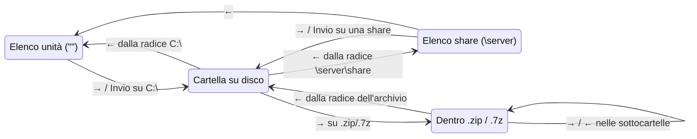
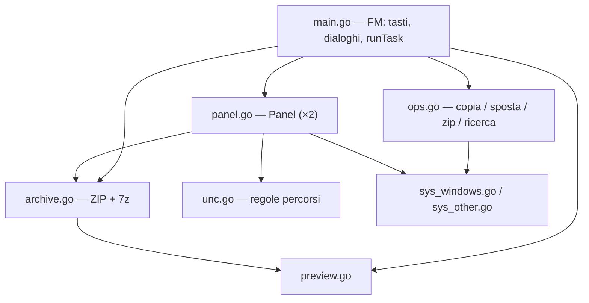

# gofm — Documentazione di progetto e specifiche

**Versione documentata:** 1.10 · **Data:** 28/10/2026 · **Licenza:** MIT, © 2026 rives
**Linguaggio:** Go 1.24 · **Piattaforma bersaglio:** Windows 64 bit (x64, ARM64) · **Interfaccia:** inglese

---

## Indice

0. [Regole di lavoro](#0-regole-di-lavoro)
1. [Panoramica](#1-panoramica)
2. [Decisioni di progetto](#2-decisioni-di-progetto)
3. [Interfaccia](#3-interfaccia)
4. [Luoghi e navigazione](#4-luoghi-e-navigazione)
5. [Mappa dei tasti](#5-mappa-dei-tasti)
6. [Specifiche funzionali](#6-specifiche-funzionali)
7. [Architettura del codice](#7-architettura-del-codice)
8. [Dettagli specifici di Windows](#8-dettagli-specifici-di-windows)
9. [Dipendenze e compilazione](#9-dipendenze-e-compilazione)
10. [Test](#10-test)
11. [Limiti noti e parti non verificate](#11-limiti-noti-e-parti-non-verificate)
12. [Storico versioni](#12-storico-versioni)
13. [Prompt per rigenerare il programma](#13-prompt-per-rigenerare-il-programma)

---

## 0. Regole di lavoro

- Risposte in **italiano**; interfaccia del programma e README in **inglese**.
- Prima di implementare, chiarire con domande i punti ambigui.
- **A ogni nuova versione** (regola fissata dall'utente nella v1.10) si aggiornano **sempre e tutte**:
  1. `const version` in `main.go`;
  2. `CHANGELOG.md` (sezione `## <versione> — <data>` in cima: è anche il testo della Release su GitHub);
  3. `README.md` (inglese);
  4. questa documentazione: intestazione, sezioni toccate, test (§10), limiti (§11), storico (§12) e **prompt di rigenerazione** (§13);
  5. le **specifiche compatte** (`gofm-<versione>-specifiche-compatte.md`, il riepilogo per riprendere il lavoro in una nuova chat);
  6. la **pubblicazione su GitHub** (§9.5): commit con **tutti** i file del repository e tag annotato `v<versione>`; il workflow pubblica la Release con il **pacchetto compilato** pronto da scaricare.
- Licenza **MIT**, "Copyright (c) 2026 rives".

---

## 1. Panoramica

`gofm` è un file manager a doppio pannello per il terminale di Windows (Windows Terminal, `cmd.exe`, PowerShell), nello stile di Midnight Commander / Total Commander. È un singolo eseguibile senza dipendenze esterne (`gofm.exe`, circa 7 MB).

Funzioni principali:

- navigazione con frecce (→ entra, ← risale), ricerca digitando, Shift+lettera per cambiare unità;
- copia, spostamento, rinomina, nuova cartella, eliminazione nel **Cestino di Windows**;
- creazione ed estrazione di **ZIP**, anteprima ed estrazione di **7z**;
- **navigazione dentro gli archivi** come se fossero cartelle, con estrazione dei soli elementi selezionati;
- **percorsi UNC** (`\\server\share`) ed **elenco delle share** di un server;
- **barra di avanzamento** con velocità e tempo residuo stimato;
- copia e spostamento **immediati** verso la cartella dell'altro pannello (senza campo destinazione);
- **totale cumulativo della selezione** sul bordo superiore del pannello, con le cartelle misurate ricorsivamente;
- **Ctrl+→ / Ctrl+←** per portare il percorso del pannello corrente in quello opposto;
- **confronto delle due cartelle (F12)** per nome, dimensione e data: seleziona da entrambi i lati i file mancanti nell'altra cartella e la copia più recente dei file presenti in entrambe;
- **copia ottimizzata per la rete**: ogni file è copiato con il motore di Windows (`CopyFileEx`), i file piccoli fino a 4 alla volta, quelli grandi uno alla volta;
- **tema blu scuro** con **colori per tipo di file**, totale della selezione sul bordo del pannello e dimensione ricorsiva delle cartelle selezionate;
- **aggiornamento automatico** dei due pannelli con le notifiche di modifica del sistema;
- **riepilogo dei tasti (Alt+F1)** con le scorciatoie che non sono nella barra in basso;
- **pacchetto scaricabile** pubblicato come Release su GitHub a ogni tag di versione;
- **icone per tipo di file** davanti ai nomi (glifi Nerd Font, oppure simboli semplici con Alt+I);
- **profilo per Windows Terminal** (Cascadia Mono NF, schema "gofm Navy", cursore a trattino basso) con script di installazione;
- **vista piatta (Ctrl+B)**: tutti i file di una cartella e delle sue sottocartelle in un'unica lista, con tutte le operazioni;
- **spazio libero** del disco o della share sul bordo inferiore di ogni pannello;
- **memoria delle cartelle**: alla riapertura i pannelli tornano dove erano;
- **pronto per GitHub** con licenza MIT (sezione 9.4).
- ricerca ricorsiva per nome e contenuto, filtro del pannello, anteprima di testo/binari/archivi;
- colonna del nome che si adatta alla larghezza della finestra, date in formato compatto.

Avvio:

```
gofm.exe                        :: entrambi i pannelli nella cartella corrente
gofm.exe C:\Progetti D:\Backup  :: pannello sinistro e destro
gofm.exe \\nas                  :: un pannello sull'elenco delle share di \\nas
gofm.exe -h | --help | /?       :: stampa "gofm 1.10 — usage: gofm [left_folder] [right_folder]"
```

Un argomento non valido (inesistente o non cartella) viene sostituito dalla cartella corrente.

---

## 2. Decisioni di progetto

Ogni scelta è stata presa con l'utente o motivata esplicitamente.

| Tema | Scelta | Motivo |
|---|---|---|
| Linguaggio | **Go** + `rivo/tview` / `gdamore/tcell` | Un solo `.exe` senza CGO, cross-compilabile, librerie TUI mature. Rust era l'alternativa. |
| Layout | **Doppio pannello** | Richiesta dell'utente (stile MC/TC). |
| Eliminazione | **Cestino** con `SHFileOperationW` + `FOF_ALLOWUNDO` | Recuperabile. `FOF_WANTNUKEWARNING` fa avvisare Windows se un file verrebbe distrutto invece che cestinato (share di rete, file troppo grandi). |
| Lingua UI | **Inglese** | Richiesta dell'utente (v1.1). |
| Frecce | → entra / ← risale; → su un file normale **non fa nulla** | Evita di lanciare programmi per errore. Tab resta il cambio pannello. |
| 7z | **Solo lettura** (anteprima, estrazione) | Non esiste un'implementazione Go pura affidabile in scrittura; crearli richiederebbe 7-Zip installato. |
| Tasti | Le lettere **minuscole** servono alla **ricerca digitando**; **Shift+lettera (maiuscola) = unità** (fino alla v1.7 Ctrl+lettera); i comandi stanno su **F2–F10, F12 e Alt+lettera** | L'utente ha scelto Ctrl+lettera per le unità, quindi i comandi non potevano usare Ctrl. |
| Date | `22/10 16:37` se dell'anno corrente, altrimenti `22/10/2024` | Stile `ls`, 11 caratteri. |
| Share di rete | Percorsi UNC digitabili **e** elenco share con `NetShareEnum` | Richiesta dell'utente. |
| Destinazione di F5/F6 | **Sempre la cartella dell'altro pannello, senza campo da confermare** (anche per l'estrazione con F5 dentro un archivio). Resta la domanda sui file omonimi | Richiesta dell'utente (v1.3). La domanda sui conflitti resta perché è l'unica protezione contro la sovrascrittura. |
| Specchio del percorso | **Ctrl+→ nel pannello sinistro, Ctrl+← nel destro**: la freccia indica il pannello che cambia; nella direzione opposta non succede nulla | Richiesta dell'utente (v1.3); gesto direzionale, Alt+E resta come equivalente non direzionale. |
| Confronto cartelle | **F12**, **solo file** (le cartelle sono ignorate). Dalla v1.10 per **nome, dimensione e data**: seleziona i mancanti dall'altro lato e, per i file presenti in entrambi, **solo la copia più recente**; stessa data e dimensione diversa → entrambe. **Tolleranza 2 s** sulla data | Scelte dell'utente (v1.4: solo nome e mancanti; v1.10: nome+data+dimensione, la più recente, 2 s). Selezionare la sola copia più recente rende sicuro F5 subito dopo (come la sincronizzazione di Total Commander). 2 s è la risoluzione delle date su FAT/exFAT e su molti NAS; uno scarto di **1 ora esatta** (ora legale su FAT) resta una differenza: ignorarlo nasconderebbe anche modifiche reali. |
| Aiuto | F1 non fa nulla (dalla v1.4). Dalla v1.10 **Alt+F1** apre un **riepilogo dei tasti** che **esclude** quelli della barra in basso | Scelte dell'utente (v1.4, v1.10): la barra mostra già i suoi tasti; un test verifica che le due liste non si sovrappongano. |
| Cancellazione di cartelle con sottocartelle | Dopo la conferma normale di F8, una **seconda conferma** con l'**elenco dei nomi** (al massimo 8, poi `… and N more`); pulsante predefinito **Cancel** | Scelta dell'utente (v1.10): solo i nomi, nessun conteggio, così la risposta è immediata anche su share lente. Il controllo legge ogni cartella solo fino alla prima sottocartella, in background. |
| Pubblicazione | **Release su GitHub** con lo zip compilato e il suo SHA-256, creata dal workflow `release.yml` al push di un tag `v<versione>`. Commit e tag li prepara Claude nella copia locale, il push lo fa l'utente | Scelta dell'utente (v1.10). Lo zip è compilato da GitHub dai sorgenti pubblicati, quindi verificabile; lo stesso script (`scripts/build-release.sh`) produce il pacchetto in locale e nella CI. |
| Totale della selezione | Cumulativo (in barra di stato fino alla v1.5, sul bordo del pannello dalla v1.6); le cartelle sono misurate **ricorsivamente in background** | Richiesta dell'utente (v1.3); il calcolo asincrono non blocca l'interfaccia su cartelle grandi o di rete. |
| Spostamento tra unità | Copia + eliminazione dell'origine **solo se la copia è riuscita al 100%** | Nessuna perdita di dati possibile. |
| Collegamenti | Symlink e junction **non vengono attraversati** | Evita cicli infiniti (es. "Application Data"). |
| Copia dei file (Windows) | **`CopyFileExW`** invece di un ciclo lettura/scrittura | v1.5, uso principale dell'utente: file grandi tra PC e server e tra server in LAN, a volte in VPN. È il motore di Esplora risorse e robocopy: sceglie l'I/O migliore e, dove server e protocollo lo supportano, delega la copia (copia lato server SMB tra cartelle dello stesso server, ODX sugli storage che lo offrono), così i dati non passano dal PC. Copia anche attributi e date in un solo passaggio. |
| I/O senza cache | `COPY_FILE_NO_BUFFERING` per file **≥ 256 MB** | Raccomandato da Microsoft per trasferimenti molto grandi (equivale a `robocopy /J`): evita di riempire la cache di sistema con dati che non verranno riletti. |
| Parallelismo | **4 file insieme**, ma **un solo file ≥ 64 MB alla volta** | Con molti file piccoli il tempo va nelle attese di rete per ogni file, e il parallelo le sovrappone (come `robocopy /MT`). Più flussi grandi in parallelo non aumentano la banda di un singolo collegamento o disco e su un disco meccanico peggiorano per i salti della testina. |
| Tema | Sfondo **blu scuro `#0A1946`** su tutta l'interfaccia, colori **RGB** (uguali in ogni profilo di terminale; le console a 16 colori usano il colore più vicino) | Richiesta dell'utente (v1.6). |
| Colori dei file | 7 famiglie per estensione; il **giallo `#FFE14D` è riservato** alla selezione e nessuna famiglia gli si avvicina (verificato da un test sulla distanza dei colori) | Richiesta dell'utente (v1.6): il colore di un file non deve mai confondersi con quello di un file selezionato. |
| Totale selezione | Spostato dalla barra di stato al **bordo superiore del pannello**, a destra, sulla stessa riga del percorso | Richiesta dell'utente (v1.6). |
| Tasto `*` | Nessuna selezione → **seleziona file e cartelle**; selezione presente → **deseleziona tutto**. `*` non può comparire nei nomi Windows, quindi non serve alla ricerca digitando | Scelte dell'utente (v1.6). |
| Cursore | **Trattino basso lampeggiante** (DECSCUSR 3) al posto della barra verticale di Windows Terminal | Scelta dell'utente (v1.6). |
| Font | **Cascadia Mono NF** (dalla v1.9; Cascadia Mono nella v1.6–1.8) tramite un profilo di Windows Terminal: un programma da terminale non può scegliere il font | Scelta dell'utente. La variante **NF** contiene i glifi Nerd Font delle icone; l'utente la installa **a mano** (README, *Font with icons*). Lo script di installazione si limita a segnalarne l'assenza. |
| Icone dei file | Un **carattere** per famiglia di colori (+ cartella, file generico, `..`, unità, share). Insieme predefinito: **glifi Nerd Font**; con **Alt+I** **simboli semplici** della codepage 437, ricordati in `state.json` | Scelta dell'utente (v1.9) fra tre opzioni. Le icone di Esplora risorse sono bitmap e in una cella del terminale non si possono disegnare. Le **emoji** sono state scartate: occupano 2 celle con resa diversa da terminale a terminale e nella console classica diventano `??`, disallineando le colonne. Il Nerd Font dà vere icone ma senza il font mostra quadratini, e un programma da terminale **non può accorgersene**: da qui il tasto esplicito e il ripiego. |
| Colore delle icone | Sempre il **colore della famiglia**, anche sugli elementi selezionati (solo il nome diventa giallo); **sulla riga del cursore del pannello attivo** l'icona prende il colore del testo del cursore `#06122E`; i nascosti hanno l'icona attenuata | Scelta dell'utente (v1.9). Eccezione del cursore: sul ciano `#2AB3C8` **tutte** le famiglie hanno un contrasto fra 1,0:1 e 1,8:1 (illeggibili), mentre `#06122E` arriva a 7,4:1. Sul cursore del pannello inattivo (`#2B3F6E`) le famiglie restano ≥ 3:1 e mantengono il loro colore. |
| Aggiornamento automatico | **Notifiche del sistema** (`ReadDirectoryChangesW` via `fsnotify`) su **entrambi i pannelli**, raggruppate; nessun polling. Alt+R resta per il refresh manuale | Scelta dell'utente (v1.6): costo quasi nullo a cartella ferma; il ritmo si adatta alla lentezza della cartella. |
| Vista piatta | **Ctrl+B** dalla v1.8 (Alt+D nella v1.7); l'elenco delle unità è su **Alt+V** | Scelta dell'utente. |
| Unità su Shift+lettera | La lettera **maiuscola** cambia unità. Il terminale consegna Shift+D come il carattere `D`, senza poterlo distinguere dal Blocco Maiuscole | Scelta dell'utente (v1.8), presa **sapendo le conseguenze**: la ricerca digitando funziona solo con le minuscole (trova comunque i nomi in maiuscolo, perché non distingue maiuscole e minuscole); con il **Blocco Maiuscole attivo** ogni lettera digitata cambia unità. Alternative scartate: Ctrl+lettera (com'era) e Alt+Shift+lettera. |
| Bordo inferiore | Formato compatto ` 12 files 3.4 MB │ 28.5G free (11%) ` | Scelta dell'utente (v1.8) fra tre formati. |
| Copia dalla vista piatta | **Tutti i file nella stessa cartella** di destinazione (`sub\a.txt` → `dest\a.txt`, come Total Commander); nomi doppi nella selezione → **rifiuto** con elenco dei nomi | Scelta dell'utente (v1.7). Il rifiuto evita che due file omonimi si sovrascrivano a vicenda: con la copia parallela l'esito sarebbe casuale. |
| Memoria delle cartelle | Salvataggio a **ogni cambio di cartella** (non solo all'uscita) in `%APPDATA%\gofm\state.json` | Chiudere la finestra del terminale con la X termina il processo senza un'uscita ordinata: salvando subito non si perde nulla. La scrittura avviene solo se qualcosa è cambiato. |
| Avvio con cartelle irraggiungibili | Controllo con **timeout di 3 s** per cartella; poi cartella corrente | Una share su VPN non connessa può bloccare `os.Stat` per decine di secondi. |
| Spazio libero | `GetDiskFreeSpaceExW` (spazio **disponibile all'utente**, rispetta le quote) in background, al massimo ogni 2 s per cartella | Una chiamata su share remota è un giro di rete: non deve bloccare l'interfaccia. |
| Licenza | **MIT**, titolare **rives** | Scelta dell'utente (v1.7). Compatibile con tutte le dipendenze (MIT, BSD-3, Apache-2.0, MPL-2.0). |
| Compressione SMB | **Non attivata** | `COPY_FILE_REQUEST_COMPRESSED_TRAFFIC` richiede Windows 11 / Server 2022 e un server che la supporti; su LAN veloce può rallentare. Possibile opzione futura per la VPN. |

---

## 3. Interfaccia

```
╔ C:\Users\me\Documents ═══ 2 selected · 3.8 MB · 3 files ═╗┌ D:\Backup ──────────────────────────────────┐
║  ↑ ..                                    UP              ║│  ↑ ..                               UP       │
║* ► Progetti                          3.8 MB 22/10 16:37  ║│  ► 2025                    <DIR> 05/03/2025  │
║* ¶ relazione f….pdf                  1.2 MB 21/10 09:12  ║│  ▒ archivio.zip          412.0 KB 22/10 10:01 │
║  ♦ setup.exe                        85.3 MB 02/01/2024  ║│                                              │
╚══════════════════════════════════════════════════════════╝└──────────────────────────────────────────────┘
 Search: rel  relazione finale.pdf                         1.2 MB │ 21/10/2026 09:12 │ ---A │     3 items
F2Ren F3View F5Copy F6Move F7MkDir F8Trash F9Zip F10Quit F12Compare Alt+SFind Alt+FFilter Alt+UExtract Ctrl+XDrive X:
```

Sfondo blu scuro su tutto; icona e nome colorati per tipo (§3.5, §3.9); selezione in giallo. Nello schema le icone sono i simboli semplici (Alt+I): i glifi Nerd Font predefiniti non si vedono senza il font. Una schermata reale (v1.8, senza icone) è nel file `screenshot.png`.

### 3.1 Pannelli

- Titolo (bordo superiore, a sinistra): il percorso del luogo, tagliato a sinistra con `…` se troppo lungo; tra parentesi quadre eventuali `filter: …`, `sort: size|date`, `hidden shown`.
- **Bordo inferiore, a destra** (§6.26): ` 12 files 3.4 MB │ 28.5G free (11%) `, cioè numero e dimensione dei file elencati nel pannello, poi lo spazio libero del disco in forma compatta e la percentuale libera. Se lo spazio manca si toglie prima la parte del disco, poi quella dei file. Negli elenchi unità/share non c'è la parte dei file.
- **Vista piatta**: nel titolo `[flat view]`, con `, first 200000` se l'elenco è troncato e `, updating…` durante una rilettura.
- **Totale della selezione** (bordo superiore, a destra, in giallo): ` N selected · <dimensione> · M files ` più ` · counting…` finché una cartella è in misurazione (§6.18). Il percorso viene accorciato per lasciargli spazio; se il pannello è troppo stretto il totale non viene mostrato.
- Pannello attivo: bordo **giallo** `#FFE14D` (doppio), riga del cursore **sfondo `#2AB3C8`, testo `#06122E`**. Pannello inattivo: bordo `#5A6E9A`, riga del cursore **sfondo `#2B3F6E`, testo bianco**. Sotto il cursore il colore del tipo di file è sostituito da quello del cursore; un elemento selezionato resta riconoscibile dall'asterisco `*`. Eccezione: sul cursore del pannello **inattivo** l'icona conserva il colore della famiglia (§3.9).
- Cinque colonne, separate da uno spazio (comportamento di tview):

| Colonna | Larghezza | Contenuto |
|---|---|---|
| Marca | 1 | `*` se marcato, altrimenti spazio |
| Icona | 1 | icona del tipo (§3.9) |
| Nome | `larghezza_interna − 4 − 9 − 11 − 2` (minimo 6), si espande | il nome, senza prefissi (fino alla v1.8 le cartelle erano precedute da `\`); link seguiti da ` ~` |
| Dimensione | 9, allineata a destra | `UP` per `..`, `DRIVE`, `SHARE`; per una cartella `<DIR>`, ma se è **selezionata** il **totale ricorsivo** del suo contenuto (`…` durante la misurazione); per un file la dimensione leggibile |
| Data | 11 | vedi §6.13; vuota se la data è sconosciuta |

- Colori del nome: vedi §3.5. Nascosti `#7F8FB4`; marcati **giallo grassetto** (prevale su tutto). Marca, nome, dimensione e data usano lo stesso colore; l'icona ha il colore della famiglia (§3.9).
- Ordinamento: cartelle sempre prima; poi per nome (senza distinzione maiuscole), dimensione decrescente o data decrescente. La riga `..` è sempre in cima.

### 3.2 Barra di stato (penultima riga)

Stesse regole delle colonne dei pannelli: **colonne a larghezza fissa a destra**, **colonna del nome che occupa lo spazio rimanente** (accorciata con `…` mantenendo l'estensione). Sfondo `#06122E`, un carattere di margine per lato.

| Colonna | Larghezza | Contenuto |
|---|---|---|
| (ricerca) | variabile | durante la ricerca digitando: badge ` Search: <testo> ` (testo scuro su giallo) ed eventualmente `no match` in rosso; riduce la colonna del nome |
| Nome | resto della riga | nome dell'elemento sotto il cursore; per una share ` — <commento>`; vuoto su `..` |
| Dimensione | 9, a destra | dimensione del file; per una cartella `<DIR>` o, se selezionata e misurata, il totale ricorsivo |
| Data | 16 | `gg/mm/aaaa hh:mm` |
| Attributi | 4 | `RHSA` (Windows) |
| Elementi | 11, a destra | `N items` (escluso `..`) |

Le colonne fisse sono separate da ` │ ` e scritte in `#7F8FB4`; il nome in `#D5DEEE`. Dopo F12, Ctrl+B o Alt+I un avviso (testo scuro su `#56D4DD`) **sostituisce l'intera riga** fino al tasto successivo (§6.20). Il totale della selezione non è più qui ma sul bordo del pannello (§3.1).

### 3.3 Barra dei tasti (ultima riga)

Sfondo `#06122E`; ogni coppia è resa come `[#06122E:#2AB3C8]Tasto[-:-]Etichetta `:
`F2 Ren · F3 View · F5 Copy · F6 Move · F7 MkDir · F8 Trash · F9 Zip · F10 Quit · F12 Compare · Ctrl+B Flat · Alt+S Find · Alt+F Filter · Alt+U Extract · Alt+V Drives · Alt+I Icons · Shift+X Drive X:`. Gli altri tasti sono nel riepilogo di **Alt+F1** (§3.4). (le ultime voci si vedono solo nelle finestre larghe)

### 3.4 Finestre di dialogo

- **Messaggio**: `tview.Modal` con pulsante `OK`.
- **Conferma**: `tview.Modal` con pulsanti personalizzati (es. `Overwrite` / `Skip existing` / `Cancel`; `Yes` / `No`; `Replace` / `Cancel`).
- **Richiesta di testo**: Form 76×7 con un campo e i pulsanti `OK` / `Cancel`; Invio conferma, Esc annulla.
- **Avanzamento**: riquadro 72×12 intitolato ` Working ` con testo e pulsante `Cancel` (anche Esc).
- Tutto il testo derivato da nomi di file passa per `tview.Escape`, altrimenti `[x].txt` verrebbe interpretato come tag di colore.
- Le finestre sono una pila: chiudendo una finestra il focus torna a quella sotto, o al pannello attivo. **Dettaglio tecnico** (bug corretto nella v1.10): `Pages.RemovePage` restituisce il focus alla pagina principale, il cui `Flex` lo passa al primo elemento, cioè al pannello **sinistro**, e il gestore del focus di quel pannello lo rende attivo. `closeModal` memorizza quindi il pannello attivo **prima** di `RemovePage` e poi lo riattiva con `setActive(active, true)`. Fino alla v1.9 la chiusura di qualsiasi finestra aperta dal pannello destro (avanzamento di Ctrl+B, F5, F8, conferme, F3) spostava il focus a sinistra.
- **Riepilogo dei tasti (Alt+F1)**: TextView con bordo, titolo ` Keys — Esc to close `, sezioni *Navigation*, *Search and selection*, *Files*, *View*, *Program*; larghezza adattata al testo (righe ≤ 76 celle, quindi entra in 80 colonne), altezza limitata allo schermo con scorrimento (titolo ` Keys — ↑↓ to scroll, Esc to close `). Si chiude con Esc, Invio, F1, Alt+F1 o `q`. Elenca **solo** i tasti che **non** sono nella barra in basso: la barra e il riepilogo leggono due liste nel codice (`keybarKeys`, `helpSections`) e un test verifica che non abbiano voci in comune. `Del` e `Alt+Q` compaiono perché sono tasti diversi da F8 e F10, con l'indicazione `(same as F8)` / `(same as F10)`.
- Colori dal tema (§3.6): riquadro dei messaggi `#1E3A78` con pulsanti su `#0A1946`; moduli su `#0A1946` con campi e pulsanti `#1E3A78`; etichette `#8FD3FF`; pulsante attivo invertito.
- **Cursore di testo** nei campi: trattino basso lampeggiante (§3.7).

### 3.5 Colori per tipo di file

Il colore dipende dall'estensione (senza distinzione di maiuscole). Le famiglie sono scelte perché distano almeno 60 tra loro e almeno 120 dal giallo della selezione nello spazio RGB (controllato dai test).

| Famiglia | Colore | Estensioni |
|---|---|---|
| Cartelle | bianco grassetto `#FFFFFF` | — |
| Archivi | rosa `#FF79C6` | `.zip .7z .rar .tar .gz .tgz .bz2 .xz .zst .cab .iso .lz .lzma` |
| Programmi e script | verde `#5AF78E` | `.exe .msi .bat .cmd .ps1 .com .vbs .scr .appx .msix .reg` |
| Immagini | orchidea `#C792EA` | `.jpg .jpeg .png .gif .bmp .tif .tiff .svg .webp .ico .heic .raw .cr2 .nef .psd .ai` |
| Documenti | azzurro `#79C0FF` | `.pdf .doc .docx .odt .rtf .txt .md .xls .xlsx .xlsm .ods .csv .ppt .pptx .odp .msg .eml .one` |
| Audio e video | rosso `#FF6B6B` | `.mp3 .wav .flac .aac .ogg .m4a .wma .mp4 .mkv .avi .mov .wmv .webm .m4v .mpg .mpeg` |
| Codice, configurazione, log | acquamarina `#4EE6C8` | `.go .py .js .ts .c .cpp .h .hpp .cs .java .rs .json .xml .yaml .yml .ini .cfg .conf .toml .html .htm .css .sql .sh .log` |
| File di sistema e di supporto | grigio-blu `#9AA3B5` | `.dll .sys .bak .tmp .old .dat .db .lnk` |
| Altri file | `#D5DEEE` | — |
| Nascosti/di sistema (attributi) | `#7F8FB4` | prevale sul tipo |
| **Selezionati** | **giallo `#FFE14D` grassetto** | prevale su tutto; riservato |

### 3.6 Tema

Impostato in `applyTheme()` prima di creare qualsiasi elemento (i valori predefiniti di tview vengono letti alla creazione):

| Ruolo | Colore |
|---|---|
| Sfondo di tutta l'interfaccia | `#0A1946` |
| Sfondo di campi, pulsanti, messaggi | `#1E3A78` |
| Testo | `#D5DEEE` |
| Bordi inattivi / attivi | `#5A6E9A` / `#FFE14D` |
| Barre in basso | `#06122E` |
| Etichette dei moduli | `#8FD3FF` |

Tutti i colori sono RGB: in Windows Terminal appaiono esattamente; nella console classica a 16 colori tcell sceglie il colore di tavolozza più vicino (lo sfondo diventa il blu scuro standard, e alcune famiglie possono coincidere).

### 3.7 Cursore

Prima di ogni ridisegno gofm imposta lo stile **trattino basso lampeggiante** (`CursorStyleBlinkingUnderline`, sequenza `ESC [3 q`). Il cursore è visibile solo nei campi di testo. All'uscita tcell ripristina lo stile predefinito del terminale.

### 3.8 Font e profilo di Windows Terminal

Il font è una scelta del terminale. In `windows-terminal/` ci sono:
- `gofm-terminal-profile.json`, un *fragment* di Windows Terminal che aggiunge il profilo **gofm**: avvia `%LOCALAPPDATA%\Programs\gofm\gofm.exe`, font **Cascadia Mono NF 11**, schema **gofm Navy** (sfondo `#0A1946` e 16 colori coerenti con il tema), cursore `underscore`, niente acrilico;
- `install-gofm.ps1`, che copia l'eseguibile giusto (x64 o ARM64) in `%LOCALAPPDATA%\Programs\gofm`, mette il fragment in `%LOCALAPPDATA%\Microsoft\Windows Terminal\Fragments\gofm\gofm.json` e, con `-AddToPath`, aggiunge la cartella al PATH dell'utente. Controlla anche che **Cascadia Mono NF** sia installato (file `CascadiaMonoNF*` in `%WINDIR%\Fonts` o `%LOCALAPPDATA%\Microsoft\Windows\Fonts`) e, se manca, stampa in giallo dove scaricarlo e il suggerimento di Alt+I; **non installa font**. Non servono diritti di amministratore.

Uso: `powershell -ExecutionPolicy Bypass -File install-gofm.ps1 [-AddToPath]`, poi riavviare Windows Terminal e scegliere il profilo **gofm**. File scaricati da Internet possono essere bloccati da Windows: "Proprietà → Sblocca" sullo zip prima di estrarlo, oppure `-ExecutionPolicy Bypass` come sopra.

**Installazione del font (a mano, una volta).** Da <https://github.com/microsoft/cascadia-code/releases> scaricare `CascadiaCode-<versione>.zip`, aprire la cartella `ttf`, clic destro su **`CascadiaMonoNF.ttf`** → **Installa** (o *Installa per tutti gli utenti*). Verificato sulla release 2407.24: il file contiene tutti i 12 glifi usati da gofm, ciascuno largo esattamente una cella (avanzamento 1200 unità come la lettera `M`); il normale `CascadiaMono.ttf` non ne contiene nessuno. Se il profilo indica un font non installato, Windows Terminal lo segnala e usa il font predefinito: le icone appaiono come quadratini finché non si installa il font o si preme Alt+I.

### 3.9 Icone dei file

Davanti a ogni nome c'è un'icona di **una cella**, nella colonna *Icona* (§3.1). Il tipo è quello dei colori (§3.5): stessa tabella di estensioni, senza distinzione di maiuscole.

| Tipo | Nerd Font (predefinito) | Simbolo semplice (Alt+I) | Colore dell'icona |
|---|---|---|---|
| Cartella | `U+F07B` nf-fa-folder | `►` | bianco |
| `..` | `U+F062` nf-fa-arrow_up | `↑` | bianco |
| Unità | `U+F0A0` nf-fa-hdd_o | `■` | bianco |
| Share | `U+F233` nf-fa-server | `≡` | bianco (attenuato per `C$`, `ADMIN$`) |
| Archivi | `U+F1C6` nf-fa-file_archive_o | `▒` | `#FF79C6` |
| Programmi e script | `U+F120` nf-fa-terminal | `♦` | `#5AF78E` |
| Immagini | `U+F1C5` nf-fa-file_image_o | `☼` | `#C792EA` |
| Documenti | `U+F0F6` nf-fa-file_text_o | `¶` | `#79C0FF` |
| Audio e video | `U+F144` nf-fa-play_circle | `♫` | `#FF6B6B` |
| Codice, configurazione, log | `U+F1C9` nf-fa-file_code_o | `§` | `#4EE6C8` |
| Sistema e supporto | `U+F013` nf-fa-cog | `◘` | `#9AA3B5` |
| Altri file | `U+F016` nf-fa-file_o | `·` | `#D5DEEE` |

- **Glifi Nerd Font**: dall'intervallo Font Awesome (`U+F000`–`U+F2E0`), che i Nerd Font mantengono invariato dalla v2; sono nell'area a uso privato di Unicode, quindi esistono **solo** nei font patchati. Nella variante *Mono* di un Nerd Font sono larghi una cella; la colonna *Icona* è comunque seguita da uno spazio, così anche un glifo che sborda leggermente non copre il nome.
- **Simboli semplici**: tutti della codepage 437 (presenti in Cascadia Mono, Consolas, Lucida Console), quindi funzionano anche nella **console classica**. Nessuno ha una forma emoji predefinita.
- **Larghezza**: entrambi gli insiemi misurano 1 cella con `uniseg` (verificato dai test), la stessa misura usata da tview per allineare le colonne.
- **Colore**: quello della famiglia anche quando l'elemento è **selezionato** (solo marca e nome diventano gialli); icona **attenuata** (`#7F8FB4`) per gli elementi nascosti, come il loro nome; sulla **riga del cursore del pannello attivo** colore del testo del cursore `#06122E`, perché sul ciano tutte le famiglie scendono sotto 2:1 di contrasto; sulla riga del cursore del pannello **inattivo** colore della famiglia su `#2B3F6E` (contrasto ≥ 3:1, verificato dai test).
- **Alt+I** passa da un insieme all'altro, ridisegna i due pannelli, mostra l'avviso `Icons: basic symbols — Alt+I for Nerd Font icons` (o `Icons: Nerd Font (needs e.g. Cascadia Mono NF) — Alt+I for basic symbols`) e salva subito la scelta in `state.json` (§6.27).
- **Implementazione**: tview colora tutta la riga del cursore con il colore di primo piano della tabella, a meno che la cella abbia un proprio `SelectedStyle`. Prima di ogni disegno `Panel.styleCursorIcon()` imposta lo `SelectedStyle` della sola cella icona della riga del cursore in base al pannello attivo: costo costante, nessuna ricostruzione delle righe al cambio di pannello.

---

## 4. Luoghi e navigazione

Un pannello si trova sempre in uno di quattro tipi di luogo:



| Luogo | Campo `dir` | Operazioni su file |
|---|---|---|
| Elenco unità | `""` (solo Windows) | no |
| Elenco share | `\\server` (solo Windows) | no |
| Cartella | percorso assoluto, anche `\\server\share\…` | sì |
| Archivio | cartella che contiene l'archivio + stato `arch` (percorso, voci, cartella interna) | sola lettura: anteprima ed estrazione |

### 4.1 Regole del "padre"

Calcolate con pura manipolazione di stringhe (testabili ovunque):

| Da | A | Selezione dopo il salto |
|---|---|---|
| `C:\Users\me` | `C:\Users` | `me` |
| `C:\Users` | `C:\` | `Users` |
| `C:\` | elenco unità | `C:\` |
| `\\nas\docs\a\b` | `\\nas\docs\a` | `b` |
| `\\nas\docs\a` | `\\nas\docs\` | `a` |
| `\\nas\docs\` | `\\nas` (share) | `docs` |
| `\\nas` | elenco unità | — |
| dentro archivio `sub/x` | `sub` | `x` |
| radice dell'archivio | cartella che lo contiene | il nome dell'archivio |

Su Linux/macOS (solo per sviluppo e test) il padre è `filepath.Dir` e la radice `/` non ha padre.

### 4.2 Memoria per unità

A ogni cambio di cartella riuscito su un percorso con lettera di unità, `lastDir[lettera] = cartella`. Shift+lettera porta all'ultima cartella visitata su quell'unità se esiste ancora, altrimenti alla radice. All'avvio vengono registrate le cartelle iniziali dei due pannelli.

### 4.3 Cambio cartella sicuro

`chdir` salva lo stato (cartella, filtro, archivio, marcati), prova a caricare e, se fallisce, ripristina e mostra `Cannot open folder:` (o `Cannot open share list:`) con l'errore. Entrando in una nuova cartella filtro e marcati si azzerano. Se un `reload` fallisce (cartella eliminata da fuori), il pannello risale finché trova un luogo caricabile.

---

## 5. Mappa dei tasti

> Le lettere semplici servono alla ricerca digitando: per questo nessun comando usa una lettera da sola.

### 5.1 Navigazione

| Tasto | Azione |
|---|---|
| ↑ ↓ PgUp PgDn Home End | muovono il cursore (gestiti da `tview.Table`) |
| → | entra in cartella / unità / share / `..`; su `.zip`/`.7z` (solo su disco) apre l'archivio; su altri file nulla |
| ← | padre (o esce dall'archivio) |
| Backspace | se la ricerca digitando è attiva cancella un carattere, altrimenti padre |
| Invio | cartelle come →; file dentro un archivio → anteprima; altri file → apertura con il programma associato |
| Tab / Shift+Tab | cambia pannello attivo |
| Shift+*lettera* (lettera maiuscola) | va a quell'unità (vedi §4.2); messaggio se non esiste; fuori da Windows `Shift+<letter> switches drive on Windows only.` + `Type lower-case letters to search by name.`. Con il Blocco Maiuscole attivo ogni lettera è un cambio di unità |
| Ctrl+B | **vista piatta** on/off (§6.25) |
| Ctrl+altre lettere | nessuna funzione (fino alla v1.7 cambiavano unità) |
| Alt+L | `Go to`: digita un percorso (vedi §6.12) |
| Alt+V | elenco unità, con il cursore sull'unità corrente (fino alla v1.6 era Alt+D) |
| Ctrl+→ | **solo nel pannello sinistro**: il pannello destro mostra lo stesso luogo (vedi §6.19); nel pannello destro non fa nulla |
| Ctrl+← | **solo nel pannello destro**: il pannello sinistro mostra lo stesso luogo; nel pannello sinistro non fa nulla |
| Alt+E | come sopra, verso l'altro pannello in qualunque direzione |
| Alt+R | aggiorna entrambi i pannelli e rimisura le cartelle selezionate (l'aggiornamento è comunque automatico, §6.22) |
| Alt+I | icone: glifi Nerd Font ↔ simboli semplici (§3.9); la scelta è ricordata |
| Mouse | clic per selezionare e attivare un pannello |

### 5.2 Selezione

| Tasto | Azione |
|---|---|
| Spazio | marca/smarca e scende; aggiorna il totale cumulativo sul bordo del pannello (§6.18); durante una ricerca digitando inserisce uno spazio nel testo |
| Ins | marca/smarca e scende (sempre) |
| `*` | nessuna selezione → seleziona **tutti** i file e le cartelle; altrimenti **deseleziona tutto** (§6.23) |
| Alt+A | inverte la marcatura (esclusi `..`, unità, share) |
| Esc | nell'ordine: termina la ricerca digitando → toglie il filtro → toglie le marcature |

### 5.3 Operazioni

Agiscono sugli elementi marcati; se non ce ne sono, sull'elemento sotto il cursore.

| Tasto | Su disco | Dentro un archivio |
|---|---|---|
| F2 | Rinomina | messaggio sola lettura |
| F3 | Anteprima / proprietà | Anteprima della voce |
| F5 | Copia **subito** nella cartella dell'altro pannello | **Estrae subito** la selezione nella cartella dell'altro pannello |
| F6 | Sposta **subito** nella cartella dell'altro pannello | rifiutato: `Archives are read-only here: use F5 to extract instead of moving.` |
| F7 | Nuova cartella (accetta `a\b\c`) | messaggio sola lettura |
| F8 / Canc | Cestino (seconda conferma se ci sono cartelle con sottocartelle, §6.6) | messaggio sola lettura |
| F9 | Comprimi in ZIP | messaggio sola lettura |
| F10 / Alt+Q | Esci | Esci |
| F12 | Confronta le due cartelle (§6.20) | Confronta (funziona anche dentro gli archivi) |
| F1 | nessuna funzione (l'aiuto è stato eliminato in v1.4) | — |
| Alt+F1 | Riepilogo dei tasti non presenti nella barra (§3.4) | uguale |
| Alt+U | Estrae tutto l'archivio sotto il cursore | Estrae la selezione |

Messaggio di sola lettura: `Archives are read-only here.\nUse F5 or Alt+U to extract the selected items.` In elenco share: `Open a share first (→ or Enter).`; in elenco unità: `Open a drive first (→ or Enter).`

### 5.4 Vista e ricerca

| Tasto | Azione |
|---|---|
| Alt+S | Ricerca ricorsiva (solo su disco) |
| Alt+F | Filtro del pannello (anche dentro archivi ed elenco share) |
| Alt+O | Ordina: nome → dimensione → data |
| Alt+H | Mostra/nasconde file nascosti e di sistema e le share amministrative (`C$`, `ADMIN$`) |

### 5.5 Decodifica dei tasti (dettaglio tecnico)

- **Shift+lettera** arriva come il carattere maiuscolo (`KeyRune` `'A'…'Z'`, senza modificatori: tcell toglie `ModShift` dai caratteri stampabili), identico a una lettera digitata con il Blocco Maiuscole. Si riconosce solo `A`–`Z` ASCII; le lettere accentate maiuscole (`À`) restano alla ricerca digitando.
- **Ctrl+lettera** (usato per Ctrl+B) arriva da tcell in due forme e vanno gestite entrambe:
  1. console classiche / VT: `KeyCtrlA…KeyCtrlZ` con `ModCtrl`;
  2. Windows Terminal (*win32-input-mode*): `Key('A'…'Z')` con `ModCtrl`. Solo questa forma distingue Ctrl+H, Ctrl+I, Ctrl+M da Backspace, Tab e Invio.
  Va scartato Ctrl+Alt, che è AltGr sulle tastiere europee.
- **Alt+lettera**: `KeyRune` con `ModAlt` e senza `ModCtrl`; la lettera viene portata in minuscolo.
- I caratteri AltGr (`@ # [ ]` sulla tastiera italiana) arrivano come rune semplici e finiscono nella ricerca digitando.
- La cattura dei tasti avviene a livello di applicazione e solo quando la pagina in primo piano è `main`; con una finestra di dialogo aperta i tasti vanno alla finestra.
- Ctrl+C viene consumato dalla cattura (diventa "unità C:") e non chiude il programma.

---

## 6. Specifiche funzionali

### 6.1 Elenco dei file

- Lettura con `os.ReadDir`; per ogni voce `Info()`. Le voci sparite nel frattempo vengono saltate.
- Un elemento con `ModeSymlink` o `ModeIrregular` (le junction in Go ≥ 1.23) è un collegamento; con `os.Stat` si verifica se punta a una cartella.
- **Nascosto** = attributo Windows H o S, oppure nome che inizia con `.`. I nascosti sono esclusi salvo Alt+H.
- Il filtro si applica a tutti i luoghi tranne l'elenco unità.
- I marcati che non compaiono più dopo un ricaricamento vengono dimenticati.
- Dopo il caricamento il cursore va sull'elemento richiesto: corrispondenza esatta, altrimenti senza distinzione di maiuscole; se non c'è, sulla prima riga.

### 6.2 Ricerca digitando

- Ogni rune stampabile senza Ctrl/Alt si aggiunge al testo di ricerca. Se sono passati più di **1,5 s** dall'ultimo tasto, la ricerca riparte da capo.
- Salto: prima voce (esclusa `..`) il cui nome **inizia** con il testo, senza distinzione di maiuscole; se non c'è, la prima che lo **contiene**.
- Se non c'è corrispondenza il carattere viene ignorato e la barra mostra `no match`; il cursore resta sull'ultima corrispondenza valida.
- Backspace toglie l'ultimo carattere e risalta; con il testo vuoto torna a essere "padre".
- Esc e qualunque altro tasto di comando o navigazione chiudono la ricerca. Anche cambiare pannello la azzera.

### 6.3 Copia e spostamento (F5 / F6)

1. **Nessuna richiesta di destinazione** (da v1.3): la destinazione è sempre la cartella mostrata dall'altro pannello. Se l'altro pannello non mostra una cartella su disco (elenco unità, elenco share, interno di un archivio) l'operazione non parte e appare `The destination is the other panel:\nopen a folder on disk there first.` (titolo `Copy` o `Move`).
2. Ogni elemento va dentro la destinazione con lo stesso nome. Copiare con un nome nuovo non è più possibile da F5/F6: si copia e poi si rinomina con F2.
3. Se nel frattempo la cartella dell'altro pannello è stata eliminata: `Destination folder does not exist:` e l'altro pannello viene ricaricato.
4. Controlli preventivi, ciascuno bloccante:
   - origine e destinazione coincidono → `Source and destination are the same:`;
   - cartella dentro sé stessa → `Cannot copy a folder into itself:`;
   - esiste già un elemento di tipo diverso con lo stesso nome → `An item of a different type with the same name already exists:`.
5. Se ci sono conflitti (**unica domanda rimasta**): `N items already exist at the destination.\nFolders with the same name will be merged.` con `Overwrite` / `Skip existing` / `Cancel`.
6. Esecuzione in background (§6.10). Fase `Counting files…`: si calcola la dimensione di ogni elemento (`treeSize`, senza seguire link) e il totale.
7. Gli elementi da saltare (conflitto con *Skip existing*) vengono tolti subito e la loro dimensione aggiunta all'avanzamento. Tutti gli altri passano a **un unico motore di copia** condiviso dall'intera selezione (§6.21), così il parallelismo vale anche tra file marcati singolarmente.
8. **Copia** (`copyAll`), visita in ordine di ogni elemento:
   - cartella: `MkdirAll` con permessi originali più `0700`, poi visita del contenuto; la data delle cartelle viene impostata alla fine, dalla più interna;
   - file: messo in coda ai lavoratori, copiato con `copyFileNative` (§8.4 su Windows; altrove buffer da 1 MB, permessi più `0200`, `Chtimes`); in caso di errore o annullamento il file parziale viene rimosso;
   - symlink: viene ricreato; se non è possibile (tipico di Windows senza privilegi) e punta a un file, si copia il contenuto, altrimenti errore `link not copied`;
   - junction / reparse point verso cartelle: saltati con `folder link (junction) skipped`.
9. **Spostamento** (`moveAll`): per ogni elemento che non sia una fusione cartella→cartella esistente si prova `os.Rename`, istantaneo sulla stessa unità; la sua dimensione si aggiunge subito all'avanzamento. Gli elementi che non si possono rinominare (unità diverse, fusioni) passano al motore di copia condiviso. Dopo la copia, l'origine di **ciascun elemento** viene eliminata **solo se tutti i suoi file sono stati copiati senza errori e senza annullamento**; altrimenti `source NOT deleted because the copy is incomplete`. L'errore su un elemento non blocca l'eliminazione degli altri, completi.
10. Al termine: marcati azzerati, entrambi i pannelli ricaricati, eventuali errori mostrati (§6.11).

### 6.4 Rinomina (F2)

Richiesta `New name:` con il nome attuale. Rifiuta `\` e `/` (`use F6 to move`), `.` e `..`. Su Windows rifiuta anche `: * ? " < > |`. Rifiuta un nome già esistente, tranne un cambio solo di maiuscole sullo stesso file. Dopo la rinomina il cursore va sul nuovo nome.

### 6.5 Nuova cartella (F7)

Richiesta `Name:`. Usa `MkdirAll`, quindi accetta percorsi annidati e assoluti; il cursore va sul primo segmento creato.

### 6.6 Cestino (F8 / Canc)

Conferma `Move "<nome>" to the Recycle Bin?` con `Yes` / `No` (`Move N items …` per più elementi).

**Seconda conferma (v1.10)** se fra gli elementi ci sono **cartelle che contengono almeno una sottocartella**:
- il controllo (`foldersWithSubfolders`) gira in una goroutine, così una share lenta non blocca l'interfaccia; per ogni elemento che è una cartella vera (`os.Lstat`: collegamenti e junction esclusi, il Cestino sposta il collegamento e non il contenuto) legge le voci a blocchi di 256 e si ferma alla prima sottocartella;
- se nessuna cartella ha sottocartelle si procede subito, senza altre domande (anche cartelle con soli file);
- altrimenti appare `WARNING: this folder contains subfolders:` (oppure `WARNING: N folders contain subfolders:`), l'elenco dei nomi (al massimo 8, poi `… and N more`) e `They will go to the Recycle Bin with everything inside them.`, con i pulsanti **`Cancel`** (predefinito: Invio annulla) e `Move to Recycle Bin`; Esc annulla.

Poi un'unica chiamata di sistema con tutti i percorsi (§8.2), nella fase `Waiting for Windows…`. Su Linux/macOS segue in forma semplificata la specifica freedesktop (`~/.local/share/Trash/files` + `.trashinfo`).

### 6.7 Compressione ZIP (F9)

- Richiesta `Archive:` con `<cartella altro pannello>\<nome>.zip`. Il nome è il file senza estensione se l'elemento è uno solo, altrimenti il nome della cartella corrente. Se manca, viene aggiunta l'estensione `.zip`.
- Se l'archivio esiste: `The archive already exists:\n<percorso>\nReplace it?` con `Replace` / `Cancel`.
- Nomi interni relativi alla cartella corrente, con `/`. File in **Deflate**, cartelle in **Store** con `/` finale. Il flag UTF-8 viene impostato automaticamente da `archive/zip`: compatibile con Esplora risorse.
- L'archivio non include sé stesso. Symlink e junction vengono saltati con `link not added to the archive`.
- In caso di errore o annullamento lo ZIP parziale viene eliminato.

### 6.8 Archivi: lettura comune ZIP / 7z

- Un'interfaccia unica (`openArchive`) restituisce le voci: nome, cartella sì/no, link sì/no, dimensione, data, permessi, funzione di apertura.
- **ZIP**: `archive/zip`. I nomi non UTF-8 (`NonUTF8` e non validi) vengono decodificati con la **codepage OEM** di sistema (`GetOEMCP`: 850, 852, 858, 866, altrimenti 437; su Linux 437). Gli ZIP creati da vecchie versioni di Windows in italiano usano CP850.
- **7z**: `github.com/bodgit/sevenzip`, sola lettura; supporta LZMA, LZMA2, BZip2, Deflate, Brotli, Zstandard e LZ4, anche *solid*. Gli archivi cifrati producono `archive is password-protected (not supported)`, riconosciuto da `ReadError.Encrypted` o dalla parola "password" nell'errore.
- `cleanArchName`: barre convertite in `/`, nessuna barra iniziale o finale.

### 6.9 Estrazione

**Archivio intero (Alt+U su un file su disco):**
- Destinazione predefinita: se tutte le voci stanno sotto **un'unica cartella radice**, la cartella dell'altro pannello; altrimenti `<altro pannello>\<nome archivio senza estensione>`. Si evita così `progetto\progetto`.
- Se la destinazione esiste e non è vuota: `The destination folder is not empty.\nWhat about files that already exist?` con `Overwrite` / `Skip existing` / `Cancel`.

**Selezione dentro un archivio (F5 / Alt+U):**
- **Nessuna richiesta di destinazione** (da v1.3): si estrae subito nella cartella dell'altro pannello, con lo stesso messaggio di §6.3 se l'altro pannello non mostra una cartella su disco (titolo `Extract`). L'estrazione dell'archivio intero (Alt+U su un file) mantiene invece il suo campo `Extract to:`, perché propone una sottocartella.
- Ogni elemento selezionato finisce nella destinazione **con il proprio nome base**, come in una copia: estraendo `progetto/sub` si ottiene `dest\sub\…`.
- Conflitti calcolati sui nomi base, con la stessa finestra di §6.3.

**Regole comuni:**
- **Protezione Zip Slip**: una voce che risulterebbe assoluta, con lettera di unità o fuori dalla destinazione viene saltata con `unsafe path, skipped`.
- Cartelle create con `MkdirAll`; le cartelle implicite (presenti solo come prefisso) si creano dai percorsi dei file.
- Symlink nell'archivio: saltati con `symbolic link in archive skipped`.
- File esistenti senza `Overwrite`: saltati, ma i loro byte contano nell'avanzamento.
- File scritti con permessi dell'archivio (o `0644`) più `0200`; data impostata a quella della voce; i file parziali vengono rimossi.
- Il totale per la barra è la somma delle dimensioni non compresse delle voci scelte.
- Su un archivio cifrato, dopo il primo errore di password l'estrazione si interrompe.

### 6.10 Avanzamento e stima del tempo

- `runTask` apre il riquadro ` Working ` ed esegue il lavoro in una goroutine. Su Windows il thread di sistema viene bloccato (`LockOSThread`) perché `SHFileOperation` può mostrare finestre.
- Contatori atomici: `total` (byte attesi), `bytes` (byte elaborati: incrementati dal lettore che controlla anche l'annullamento oppure, su Windows, dal callback di avanzamento di `CopyFileEx`), `files`, `cur` (ultimo file iniziato; con la copia parallela possono esserne in corso fino a 4), `phase` (es. `Counting files…`).
- Un ticker ogni **250 ms** aggiorna il testo:
  - con `phase` impostata: titolo + fase;
  - con `total = 0`: `N files processed` + file corrente;
  - altrimenti:

```
Copy "huge.bin"

█████████████████████████████████████░░░░░░░░░░░░░░░░░░░░░░░  61%
1.7 GB of 2.8 GB · 742.0 MB/s · 0:01 left

…\scratchpad\t3\big\huge.bin
```

- Barra: larghezza 60 (`█` pieni, `░` vuoti); percentuale intera.
- **Velocità**: campioni (istante, byte) negli ultimi **5 s**, velocità = Δbyte/Δt tra il primo e l'ultimo campione. Serve un intervallo di almeno 0,75 s, altrimenti appare `estimating time left…`. Con il 100% e nessuna stima appare `finishing…`.
- **Tempo residuo** = (totale − fatto) / velocità, formato `m:ss` oppure `h:mm:ss`.
- Il file corrente è troncato a sinistra con `…` a 66 caratteri.
- `Cancel` o Esc impostano l'annullamento e il testo diventa `Cancelling…`. Le operazioni lo controllano tra un file e l'altro e durante ogni lettura.
- Alla fine: chiusura del riquadro, ricaricamento dei pannelli, callback dell'operazione, poi resoconto (§6.11).

### 6.11 Errori

Le operazioni proseguono e raccolgono gli errori come `percorso: messaggio`; l'annullamento non conta come errore. Al termine:
- nessun errore e annullato → `Cancelled` / `Operation cancelled.`;
- altrimenti `Errors` / `N errors:` con al massimo 12 righe, più `… and N more errors`.

### 6.12 Percorsi digitati (`expandPath`)

Usato da Alt+L e da tutti i campi di destinazione:
1. rimuove spazi e virgolette esterne;
2. `~`, `~\…`, `~/…` → cartella home;
3. `%VARIABILE%` → variabile d'ambiente (se esiste);
4. non Windows: `$VARIABILE` e `filepath.Clean`;
5. Windows, percorso UNC (`\\` o `//`): normalizzato a mano, **senza** `filepath.Clean`, che rovinerebbe un `\\server` isolato:
   - `\\server` → `\\server`;
   - `\\server\share` → `\\server\share\`;
   - il resto rimane con `\`;
   - `\\?\` e `\\.\` non sono considerati UNC;
6. Windows: `D:` → `D:\` (altrimenti significherebbe "cartella corrente dell'unità D"); poi `filepath.Clean`.

**Alt+L (`Go to`)**: etichetta `Path (also \\server or \\server\share):`, precompilata con la cartella corrente.
- `\\server` apre l'elenco delle share.
- Un percorso relativo viene risolto rispetto alla cartella corrente.
- Una cartella viene aperta; un file apre la sua cartella con il cursore sul file.
- Se un percorso UNC dà errore, al messaggio si aggiunge il suggerimento di collegarlo una volta con `net use \\server\share` o da Esplora risorse.

### 6.13 Date e nomi

- **Data in colonna**: `02/01 15:04` se l'anno coincide con l'anno corrente, altrimenti `02/01/2006` (ora locale).
- **Data in barra di stato e anteprima**: completa (`02/01/2006 15:04` in barra, `2006-01-02 15:04:05` in anteprima).
- **Troncamento del nome**, misurando in celle con `uniseg`, quindi corretto anche per caratteri larghi CJK:
  - se il testo sta nella larghezza, resta invariato;
  - altrimenti, se l'estensione occupa al massimo 6 celle e la larghezza è almeno estensione + 4, si tiene l'estensione: `testa….ext`;
  - altrimenti si tronca con `…` finale.
- Il ridisegno avviene da solo quando cambia la larghezza interna del pannello: un `Draw` personalizzato confronta la larghezza con quella dell'ultimo disegno.

### 6.14 Ricerca ricorsiva (Alt+S)

- Form ` Find files in <cartella> ` con i campi `Name (text or *.ext):`, `Containing text (optional):`, `Include hidden:` e i pulsanti `Find` / `Cancel`. Invio in un campo di testo avvia subito la ricerca.
- Corrispondenza del nome come il filtro (§6.15). Il contenuto è cercato a blocchi da 256 KB con sovrapposizione, senza distinzione di maiuscole (ASCII).
- I nascosti (e le loro sottocartelle) vengono saltati se non richiesti; le cartelle senza permessi sono ignorate in silenzio.
- Limite di 2000 risultati. Durante la ricerca: `N found — <cartella>`.
- Risultati in una lista ` N results — Enter to go there, Esc to close `; Invio porta il pannello alla cartella del risultato con il cursore sul file, attivando la visualizzazione dei nascosti se necessario. Nessun risultato: `No results.`
- Non disponibile fuori dalle cartelle su disco: `Search works in folders on disk.\nUse Alt+F to filter the current list.`

### 6.15 Filtro (Alt+F)

Richiesta `Show only (text or *.ext, empty = all):`; vuoto = nessun filtro. Se il testo contiene `* ? [` si usa `filepath.Match` in minuscolo, altrimenti la ricerca "contiene" senza distinzione di maiuscole.

### 6.16 Anteprima (F3)

Riquadro a tutto schermo, scorrevole, intitolato ` <nome> — Esc/F3 to close ` (si chiude con Esc, F3 o q).

- **File su disco**: intestazione `Path / Type (File|Folder|Link → destinazione) / Size / Modified / Created (Windows) / Attributes (R=read-only H=hidden S=system A=archive)`, una riga di 60 `─`, poi il contenuto:
  - `.zip`/`.7z` → elenco con intestazione `<ZIP|7z> archive: N entries, <dimensione> uncompressed`; per ogni voce dimensione, data `2006-01-02 15:04` e nome; massimo 1000 voci;
  - si leggono al massimo **512 KB**: BOM UTF-16 LE/BE → decodifica; un byte NUL nei primi 8 KB → binario, mostrato come dump esadecimale dei primi 512 byte; UTF-8 valido → testo (BOM rimosso, CRLF→LF, un carattere multibyte tagliato a metà dal limite viene scartato); altrimenti **Windows-1252**;
  - file vuoto → `(empty file)`; file troncato → `… preview truncated at X of Y`.
- **Cartella su disco**: `Calculating contents…`, poi in modo asincrono e annullabile `Contains: N files, N folders\nTotal size: …`.
- **Voce di un archivio**: `Archive / Entry / Size / Modified`, quindi il contenuto con le stesse regole. Per una cartella dell'archivio: numero di file e dimensione totale.

### 6.17 Share di rete

- L'elenco usa `NetShareEnum` (livello 1). Mostra solo le share di tipo disco (`STYPE_DISKTREE`); stampanti e IPC sono esclusi.
- Le share speciali (`STYPE_SPECIAL`: `C$`, `ADMIN$`) sono nascoste salvo Alt+H.
- Colonna dimensione `SHARE`; il commento della share appare in barra di stato.
- Credenziali: si usa il login di Windows; le share con altre credenziali vanno collegate prima.

### 6.18 Totale cumulativo della selezione

- Ogni volta che la marcatura cambia (Spazio, Ins, `*`, Alt+A) il **bordo superiore del pannello**, a destra e sulla stessa riga del percorso, mostra ` N selected · <dimensione> · M files ` in giallo.
- Una **cartella selezionata** mostra nella colonna dimensione il proprio **totale ricorsivo** (`…` durante la misurazione); smarcata torna `<DIR>`.
- **File**: contano 1 e la loro dimensione.
- **Cartelle**: alla marcatura parte una misurazione **ricorsiva in background** (`treeStats`: solo file regolari, i collegamenti non vengono seguiti, gli errori di permesso vengono ignorati). Finché non termina, la cartella non contribuisce al totale, che mostra ` · counting…`; all'arrivo del risultato riga e totale si aggiornano da soli.
- Smarcando una cartella la sua misurazione viene **annullata**. Una cartella rimarcata riusa il risultato se è ancora in memoria.
- Dentro un archivio la misura delle cartelle è immediata, calcolata dall'elenco delle voci in memoria (dimensioni non compresse).
- Le misure in memoria vengono azzerate (e quelle in corso annullate) quando il pannello **cambia luogo** e con **Alt+R**; i ricaricamenti nello stesso luogo, compresi quelli automatici (§6.22), **le conservano** per non rimisurare di continuo. Dopo una copia o uno spostamento le marcature vengono comunque tolte.
- Il risultato viene accettato solo se nel frattempo la misura non è stata sostituita: il controllo è sull'identità dell'oggetto `dirSize` nella mappa. Le misure di un elenco ormai abbandonato vengono quindi scartate.
- Le unità `UP`, `DRIVE` e `SHARE` non si possono marcare.

### 6.19 Specchio del percorso (Ctrl+→ / Ctrl+←, Alt+E)

- La freccia indica il pannello che cambia: Ctrl+→ funziona solo dal pannello sinistro, Ctrl+← solo dal destro. Nella direzione opposta il tasto viene consumato senza effetto, così non arriva alla tabella. Alt+E fa lo stesso in entrambe le direzioni.
- L'altro pannello va nello stesso luogo (cartella, elenco unità o elenco share) e posiziona il cursore sull'elemento con lo stesso nome di quello corrente, se esiste.
- Se il pannello di partenza è dentro un archivio, l'altro apre lo stesso archivio alla stessa cartella interna.
- Il focus resta sul pannello di partenza.
- Decodifica: tcell riporta Ctrl+freccia come `KeyRight`/`KeyLeft` con `ModCtrl`, sia dalla console Windows sia dalle sequenze VT (`ESC [1;5C`/`ESC [1;5D`). Il controllo avviene prima di Ctrl+lettera.

### 6.20 Confronto delle cartelle (F12)

- Confronta i **file** elencati nei due pannelli per **nome, dimensione e data di modifica** (v1.10; fino alla v1.9 solo per nome) e **sostituisce la selezione** di ciascun pannello con ciò che conviene copiare nell'altro:

| Il file è… | Selezionato |
|---|---|
| solo da questo lato | qui |
| in entrambi, modificato **più di 2 s dopo** qui | qui (la copia **più recente**) |
| in entrambi, stessa data (±2 s) ma **dimensione diversa** | in **entrambi** i pannelli (non si sa quale sia giusta) |
| in entrambi, stessa dimensione e data (±2 s) | in nessuno |

- **Tolleranza di 2 s** (`dateTolerance`): FAT/exFAT e molti NAS salvano le date con risoluzione di 2 secondi. Uno scarto di **1 ora esatta** (ora legale su FAT) è considerato una differenza. Una data sconosciuta (zero, possibile in alcuni archivi) non rende mai un file "più recente": conta solo la dimensione.
- La data più recente vince **anche se la dimensione è diversa** (es. un file rimpicciolito ma modificato dopo).
- Il contenuto non viene letto.
- **Solo file**: cartelle, `..`, unità e share vengono ignorate e non vengono mai selezionate.
- Su Windows il confronto **non distingue maiuscole e minuscole** (`Report.PDF` = `report.pdf`), come il file system; altrove le distingue.
- Si confronta **ciò che è elencato**: il filtro (Alt+F) e l'impostazione dei nascosti (Alt+H) di ciascun pannello contano. In vista piatta si confrontano i percorsi relativi.
- Le selezioni precedenti dei due pannelli vengono **sostituite**, e le misure delle cartelle in corso annullate.
- Funziona con cartelle su disco, share UNC aperte e interno di archivi, anche misti (es. cartella contro contenuto di uno zip). Con un elenco unità o un elenco share appare `Both panels must show a folder (or the inside of an archive).`
- Esito in barra di stato, fino al tasto successivo: `Compare: left N only here, M newer · right P only here, Q newer`, più ` · K same date, different size` se ce ne sono; se non c'è nulla da selezionare `Compare: same files on both sides (name, size, date ±2 s)`.
- Uso tipico: F12, poi F5 in ciascun pannello: ogni lato riceve i file che gli mancano e le versioni più recenti, senza che un file nuovo venga sovrascritto da uno vecchio. F5 chiede comunque conferma prima di sovrascrivere.
- Implementazione: `compareSides(left, right, foldCase) compareResult` (pura, testata) con `markL`, `markR` e i contatori `onlyL`, `onlyR`, `newerL`, `newerR`, `sizeOnly`; `newer(a, b)` = entrambe le date note e `a − b > 2 s`.

### 6.21 Motore di copia parallelo

- Un **visitatore** percorre gli elementi in ordine (nel goroutine dell'operazione): crea le cartelle e mette i file in una coda (capacità 64).
- **4 lavoratori** (`copyWorkers`) prendono i file dalla coda e li copiano. Un **gettone unico** fa sì che un solo file **≥ 64 MB** (`bigFileLimit`) sia in copia in ogni momento; i file piccoli continuano a scorrere sugli altri lavoratori.
- Effetto: con molti file piccoli le attese di rete di ciascun file (apertura, creazione, chiusura, attributi) si sovrappongono; con file grandi c'è un solo flusso, che `CopyFileEx` gestisce già con letture e scritture ottimizzate.
- Errori: raccolti in modo concorrente (mutex in `opCtx.fail`). Ogni file è associato all'elemento di primo livello da cui proviene, così uno spostamento sa quali origini sono state copiate per intero.
- Annullamento: il visitatore smette di accodare; i lavoratori scartano i file in coda; la copia in corso si interrompe (su Windows il callback restituisce `PROGRESS_CANCEL` e Windows elimina il file parziale).
- La fase `Counting files…` e la lettura delle cartelle durante la copia restano separate: in rete il conteggio iniziale costa un giro per cartella (miglioramento possibile ma non implementato).

### 6.22 Aggiornamento automatico

- Le cartelle mostrate nei **due pannelli** sono osservate con le notifiche del sistema (`github.com/fsnotify/fsnotify`: `ReadDirectoryChangesW` su Windows, che funziona anche sulle share SMB; inotify su Linux). Elenchi unità e share e l'interno degli archivi non sono osservati.
- Nessun polling: una cartella ferma non costa nulla.
- **Raggruppamento**: il primo evento avvia un timer; gli eventi successivi vengono accumulati; allo scadere ogni pannello la cui cartella ha avuto modifiche viene riletto **una volta**. Il ritardo è `max(400 ms, 2 × durata dell'ultima lettura)`: una cartella di rete lenta viene riletta meno spesso, e durante una copia di centinaia di file la cartella di destinazione si aggiorna circa 2 volte al secondo invece che a ogni file.
- Un errore delle notifiche (es. buffer saturo, eventi persi) fa rileggere entrambi i pannelli.
- La rilettura conserva **cursore** (regola di §6.24), **scorrimento**, **marcature** ancora presenti e **totali** delle cartelle selezionate.
- L'insieme delle cartelle osservate viene riallineato dopo ogni lettura (`syncWatches`): si aggiunge la nuova cartella e si rimuove quella abbandonata; una cartella mostrata da entrambi i pannelli è osservata una volta sola.
- Se le notifiche non sono disponibili (es. NAS che non le supporta) non compare alcun errore: resta **Alt+R**.

### 6.23 Seleziona tutto / niente (`*`)

- Se nel pannello non c'è nessuna selezione, `*` seleziona **tutti gli elementi elencati** (file e cartelle; mai `..`, unità, share) e avvia la misurazione delle cartelle.
- Se c'è almeno una selezione, `*` le toglie **tutte** e annulla le misurazioni.
- `*` non è mai usato dalla ricerca digitando (non può comparire nei nomi Windows); interrompe una ricerca in corso.
- Funziona anche dentro un archivio. Alt+A (inverti) resta disponibile.

### 6.24 Posizione del cursore dopo una rilettura

Dopo ogni rilettura (fine di una copia, spostamento, cestino, aggiornamento automatico, Alt+R):
1. se l'elemento sotto il cursore esiste ancora, il cursore resta lì;
2. altrimenti va sul **primo elemento che lo seguiva** e che esiste ancora;
3. se non ce ne sono (era in fondo all'elenco), sul **primo elemento precedente** ancora presente;
4. lo scorrimento della lista viene mantenuto.

Esempio: cursore su `photo.jpg`, F8 → il cursore passa a `plain`, il file che seguiva. Con più file selezionati e cancellati insieme vale la stessa regola: si salta al primo superstite dopo la posizione del cursore.

### 6.25 Vista piatta (Ctrl+B)

- **Attivazione**: Ctrl+B (Alt+D nella v1.7) in una cartella su disco (anche UNC). Negli elenchi unità/share e negli archivi: `The flat view works in folders on disk.`
- **Costruzione**: in una finestra di avanzamento annullabile (` Working `, `Flat view of <cartella>`, contatore dei file). Visita ricorsiva (`flatScan`):
  - elenca solo i **file**, con nome **relativo** alla cartella (`src\deep\util.go`);
  - le cartelle sono attraversate ma non elencate;
  - **collegamenti e junction non vengono seguiti**, e un collegamento verso una cartella non è elencato;
  - file e cartelle nascosti sono esclusi (con tutto il loro contenuto) salvo Alt+H;
  - le cartelle illeggibili vengono saltate in silenzio;
  - limite di **200 000 file** (`maxFlatEntries`): oltre, l'elenco si ferma e il titolo lo segnala.
- **Avviso** in barra di stato: `Flat view: N files in <cartella> and its subfolders — Ctrl+B to go back`.
- **Uscita**: Ctrl+B di nuovo, cursore sull'elemento di primo livello che conteneva il file corrente. Ogni **cambio di luogo** (←, Backspace, `..`, Shift+lettera, Alt+L, Alt+V, Ctrl+→/←, Alt+E sull'altro pannello, apertura di un archivio) chiude la vista piatta; se il cambio fallisce, la vista piatta viene ripristinata.
- **Operazioni**: il percorso completo di ogni voce è cartella + nome relativo, quindi funzionano tutte:
  - **F5/F6**: ogni file va **direttamente** nella cartella di destinazione (`dest\util.go`). Se due file selezionati hanno lo stesso nome: `These names are selected more than once (from different subfolders) and would overwrite each other in one folder:` + elenco (al massimo 8) + `Unmark the duplicates and try again.`; nulla viene copiato.
  - **F8**, **F3**, Invio: come per un file normale.
  - **F2**: il campo mostra solo il nome del file; il file resta nella sua sottocartella e la voce viene aggiornata subito.
  - **F9** (ZIP): l'archivio conserva i percorsi relativi.
  - **F7**: crea la cartella sotto la cartella radice (non compare nell'elenco, che mostra solo file).
  - **F12**: confronta i **percorsi relativi**; con due viste piatte confronta due alberi.
  - Selezione, `*`, Alt+A, filtro (sul percorso relativo), ordinamento (sull'intero albero, es. i file più grandi), ricerca digitando (sul **nome del file**, poi sul percorso).
- **Aggiornamento**: dopo un'operazione, con Alt+R, Alt+H o una notifica sulla cartella radice, l'albero viene riletto **in background**. L'elenco precedente resta visibile (`updating…`) e, all'arrivo, il cursore segue la regola di §6.24. Le notifiche osservano solo la cartella radice: le modifiche fatte da altri programmi dentro le sottocartelle compaiono con Alt+R.

### 6.26 Bordo inferiore: file della cartella e spazio libero

- **File della cartella**: numero e dimensione totale dei **file elencati** nel pannello. Le cartelle non contano e non c'è calcolo ricorsivo; il conteggio rispetta filtro e file nascosti. In vista piatta valgono tutti i file dell'albero elencati, dentro un archivio i file della cartella interna (dimensioni non compresse). Formato: `12 files 3.4 MB` (`1 file` al singolare).
- **Spazio libero**: per ogni pannello su una cartella o dentro un archivio (si misura il volume che contiene l'archivio): `GetDiskFreeSpaceExW` su Windows (percorso con `\` finale, obbligatorio per le share UNC), `statfs` altrove. Si mostra lo spazio **disponibile all'utente** (`FreeBytesAvailableToCaller`, che tiene conto delle quote) in **forma compatta** e la percentuale libera: `28.5G free (11%)`. La forma compatta è la dimensione leggibile senza spazio e senza `B` (`512`, `900.0K`, `28.5G`).
- **Composizione**: ` <file> │ <spazio> `, allineata a destra sul bordo inferiore, colore `#D5DEEE`. Se non entra nella larghezza del pannello meno 4 celle si toglie prima lo spazio libero, poi la parte dei file. Se lo spazio libero non è noto (errore, misura in corso) resta solo la parte dei file.
- **Misura dello spazio**: in una goroutine dopo ogni lettura; una sola misura alla volta per pannello; la stessa cartella non viene rimisurata prima di 2 s. Se il pannello si sposta durante la misura, la misura si ripete per la nuova cartella.

### 6.27 Memoria delle cartelle

- **File**: `%APPDATA%\gofm\state.json` (`os.UserConfigDir`); `GOFM_STATE` lo sostituisce (test, uso portatile).
- **Contenuto** (JSON, `version: 1`): `left`, `right` (cartella del pannello; per un archivio la cartella che lo contiene, per la vista piatta la radice; `""` = elenco unità; `\\server` = elenco share), `active` (`left`/`right`), `driveDirs` (ultima cartella per lettera di unità, usata da Shift+lettera), `basicIcons` (v1.9: `true` = simboli semplici; assente = glifi Nerd Font, quindi i file delle versioni precedenti restano validi senza cambiare `version`).
- **Salvataggio**: alla fine di ogni lettura di un pannello, a ogni Alt+I e all'uscita, **solo se qualcosa è cambiato**, in modo atomico (file temporaneo + rinomina). Durante la costruzione iniziale dei pannelli non si salva nulla. Gli errori di scrittura sono ignorati.
- **Ripristino** all'avvio, prima degli argomenti della riga di comando (che hanno la precedenza):
  - elenco unità ed elenco share: ripristinati così come sono (se l'elenco share non si legge, il pannello ripiega da solo sulla cartella corrente);
  - cartella: controllata con **timeout di 3 s**; se non risponde → cartella corrente; se non esiste più → la **prima cartella padre esistente** (solo per percorsi locali); altrimenti la cartella corrente;
  - pannello attivo e memoria per unità ripristinati.

---

## 7. Architettura del codice

```
gofm/
├── main.go          UI: FM, tasti, finestre, runTask/progress, azioni, confronto, expandPath
├── panel.go         Panel: luoghi, caricamento, rendering adattivo, totale sul bordo, navigazione, marcatura, cursore dopo rilettura
├── theme.go         tema blu, famiglie per estensione (colore + tipo di icona), applyTheme
├── icons.go         icone: tipi, glifi Nerd Font, simboli semplici, colore dell'icona
├── help.go          riepilogo dei tasti (Alt+F1) e tasti della barra in basso
├── statusbar.go     barra di stato a colonne fisse
├── watch.go         aggiornamento automatico (fsnotify), raggruppamento degli eventi
├── flat.go          vista piatta: visita ricorsiva, attivazione, rilettura in background, nomi doppi
├── state.go         memoria delle cartelle: salvataggio atomico e ripristino con timeout
├── ops.go           opCtx (annullamento/contatori/errori), percorsi, zip, ricerca
├── copy.go          motore di copia/spostamento: visitatore, 4 lavoratori, un file grande alla volta
├── archive.go       lettura ZIP/7z, estrazione (intera/selettiva) sicura, albero virtuale, anteprima voci
├── preview.go       intestazione, rilevamento testo/binario, dump esadecimale, statistiche cartelle
├── unc.go           regole di percorso Windows/UNC in pura logica di stringhe, driveLetter, shareEntry
├── sys_windows.go   unità, attributi, data di creazione, ShellExecute, Cestino, codepage OEM, NetShareEnum, CopyFileEx
├── sys_other.go     equivalenti per Linux/macOS (sviluppo e test)
├── ops_test.go      test operazioni su file, zip, 7z, ricerca, decodifica
├── new_test.go      test UNC, padre, tasti, troncamento, date, avanzamento, archivi
├── copy_test.go     test del motore di copia: parallelismo, file grandi, annullamento, spostamento parziale
├── v16_test.go      test: cursore dopo rilettura, barra di stato, colori, ritmo dell'aggiornamento
├── v17_test.go      test: vista piatta, nomi doppi, stato, ripristino, spazio libero
├── v19_test.go      test: icone (larghezza, insiemi, tipi, colori, contrasto, layout della riga, memoria)
├── v110_test.go     test: confronto nome/dimensione/data, cartelle con sottocartelle, riepilogo dei tasti, focus alla chiusura delle finestre
├── scripts/build-release.sh  pacchetto scaricabile (zip, SHA-256, note di rilascio dal CHANGELOG)
├── windows-terminal/ profilo di Windows Terminal (fragment JSON) e install-gofm.ps1
├── testdata/        single.7z, multi.7z, secret.7z (fixture)
└── third_party/go4  go4.org/syncutil e readerutil (solo libreria standard, Apache 2.0)
```



### 7.1 Tipi principali

| Tipo | Ruolo | Campi chiave |
|---|---|---|
| `FM` | applicazione | `app`, `pages`, `left`, `right`, `active`, `status`, pila `modals` + `focus`, `lastDir map[byte]string`, `notice` (avviso in barra di stato), `basicIcons` (Alt+I), `qs`, `qsTime`, `qsMiss`, `watch *watcher`, `saved` (ultimo stato scritto), `restoring`; `status` è uno `statusBar` |
| `statusBar` | barra di stato | `*tview.Box` con `Draw` che legge lo stato corrente: nessun testo memorizzato |
| `watcher` | aggiornamento automatico | `fsnotify.Watcher`, `watched` (cartelle osservate), `dirty` + timer, `cost` (durata dell'ultima lettura) |
| `Panel` | un pannello | `table *panelView`, `dir`, `arch *archView`, `entries`, `marked map[string]bool`, `filter`, `showHidden`, `sortMode`, `width`, `sizes map[string]*dirSize`, `sizesLoc` (luogo a cui si riferiscono le misure), `lastLoad` (durata dell'ultima lettura), `flat`, `flatEntries`, `flatTrunc`, `flatRescan *opCtx`, `diskText`, `diskKey`, `diskAt`, `diskBusy` |
| `savedState` | stato salvato | `Version`, `Left`, `Right`, `Active`, `DriveDirs`, `BasicIcons` |
| `dirSize` | totale ricorsivo di una cartella marcata | `files, size int64`, `done bool`, `o *opCtx` (per annullare) |
| `panelView` | `*tview.Table` con `Draw` che ridisegna al cambio di larghezza | `p *Panel` |
| `entry` | una riga | `name, isDir, isLink, isUp, isDrive, isShare, inArchive, hidden, size, mod, attrs, remark` |
| `archView` | stato "dentro l'archivio" | `path, entries []archEntry, closer, inner` |
| `archEntry` | voce di archivio | `name, isDir, isLink, size, mod, mode, open()` |
| `opCtx` | operazione lunga | `cancel atomic.Bool`, `errs` + `errMu`, `total/bytes/files atomic.Int64`, `cur/phase atomic.Value` |
| `copier` | motore di copia | coda `jobs`, `wg`, gettone `big`, `failed map[int]bool` (per elemento), `dirs` (date da applicare) |
| `copyPair` | elemento di primo livello | `from`, `to`, `size` |
| `rateMeter` | velocità su finestra mobile | `samples []rateSample` |
| `shareEntry` | share di rete | `name, remark, special` |

### 7.2 Concorrenza

- La UI gira nel loop di tview. Il lavoro lungo gira in una goroutine e comunica solo tramite i contatori atomici di `opCtx`.
- Il ticker usa `QueueUpdateDraw`; il completamento chiude il riquadro con `QueueUpdateDraw`.
- `errs` viene scritto dalle goroutine di lavoro sotto `errMu` (i lavoratori della copia sono concorrenti) e letto solo dopo la loro fine.
- La funzione di copia del singolo file è una variabile (`copyOneFile`) che i test sostituiscono per misurare il parallelismo.
- **Bug di focus da evitare**: dopo il `DoneFunc` di un `InputField`, `tview.Form` sposta il focus sul pulsante successivo. Se in quel momento si chiude la finestra e se ne apre un'altra, il focus finisce su un form chiuso. Soluzione: con Invio, l'azione viene rimandata con `go app.QueueUpdateDraw(accept)` e una guardia `closed` impedisce la doppia esecuzione.

---

## 8. Dettagli specifici di Windows

### 8.1 API usate

| Funzione | DLL / pacchetto | Uso |
|---|---|---|
| `GetLogicalDrives` | `x/sys/windows` | elenco unità `A:\`…`Z:\` |
| `Win32FileAttributeData` | `syscall` (da `FileInfo.Sys()`) | attributi R/H/S/A, data di creazione |
| `ShellExecute(…, "open", …, SW_SHOWNORMAL)` | `x/sys/windows` | apertura con il programma associato |
| `SHFileOperationW` | `shell32.dll` | Cestino |
| `CopyFileExW` + callback (`syscall.NewCallback`) | `kernel32.dll` | copia di ogni file (§8.4) |
| `GetOEMCP` | `kernel32.dll` | codepage OEM per i nomi ZIP legacy |
| `NetShareEnum` + `NetApiBufferFree` | `netapi32.dll` / `x/sys/windows` | elenco share |

### 8.2 Cestino

`SHFILEOPSTRUCTW` (layout a 64 bit; su 386 la struttura è *packed* e il programma rifiuta con `Recycle Bin supported on 64-bit Windows only`):

```go
type shFileOpStruct struct {
    hwnd                  uintptr
    wFunc                 uint32   // FO_DELETE = 3
    pFrom                 *uint16  // percorsi assoluti UTF-16, ciascuno terminato da 0, lista terminata da un altro 0
    pTo                   *uint16
    fFlags                uint16   // ALLOWUNDO 0x40 | NOCONFIRMATION 0x10 | SILENT 0x4 | NOERRORUI 0x400 | WANTNUKEWARNING 0x4000
    fAnyOperationsAborted int32
    hNameMappings         uintptr
    lpszProgressTitle     *uint16
}
```

Un valore di ritorno diverso da 0 produce `SHFileOperation returned code 0x%X`; con `fAnyOperationsAborted` impostato: `operation aborted (some items may not have been recycled)`.

### 8.3 Share

`SHARE_INFO_1` a 64 bit: `{netname *uint16; typ uint32; remark *uint16}`. Chiamata con `MAX_PREFERRED_LENGTH = 0xFFFFFFFF`; accettati i codici 0 e `ERROR_MORE_DATA`; filtro `typ & 0xFF == 0` (disco); `typ & 0x80000000` = speciale. In caso di errore: `cannot list shares of \\server: <errore Windows>`.

### 8.4 Copia dei file con CopyFileExW

```go
CopyFileExW(longPath(src), longPath(dst), copyCallback, id, NULL /* pbCancel */, flags)
// flags: COPY_FILE_NO_BUFFERING (0x1000) se il file è >= 256 MB, altrimenti 0
```

- **Percorsi lunghi**: `longPath` rende il percorso assoluto e aggiunge `\\?\` (o `\\?\UNC\server\share\…` per le share), così si superano i 260 caratteri.
- **Callback di avanzamento** (`LPPROGRESS_ROUTINE`): creato **una volta sola** con `syscall.NewCallback`, perché i callback sono una risorsa limitata. Tutti i parametri sono larghi un registro a 64 bit (`LARGE_INTEGER` passato per valore). Il parametro `lpData` è un identificativo che porta allo stato della singola copia in una `sync.Map`; serve perché 4 copie possono essere in corso insieme. A ogni chiamata aggiunge a `bytes` la differenza di `TotalBytesTransferred` e restituisce `PROGRESS_CANCEL` (1) se l'operazione è annullata, altrimenti `PROGRESS_CONTINUE` (0).
- **Esito**: valore 0 = errore. `ERROR_REQUEST_ABORTED` (1235), o l'annullamento, diventa "annullato" (non è un errore); qualunque altro codice viene riportato. A copia riuscita i byte mancanti vengono completati, nel caso l'ultimo callback non sia arrivato.
- **Sovrascrittura**: `CopyFileEx` sostituisce la destinazione (non si passa `COPY_FILE_FAIL_IF_EXISTS`): la scelta *Overwrite/Skip* è già stata fatta prima. Una destinazione **in sola lettura** non viene sostituita: errore di accesso negato.
- **Cosa copia**: contenuto, flussi alternativi (ADS), attributi e date, come Esplora risorse. Non copia i permessi NTFS (ACL): la destinazione eredita quelli della cartella, come in una normale copia da Esplora.
- **Delega della copia**: con origine e destinazione sullo stesso server SMB, o su uno storage con ODX, Windows può eseguire la copia sul server senza far passare i dati dal PC. Dipende da server, protocollo e configurazione; gofm non lo forza né lo rileva. **Tra due server diversi** i dati passano comunque dal PC.

---

## 9. Dipendenze e compilazione

### 9.1 Moduli

| Modulo | Versione | Uso |
|---|---|---|
| `github.com/rivo/tview` | v0.42.0 | widget TUI |
| `github.com/gdamore/tcell/v2` | v2.13.10 | terminale, tasti, mouse |
| `github.com/rivo/uniseg` | v0.4.7 (indiretta) | larghezza dei caratteri |
| `github.com/bodgit/sevenzip` | v1.6.0 | lettura 7z |
| `golang.org/x/sys` | v0.38.0 | API Windows |
| `golang.org/x/text` | v0.31.0 | codepage (CP850, Windows-1252), UTF-16 |
| `github.com/fsnotify/fsnotify` | v1.8.0 | notifiche di modifica delle cartelle (aggiornamento automatico) |

### 9.2 Moduli e `go.sum`

Il `go.mod` pubblicato è quello standard: nessuna redirezione, tranne `replace go4.org => ./third_party/go4`. Quella cartella contiene solo `syncutil` e `readerutil`, i due pacchetti di go4.org usati da sevenzip, copiati senza modifiche: così si evita l'intero grafo di dipendenze di go4.org (`cloud.google.com/go`…). Provenienza e licenza sono in `third_party/go4/README.md`.

**Come è stato prodotto `go.sum`.** L'ambiente di sviluppo non raggiungeva `golang.org`, `gopkg.in` né il database dei checksum (`sum.golang.org`). Per questo i moduli `golang.org/x/*`, `gopkg.in/yaml.v3` e `gopkg.in/check.v1` sono stati ricostruiti dai loro mirror GitHub, con `git archive` della stessa revisione e `golang.org/x/mod/zip.CreateFromDir`, in un proxy locale (`GOPROXY=file://…`). Poi `go mod tidy` ha calcolato i checksum. Il metodo è stato **verificato**: ricostruendo allo stesso modo tre moduli GitHub (tview, fsnotify, sevenzip) si ottengono esattamente i checksum che Go calcola scaricandoli direttamente, sia `h1:` sia `/go.mod`. Al primo `go build` su una macchina normale Go confronta comunque `go.sum` con `sum.golang.org`, e il comando `go mod verify` della CI lo controlla.

Per lo sviluppo in quella sandbox restano in uso le vecchie `replace` verso i mirror; non fanno parte del repository.

### 9.3 Comandi

```bash
go vet ./...
go test ./...
GOOS=windows GOARCH=amd64 go build -trimpath -ldflags="-s -w" -o gofm.exe .
GOOS=windows GOARCH=arm64 go build -trimpath -ldflags="-s -w" -o gofm-arm64.exe .
```

Il programma compila e funziona anche su Linux/macOS, ma senza unità, share e attributi; questo serve solo per lo sviluppo.

### 9.4 Repository open source

Struttura pronta per GitHub (zip `gofm-repo`):

```
LICENSE                     MIT, Copyright (c) 2026 rives
README.md                   uso (inglese), con schermata
CHANGELOG.md                versioni 1.0 → 1.10 (la sezione di ogni versione è anche il testo della Release)
THIRD_PARTY_NOTICES.md      dipendenze incluse nell'eseguibile, licenze e testi completi
.gitignore                  eseguibili e file di editor
.github/workflows/ci.yml    CI a ogni push su un ramo e pull request: go mod verify, vet e test su Windows e Linux (race detector su Linux), pacchetto come artifact
.github/workflows/release.yml  Release al push di un tag v<versione>: verifiche, pacchetto, pubblicazione
scripts/build-release.sh    pacchetto scaricabile, usato in locale, dalla CI e dalla Release
docs/                       questa documentazione e la schermata
windows-terminal/           profilo e script di installazione
third_party/go4/            sottoinsieme di go4.org (Apache 2.0) con README di provenienza
testdata/                   archivi 7z per i test
*.go, go.mod, go.sum
```

- **Licenze delle dipendenze** (tutte compatibili con MIT): MIT (tview, uniseg, go-colorful, brotli), BSD-3-Clause (x/sys, x/text, x/term, sevenzip e collegati, fsnotify, lz4, xz, klauspost/compress con parti Apache/MIT), Apache-2.0 (tcell, gdamore/encoding, go4.org), MPL-2.0 (hashicorp errwrap, go-multierror, golang-lru, usati senza modifiche). Chi distribuisce l'eseguibile deve includere `LICENSE` e `THIRD_PARTY_NOTICES.md`, come fa l'artifact della CI.
- **Test su Windows nella CI**: tre test dipendono da Linux e su Windows vengono saltati: cestino freedesktop, socket Unix come elemento non copiabile, collegamenti simbolici che richiedono privilegi.
- **Repository pubblico**: <https://github.com/rives1/goFm_src> (ramo `main`).
- **Percorso del modulo**: `gofm`. Per permettere `go install github.com/<utente>/gofm@latest` va cambiato in `github.com/<utente>/gofm` nella prima riga di `go.mod`; nessun import interno va modificato, perché il programma è un solo pacchetto.

### 9.5 Pubblicazione di una versione (Release con pacchetto scaricabile)

**Pacchetto** (`scripts/build-release.sh [tag]`, bash: Linux, macOS, Git Bash):
- legge la versione da `const version` in `main.go`; con un tag come argomento si ferma se il tag non è `v<versione>`; si ferma anche se `CHANGELOG.md` non ha la sezione `## <versione> `;
- compila `gofm.exe` (x64) e `gofm-arm64.exe` con `-trimpath -ldflags="-s -w"`;
- crea `dist/gofm-<versione>-windows.zip` con la cartella `gofm-<versione>/` che contiene i due eseguibili, `README.md`, `CHANGELOG.md`, `LICENSE`, `THIRD_PARTY_NOTICES.md` e `windows-terminal/` (lo script di installazione trova l'eseguibile un livello sopra);
- crea `dist/gofm-<versione>-windows.zip.sha256` e `dist/release-notes.md` (la sezione del CHANGELOG più le istruzioni di download, il font e Alt+I).

**Workflow** `.github/workflows/release.yml`, al push di un tag `v*`: checkout, Go dalla versione di `go.mod`, `go mod verify`, `go vet` (anche con `GOOS=windows`), test, `bash scripts/build-release.sh "$GITHUB_REF_NAME"`, poi `gh release create <tag> <zip> <sha256> --title "gofm <versione>" --notes-file dist/release-notes.md --verify-tag` con il token del workflow (`permissions: contents: write`). La CI (`ci.yml`) gira sui rami, non sui tag, per non compilare due volte. Gli script sono lanciati con `bash` perché il repository nasce su Windows (`core.filemode=false`) e il permesso di esecuzione non verrebbe registrato.

**Procedura** a ogni versione (regola di §0):
1. aggiornare versione, CHANGELOG, README, documentazione e specifiche compatte;
2. copiare **tutti** i file nella copia locale del repository (`goFm_src`), comprese le cartelle nascoste `.github/` e il file `.gitignore`, e controllare con `git status` che nulla resti fuori;
3. `git add -A`, commit `versione <x>`, tag **annotato** `git tag -a v<x> -m "gofm <x>"`;
4. `git push --follow-tags` (spinge solo i tag annotati);
5. su GitHub, scheda *Actions*: il workflow *Release* deve finire in verde; lo zip compare in *Releases*.

Nota storica: il commit "versione 1.9" del repository non conteneva gli aggiornamenti della 1.9 a documentazione, profilo e script, né `.github/` e `.gitignore` (mai aggiunti a git, quindi la CI non era mai partita); la v1.10 li include. Per la 1.9 non esiste una Release.

---

## 10. Test

Eseguiti su Linux; su Windows è stata verificata solo la compilazione (`go vet` e `go test -c` con `GOOS=windows`).

| Area | Test |
|---|---|
| Copia/sposta | copia di un albero; fusione con spostamento (origine rimossa solo se completa); rinomina; conteggio di byte e file |
| Motore di copia | 12 file marcati singolarmente copiati **4 alla volta** (tempo < 150 ms contro 240 ms in sequenza); con 3 file > 64 MB (file sparsi) e 6 piccoli **mai più di un grande** insieme e piccoli in parallelo; annullamento che ferma la coda senza segnalare errori; spostamento di due cartelle in fusione, una con un file non copiabile (socket Unix) → **la sua origine resta**, l'altra viene spostata; 30 file reali con contenuto verificato. Tutti eseguiti con il rilevatore di race (`go test -race`) |
| ZIP | andata e ritorno con nomi accentati; *Skip existing* contro *Overwrite*; archivio che non include sé stesso; **Zip Slip** bloccato |
| 7z | estrazione *solid* LZMA2 con nomi accentati e un file da 244 KB; radice unica contro radici multiple; anteprima; archivio cifrato → errore "password" |
| Archivi | albero virtuale (radice e sottocartella) su 7z e ZIP; estrazione selettiva (`progetto/sub` + `solo.txt`) con avanzamento uguale al totale |
| Ricerca | per nome con caratteri jolly, con e senza nascosti, per contenuto; ago a cavallo di due blocchi |
| Testo | UTF-16 con BOM, Windows-1252, rilevamento dei binari |
| Percorsi | `isWithin`, `matchName`, `uncParts`, `normalizeUNC`, `windowsParent` (8 casi), `driveLetter` |
| Tasti | Ctrl+lettera nelle due codifiche, Ctrl+H/I/M, Backspace/Tab/Invio non scambiati, AltGr escluso, Alt+lettera |
| Selezione | `treeStats` (file regolari e byte, ricorsivo), `plural` |
| Confronto | `onlyOnOneSide`: cartelle e `..` ignorate, maiuscole indifferenti e distinte, cartella identica senza differenze |
| v1.10 | `compareSides`: solo nome come prima (maiuscole indifferenti e distinte, stessa cartella senza differenze); nome+dimensione+data con stessa data, arrotondamento FAT (2 s → uguali), più recente a sinistra e a destra (anche con dimensione diversa), stessa data e dimensione diversa → entrambi, 1 ora → differenza, data sconosciuta con dimensione uguale e diversa, cartelle ignorate, contatori e testo dell'avviso; `foldersWithSubfolders` (cartella con soli file, con sottocartella, vuota, file, inesistente, 600 file prima della sottocartella, collegamento a cartella escluso) e `subfolderWarning` (singolare, 11 cartelle → `… and 3 more`); riepilogo dei tasti senza voci della barra, con le voci attese, righe ≤ 76 celle; **focus**: con `newFM` reale, per destro → sinistro → destro, due finestre aperte e chiuse, il pannello attivo, il focus e i colori dei bordi restano quelli di partenza |
| v1.9 | insiemi di icone (una cella con `uniseg`, nessun doppione, Nerd Font nell'area a uso privato e simboli fuori); una famiglia = un tipo di icona (7 tipi distinti); `entryKind` (`..`, unità, share, cartella anche con nome da archivio, maiuscole, nome della vista piatta, estensione sconosciuta); colore dell'icona (famiglia anche se selezionato, mai giallo, attenuato se nascosto); **contrasto WCAG** (≥ 4,5:1 sullo sfondo, ≥ 3:1 sul cursore inattivo, testo del cursore ≥ 4,5:1 sul cursore attivo); layout della riga a 40/60/100 colonne (larghezza, cartella senza `\`, colonna marca, estensione conservata, insieme predefinito, simboli dopo Alt+I, icona della cartella selezionata bianca, `SelectedStyle` del cursore attivo e inattivo); `basicIcons` salvato anche quando cambia solo lui |
| v1.8 | `bottomLabel` (formato completo, spazio sconosciuto, elenco unità, pannello stretto, nessuno spazio); `compactSize`; `driveKey` (solo `A`–`Z`: minuscole, accentate, cifre, `*`, spazio esclusi) |
| v1.7 | `flatScan` (solo file, nomi relativi, nascosti esclusi e inclusi con Alt+H, collegamento a cartella non elencato, dimensioni, limite di voci); `duplicateTargets`; stato salvato e riletto (nessuna riscrittura se invariato, nessun salvataggio durante l'avvio); `restoreDir` (cartella esistente, padre più vicino, elenco unità fuori da Windows); `diskSpace` e `diskLabel`. Il modulo pulito per GitHub è stato verificato con `go mod tidy`, build, vet e test in modalità sola lettura |
| v1.6 | `nextSurvivor` (7 casi: stesso elemento, successivo, più rimossi, ultimo rimosso → precedente, nuovo file prima, tutti rimossi); `layoutStatus` (larghezza esatta della riga a 80/120/200 colonne, colonne fisse invariate, estensione conservata); colori: nessuna famiglia vicina al giallo della selezione, famiglie distinte tra loro, selezione sempre gialla, estensioni senza maiuscole; `refreshDelay` |
| UI | troncamento (estensione, caratteri larghi, estensione lunga), date compatte, velocità e tempo residuo (50% → `10.0 MB/s`, `0:05 left`), `formatDuration` |
| Cestino | spostamento freedesktop su Linux |

Le fixture 7z sono generate con `py7zr`:
- `single.7z`: `progetto/città.txt`, `progetto/sub/big.txt` (50 000 righe "riga");
- `multi.7z`: come `single.7z` più `solo.txt` ("S");
- `secret.7z`: `solo.txt` con password `pw`.

Prova reale (v1.10) in `tmux` a 120×30: Ctrl+B dal pannello destro → vista piatta nel destro e il bordo attivo resta a destra (prima della correzione passava a sinistra), di nuovo Ctrl+B → resta a destra; Alt+F1 → riepilogo, in 30 righe limitato all'altezza dello schermo con il titolo di scorrimento, End mostra la fine, Esc lo chiude; F8 su `proj` (con `sub/`) → prima conferma, poi l'avviso con il nome e `Cancel` predefinito: Invio annulla e la cartella resta; F8 su `flat` (solo file) → una sola conferma; F8 su `proj` con `Move to Recycle Bin` → spostata; F12 con `same.txt` (uguale), `newer.txt` (più recente a sinistra), `onlyleft.txt`/`onlyright.txt`, `clash.txt` (data 10:00:00 contro 10:00:01, dimensioni 2 e 3 byte) → a sinistra `clash`, `newer`, `onlyleft`; a destra `clash`, `onlyright`. Pacchetto: `scripts/build-release.sh v1.10` produce zip, `.sha256` (verificato con `sha256sum -c`) e note; con `v1.9` si ferma con `tag v1.9 does not match the version in main.go (1.10)`. I file YAML dei workflow sono validati; **i workflow non sono stati eseguiti su GitHub**.

Prova reale (v1.9) in `tmux` a 110 colonne: righe allineate con marca, icona, nome, dimensione e data; cartelle senza `\`; file selezionato con `*` prima dell'icona; nome lungo troncato mantenendo `.pdf`; i byte dei glifi Nerd Font presenti nell'output (es. `U+F062` su `..`); Alt+I mostra i simboli `↑ ► ¶ ▒ ◘ § ☼ · ♦ ♫`, l'avviso in barra di stato e scrive `"basicIcons": true` in `state.json`. Font: `CascadiaMonoNF.ttf` della release 2407.24 analizzato con fontTools (§3.8). **La resa in Windows Terminal non è stata vista**.

Prova reale (v1.8) in `tmux`: `r` minuscola avvia la ricerca (`Search: r` → `readme.md`); `D` maiuscola chiama il cambio di unità (su Linux il messaggio dedicato); Ctrl+B apre e chiude la vista piatta; Alt+D non fa più nulla; il bordo inferiore mostra `1 file 2 B │ 27.2G free (10%)`, e `5 files 13 B │ …` in vista piatta.

Prova reale (v1.7) in `tmux`:
- (Con il tasto della v1.7, oggi Ctrl+B.) Alt+D su una cartella con sottocartelle elenca 5 file con percorsi relativi e mostra l'avviso; lo spazio libero compare sul bordo di entrambi i pannelli.
- Due `main.go` di sottocartelle diverse selezionati e F5: rifiuto con il nome doppio.
- Copia di due file dalla vista piatta: arrivano direttamente nella cartella di destinazione.
- F8 sul file sotto il cursore: il cursore passa al file seguente.
- File creato da fuori in una sottocartella: compare con Alt+R.
- ← esce dalla vista piatta; Alt+D di nuovo la riapre e la richiude.
- Uscita con F10 e riavvio **senza argomenti**: i pannelli riaprono le ultime cartelle, e `state.json` contiene le cartelle e il pannello attivo.
- Alt+V mostra il messaggio dell'elenco unità (su Linux).

Prova reale (v1.6) in `tmux` con terminale a 24 bit: sfondo `#0A1946` presente in tutte le celle; colori per tipo verificati nell'output; cartella selezionata con totale `3.8 MB` nella colonna e sul bordo; `*` deseleziona e riseleziona tutto (10 elementi, 11 file); F8 su `photo.jpg` → cursore su `plain`; file creato e cancellato da fuori → entrambi i pannelli aggiornati in circa 1 s senza tasti. Il JSON del profilo è validato; **lo script PowerShell non è stato eseguito** (nessun PowerShell nell'ambiente).
Prova reale (v1.5): copia da F5 di un file da 2 GB e di una cartella con 500 file da 20 KB (dati casuali), verificata con `cmp` e `diff -r`: identici; barra di avanzamento attiva durante la copia parallela.
Prove dell'interfaccia in `tmux` (v1.4): F12 con file e cartelle presenti da un solo lato (selezionati solo i file, 2 a sinistra e 1 a destra, avviso in barra di stato che sparisce al tasto successivo); F12 con lo stesso percorso nei due pannelli dopo Ctrl+→ (nessuna differenza); F1 senza effetto.
Prove dell'interfaccia in `tmux` (v1.3): totale cumulativo con cartella annidata da 1,9 MB, archivio e cartella vuota; F5 che copia subito 3 elementi; domanda sui conflitti ancora presente; F5 rifiutato con l'altro pannello dentro un archivio; Ctrl+→ dal sinistro e Ctrl+← dal destro (anche dentro un 7z), direzione opposta senza effetto; F5 dentro un 7z che estrae subito.
Prove precedenti: navigazione con le frecce, ricerca digitando, larghezza delle colonne a 100 colonne di terminale, navigazione ed estrazione da un 7z, barra di avanzamento durante la copia di un file da 3 GB, messaggi di Ctrl+lettera e Alt+lettera.

---

## 11. Limiti noti e parti non verificate

**Limiti di progetto**
- ZIP/7z protetti da password non supportati; nessuna creazione di 7z; nessun RAR o altri formati.
- La ricerca per contenuto è testuale semplice: non trova testo nei file UTF-16, nei `.docx`/`.pdf` (compressi), né lettere accentate scritte con maiuscole diverse.
- Solo Windows a 64 bit.
- **Shift+lettera = unità**: la ricerca digitando funziona solo con le minuscole, e con il **Blocco Maiuscole attivo** ogni lettera cambia unità (limite del terminale, scelta consapevole).
- Nessuna richiesta di credenziali per le share.
- Vista piatta: limite di 200 000 file; le modifiche esterne nelle sottocartelle compaiono solo con Alt+R.
- Icone: senza un Nerd Font i glifi appaiono come quadratini e gofm non può rilevarlo: serve Alt+I. Un'icona per famiglia, non per singola estensione.
- `go.sum` costruito con un metodo verificato ma senza accesso a `sum.golang.org` (§9.2): la prima compilazione su una macchina normale, o la CI, lo confermano.

**Non verificato su Windows reale** (logica testata solo dove è portabile):
- Alt+F1 nei vari terminali (decodifica di F1 con il modificatore Alt) e la seconda conferma di F8 con il Cestino reale;
- il workflow di Release su GitHub (prima esecuzione al primo tag `v1.10`);
- Cestino (`SHFileOperationW`), elenco share (`NetShareEnum`), unità, attributi, data di creazione, `ShellExecute`;
- **copia con `CopyFileExW`** (callback, annullamento, I/O senza cache, percorsi lunghi) e il **guadagno reale di velocità** in rete: il motore parallelo è testato su Linux con la copia Go, la parte Windows è solo compilata. Su Windows reale va verificato in particolare che l'annullamento elimini il file parziale e che la copia lato server si attivi tra cartelle dello stesso server.
- codifica effettiva di Ctrl+B e Shift+lettera nei vari terminali (analizzata sul codice di tcell, coperta da test unitari);
- resa grafica in `cmd.exe` / conhost legacy, compresi i simboli semplici delle icone;
- resa delle icone Nerd Font in Windows Terminal con Cascadia Mono NF (glifi e larghezze verificati sul file del font, non a schermo) e controllo del font nello script di installazione;
- spazio libero con `GetDiskFreeSpaceExW` su share UNC; posizione reale di `state.json` (`%APPDATA%`); tempo di avvio con una share non raggiungibile.

---

## 12. Storico versioni

| Versione | Contenuto |
|---|---|
| 1.0 | Doppio pannello, operazioni di base, Cestino, ZIP, ricerca, filtro, anteprima; interfaccia in italiano |
| 1.1 | Frecce ←/→, interfaccia in inglese, anteprima ed estrazione 7z |
| 1.10 | Correzione: chiudendo una finestra aperta dal pannello destro il focus passava al sinistro (visibile con Ctrl+B); **seconda conferma di F8** per cartelle con sottocartelle (elenco dei nomi, `Cancel` predefinito); **Alt+F1** riepilogo dei tasti non presenti nella barra; **F12 per nome, dimensione e data** (±2 s; selezionata la copia più recente, entrambe se stessa data e dimensione diversa); **Release su GitHub** con pacchetto compilato e SHA-256 (`release.yml`, `scripts/build-release.sh`); regola di lavoro sugli aggiornamenti a ogni versione; nel repository i file della 1.9 che mancavano |
| 1.9 | **Icone per tipo di file** davanti ai nomi (una per famiglia di colori, più cartella, file generico, `..`, unità, share): glifi Nerd Font, oppure simboli semplici con **Alt+I** (ricordato in `state.json`); colore della famiglia anche sui selezionati, colore del cursore sulla riga del cursore attivo; cartelle senza prefisso `\`; profilo Windows Terminal con **Cascadia Mono NF** e controllo del font nello script |
| 1.8 | Unità su **Shift+lettera** (lettera maiuscola; ricerca digitando con le minuscole); vista piatta su **Ctrl+B**; bordo inferiore con file e dimensione della cartella e spazio libero compatto (` 12 files 3.4 MB │ 28.5G free (11%) `) |
| 1.7 | Memoria delle cartelle (`%APPDATA%\gofm\state.json`, ripristino con timeout); spazio libero sul bordo inferiore di ogni pannello; vista piatta su Alt+D (copia/sposta nella stessa cartella con controllo dei nomi doppi); elenco unità spostato su Alt+V; repository open source: licenza MIT (rives), note di terze parti, CHANGELOG, CI, `go.mod`/`go.sum` standard |
| 1.6 | Totale ricorsivo nella colonna dimensione delle cartelle selezionate; colori per tipo di file (giallo riservato alla selezione); cursore sul file seguente dopo spostamento/cancellazione; totale della selezione sul bordo del pannello; `*` seleziona tutto / niente; cursore a trattino basso lampeggiante; barra di stato a colonne fisse; tema blu scuro; profilo Windows Terminal con Cascadia Mono e script di installazione; aggiornamento automatico con le notifiche del sistema |
| 1.5 | Copia ottimizzata per la rete: `CopyFileExW` su Windows (delega della copia dove supportata, I/O senza cache per file ≥ 256 MB, percorsi lunghi), motore condiviso da tutta la selezione con 4 copie in parallelo e un solo file ≥ 64 MB alla volta; spostamenti che rinominano subito ciò che possono e copiano il resto in un unico lotto |
| 1.4 | F12 confronta le due cartelle per nome e seleziona da entrambi i lati i file presenti da una sola parte; aiuto (F1) eliminato |
| 1.3 | Ctrl+→ / Ctrl+← per specchiare il percorso nel pannello opposto; F5/F6 (ed estrazione con F5 dentro un archivio) senza campo destinazione, verso la cartella dell'altro pannello; totale cumulativo della selezione con misura ricorsiva in background delle cartelle |
| 1.2 | UNC ed elenco share, Ctrl+lettera per le unità con memoria dell'ultima cartella, comandi su Alt+lettera, ricerca digitando, barra di avanzamento con velocità e tempo residuo, date compatte, colonna nome adattiva, navigazione dentro ZIP/7z con estrazione selettiva |

---

## 13. Prompt per rigenerare il programma

Il prompt seguente è autosufficiente: incollato a un assistente di programmazione con accesso a Go, dovrebbe produrre un programma equivalente alla versione 1.10. Le stringhe dell'interfaccia sono indicate testualmente.

````text
Crea "gofm", un file manager a doppio pannello per il terminale di Windows, in Go 1.24,
compilabile in un unico gofm.exe (GOOS=windows, amd64 e arm64, senza CGO) con
github.com/rivo/tview v0.42 e github.com/gdamore/tcell/v2 v2.13, golang.org/x/sys/windows,
golang.org/x/text (charmap CP437/850/852/858/866 e Windows1252, unicode UTF-16),
github.com/rivo/uniseg e github.com/bodgit/sevenzip v1.6 (7z in sola lettura).
Interfaccia interamente in INGLESE. Deve compilare e girare anche su Linux per i test
(file sys_windows.go e sys_other.go con build tag). Scrivi test unitari per tutta la
logica portabile. Versione "1.10".

AVVIO: gofm [left_folder] [right_folder]; -h/--help//? stampa
"gofm 1.10 — usage: gofm [left_folder] [right_folder]". Argomento non valido -> cartella corrente.
Un argomento \\server apre l'elenco share.
MEMORIA (state.go): stato JSON {version:1, left, right, active "left"|"right", driveDirs
{lettera: cartella}, basicIcons bool omitempty} in os.UserConfigDir()/gofm/state.json (GOFM_STATE lo sostituisce),
scritto in modo atomico (tmp + rename) alla fine di ogni load(), a ogni Alt+I e all'uscita,
solo se cambiato (basicIcons compreso), mai durante la costruzione iniziale. All'avvio, prima degli argomenti (che
vincono): "" (unità) e \\server ripristinati come sono; una cartella è controllata con
os.Stat in goroutine e timeout di 3 s (timeout -> cartella corrente; inesistente e locale
-> primo padre esistente; altrimenti cartella corrente); pannello attivo e memoria per unità
ripristinati.

TEMA (theme.go, applyTheme() PRIMA di creare qualsiasi primitive, tutti colori RGB):
sfondo #0A1946 ovunque (tview.Styles.PrimitiveBackgroundColor); campi/pulsanti/messaggi
#1E3A78; testo #D5DEEE; bordi inattivi #5A6E9A, attivi #FFE14D; barre in basso #06122E;
etichette dei form #8FD3FF; nascosti #7F8FB4. Colori per estensione (senza maiuscole):
archivi #FF79C6, programmi/script #5AF78E, immagini #C792EA, documenti #79C0FF, audio/video
#FF6B6B, codice/config/log #4EE6C8, sistema/supporto (.dll .sys .bak .tmp .old .dat .db
.lnk) #9AA3B5, cartelle bianco grassetto, altri #D5DEEE. GIALLO #FFE14D grassetto RISERVATO
ai selezionati (prevale su tutto); test: ogni famiglia dista >=120 dal giallo e >=60 dalle
altre in RGB. Cursore di testo: prima di ogni draw screen.SetCursorStyle(
tcell.CursorStyleBlinkingUnderline).
LAYOUT: due pannelli affiancati (tview.Table selezionabile per riga, bordo, titolo a
sinistra), sotto una barra di stato e una barra tasti. Pannello attivo: bordo #FFE14D,
riga cursore sfondo #2AB3C8 testo #06122E; inattivo: bordo #5A6E9A, riga cursore #2B3F6E
testo bianco. Sul bordo superiore, a destra (stessa riga del percorso, che si accorcia per
fargli posto), in giallo: " N selected · <dimensione> · M files " + " · counting…" se una
cartella è in misurazione; nascosto se il pannello è troppo stretto.
Mouse attivo. Titolo = percorso (tagliato a sinistra con "…" se lungo) + eventuale
"  [filter: X, sort: size|date, hidden shown]".
Colonne: marca (1: "*" se marcato, altrimenti spazio), icona (1), nome (si espande),
dimensione (9, a destra), data (11). tview separa le colonne con uno spazio: il nome va
troncato a larghezza_interna-4-9-11-2 (min 6) misurando in celle
con uniseg; se l'estensione è <=6 celle e c'è spazio (w>=ext+4) mantienila: "testa….ext",
altrimenti "…" finale. Ricalcola quando cambia la larghezza: incapsula la Table in un tipo
con Draw() che confronta la larghezza interna con l'ultima e ridisegna le righe.
Riga: nome senza prefissi (nessun "\" davanti alle cartelle); link con " ~".
ICONE (icons.go): tipi kindFile, kindArchive, kindProgram, kindImage, kindDocument,
kindMedia, kindCode, kindSystem, kindFolder, kindUp, kindDrive, kindShare; ogni famiglia di
theme.go porta il suo tipo (struct {kind, color, exts}); entryKind: isUp > isDrive > isShare
> isDir > famiglia dell'estensione > kindFile. Glifi Nerd Font (predefiniti) nello stesso
ordine: U+F016 U+F1C6 U+F120 U+F1C5 U+F0F6 U+F144 U+F1C9 U+F013 U+F07B U+F062 U+F0A0
U+F233; simboli semplici (codepage 437): · ▒ ♦ ☼ ¶ ♫ § ◘ ► ↑ ■ ≡. Colore dell'icona: colore
della famiglia ANCHE se l'elemento è marcato; bianco per cartelle/../unità/share; #7F8FB4
se nascosto; #D5DEEE per gli altri file. Riga del cursore: tview ricolora tutta la riga con
il selectedStyle della tabella; prima di ogni Draw imposta il SelectedStyle della SOLA cella
icona della riga del cursore: pannello attivo sfondo #2AB3C8 testo #06122E, inattivo
sfondo #2B3F6E testo = colore dell'icona. Alt+I alterna glifi/simboli, ridisegna i pannelli,
avviso "Icons: basic symbols — Alt+I for Nerd Font icons" oppure "Icons: Nerd Font (needs
e.g. Cascadia Mono NF) — Alt+I for basic symbols", salva lo stato. Colonna dimensione: "UP" per "..", "DRIVE", "SHARE"; cartella
"<DIR>" ma, se SELEZIONATA, il suo totale ricorsivo ("…" durante la misurazione); file:
dimensione leggibile (B, KB, MB… base 1024, una cifra decimale).
Data: "02/01 15:04" se dell'anno corrente, altrimenti "02/01/2006"; vuota se sconosciuta.
Colori: vedi TEMA; tutta la riga usa il colore dell'elemento. Ordinamento: cartelle prima, poi
nome senza maiuscole | dimensione decrescente | data decrescente; ".." sempre in cima.
Barra di stato (statusbar.go, Box con Draw che legge lo stato corrente; sfondo #06122E,
margine di 1 cella): colonne FISSE a destra "%9s │ %-16s │ %-4s │ %11s" = dimensione
(file; cartella "<DIR>" o totale se selezionata e misurata) │ data "02/01/2006 15:04" │
attributi RHSA │ "N items"; colonna NOME che prende il resto (truncateName, estensione
conservata), "nome — commento" per le share, vuota su "..". Prima del nome, durante la
ricerca digitando, badge " Search: <testo> " (testo #06122E su #FFE14D) + "no match" rosso.
Dopo F12 un avviso (testo scuro su #56D4DD) sostituisce tutta la riga fino al tasto
successivo. Il totale della selezione NON sta qui (sta sul bordo del pannello).
Barra tasti (sfondo #06122E): "[#06122E:#2AB3C8]Tasto[-:-]Etichetta " per F2 Ren, F3 View, F5 Copy,
F6 Move, F7 MkDir, F8 Trash, F9 Zip, F10 Quit, F12 Compare, Ctrl+B Flat, Alt+S Find, Alt+F Filter,
Alt+U Extract, Alt+V Drives, Alt+I Icons, Shift+X Drive X: (lista keybarKeys in help.go).

LUOGHI di un pannello: elenco unità (dir=""; GetLogicalDrives), elenco share
(dir="\\server"; NetShareEnum livello 1, solo tipo disco, speciali C$/ADMIN$ nascoste
salvo Alt+H, commento in barra di stato), cartella su disco (anche UNC), dentro un archivio
(.zip/.7z: stato con percorso, voci, cartella interna; dir = cartella che lo contiene).
Padre su Windows calcolato con pura logica di stringhe (testabile su Linux):
C:\a\b->C:\a sel b; C:\a->C:\ sel a; C:\->unità sel "C:\"; \\s\sh\a\b->\\s\sh\a sel b;
\\s\sh\a->\\s\sh\ sel a; \\s\sh\->\\s sel sh; \\s->unità. Dentro un archivio: risale
nella cartella interna; dalla radice esce selezionando il nome dell'archivio.
Riconosci UNC con \\ o //, escludi \\?\ e \\.\. Normalizza: \\server, \\server\share\,
\\server\share\resto. Dopo ogni caricamento il cursore va sul nome indicato (esatto o
senza maiuscole). chdir: salva lo stato, carica, in caso di errore ripristina e mostra
"Cannot open folder:\n<err>" (o "share list"); chiudi l'archivio precedente solo se va a
buon fine; azzera filtro e marcati. reload: se fallisce risali finché un luogo carica.
Memorizza l'ultima cartella visitata per ogni lettera di unità.
Nascosto = attributo Windows H o S, oppure nome che inizia con ".". Link =
ModeSymlink|ModeIrregular (verifica con os.Stat se punta a una cartella).

TASTI (cattura a livello di Application, solo quando la pagina in primo piano è "main"):
- Ctrl+→ SOLO nel pannello sinistro / Ctrl+← SOLO nel pannello destro (KeyRight/KeyLeft con
  ModCtrl, controllati prima di Ctrl+lettera): l'altro pannello va nello stesso luogo, con il
  cursore sull'elemento omonimo se esiste; se il pannello è dentro un archivio, l'altro apre
  lo stesso archivio alla stessa cartella interna. Nella direzione opposta: consuma il tasto e
  non fare nulla. Il focus resta dov'è.
- SHIFT+lettera = vai all'unità: tcell consegna Shift+D come KeyRune 'D' senza modificatori
  (indistinguibile dal Blocco Maiuscole), quindi ogni rune 'A'..'Z' ASCII senza Ctrl/Alt va
  all'unità (ultima cartella su quell'unità se esiste, altrimenti radice; "Drive X: does
  not exist."; fuori da Windows "Shift+<letter> switches drive on Windows only.\nType
  lower-case letters to search by name."). Le minuscole e gli altri caratteri vanno alla
  ricerca digitando. "*" ha la precedenza (seleziona tutto/niente).
- Ctrl+lettera: solo CTRL+B = vista piatta; le altre non fanno nulla (Ctrl+C non deve
  chiudere l'app). Riconosci DUE codifiche di tcell: KeyCtrlA..Z con ModCtrl, e
  Key('A'..'Z') con ModCtrl (win32-input-mode di Windows Terminal). Escludi Ctrl+Alt (AltGr).
- Alt+lettera (KeyRune+ModAlt senza Ctrl): S cerca, F filtro, U estrai, L vai a percorso,
  V elenco unità (cursore sull'unità corrente), R aggiorna, O ordina (nome→dimensione→data),
  H nascosti, A inverti marcatura, E stesso luogo nell'altro pannello (anche dentro un
  archivio), I icone (Nerd Font <-> simboli), Q esci.
- Lettere semplici = ricerca digitando: si accumula il testo (ricomincia dopo 1,5 s di
  inattività); salta alla prima voce (esclusa "..") che INIZIA con il testo, altrimenti che
  lo CONTIENE, senza maiuscole; se nessuna corrisponde ignora il carattere e mostra
  "no match". Backspace toglie un carattere (con il testo vuoto = padre). Spazio marca e
  scende, ma durante una ricerca attiva aggiunge uno spazio. Esc: termina la ricerca, poi
  toglie il filtro, poi le marcature. Ogni altro tasto termina la ricerca; cambiare pannello
  la azzera.
- Tab/Shift+Tab cambia pannello. ← padre. → entra in cartella/unità/share/"..", su
  .zip/.7z su disco apre l'archivio, su altri file nulla. Invio come → per le cartelle,
  anteprima per i file nell'archivio, altrimenti apertura con ShellExecute "open"
  (xdg-open/open fuori da Windows; errore "Cannot open file:\n").
- "*" (anche durante una ricerca digitando, che interrompe): se nessuna selezione seleziona
  TUTTI gli elementi elencati (file e cartelle, mai "..", unità, share) e avvia la misura
  delle cartelle; altrimenti deseleziona tutto e annulla le misure.
- Ins marca. TOTALE DELLA SELEZIONE: a ogni marcatura (Spazio, Ins, *, Alt+A) i file contano 1
  e la loro dimensione; ogni cartella marcata viene misurata ricorsivamente in una goroutine
  (solo file regolari, senza seguire link) con un opCtx annullabile, il risultato arriva con
  QueueUpdateDraw e viene accettato solo se la mappa path->*dirSize contiene ancora lo stesso
  oggetto. Smarcare annulla la misura. Dentro un archivio la misura è immediata, dalle voci in
  memoria. load() azzera e annulla le misure SOLO se il luogo è cambiato (chiave luogo:
cartella, oppure archivio|cartella interna) e poi misura i marcati rimasti; Alt+R azzera
sempre. Il risultato fa ridisegnare la riga e il totale sul bordo.
- RILETTURA (reload): ricorda elenco, riga e scorrimento; dopo load il cursore va sullo
  stesso nome se c'è, altrimenti sul primo elemento successivo dell'elenco vecchio ancora
  presente, altrimenti sul precedente più vicino; scorrimento ripristinato. Vale dopo
  copia/sposta/cestino, Alt+R e aggiornamento automatico.
- AGGIORNAMENTO AUTOMATICO (watch.go): fsnotify v1.8 (ReadDirectoryChangesW su Windows,
  funziona su SMB). Osserva le cartelle su disco mostrate dai DUE pannelli (non unità, share,
  archivi); syncWatches() dopo ogni load riallinea l'insieme (aggiunge/rimuove, una volta
  per cartella). Ogni evento segna dirty la cartella dell'evento e il percorso stesso; il
  primo avvia time.AfterFunc(max(400ms, 2×durata ultima lettura)); allo scadere, con
  QueueUpdateDraw, rilegge una volta ogni pannello la cui cartella è dirty. Errori del
  watcher -> rilegge entrambi. Se il watcher non si crea o Add fallisce: nessun messaggio,
  resta Alt+R.
- F1 non fa nulla. ALT+F1 (KeyF1 con ModAlt, controllato prima degli altri tasti speciali):
  RIEPILOGO DEI TASTI (help.go) in una TextView con bordo e colori dinamici, titolo
  " Keys — Esc to close " (se l'altezza supera lo schermo: altezza = schermo, scorrevole, titolo
  " Keys — ↑↓ to scroll, Esc to close "), larghezza = riga più lunga + 4 (righe <= 76 celle);
  chiusura con Esc, Invio, F1, q. Sezioni (titolo giallo grassetto, tasto #8FD3FF allineato):
  Navigation (↑ ↓ con PgUp PgDn Home End, →, ←, Backspace, Enter, Tab / Shift+Tab, Ctrl+→,
  Ctrl+←, Alt+E, Alt+L, Mouse click), Search and selection (a–z 0–9 …, Space / Ins, *, Alt+A,
  Esc), Files (Del "same as F8"), View (Alt+O, Alt+H, Alt+R), Program (Alt+F1, Alt+Q "same as
  F10"); in fondo "The keys in the bar at the bottom are not repeated here." in #7F8FB4.
  NESSUN tasto della barra in basso: la barra legge keybarKeys, il riepilogo helpSections, e
  un test verifica che non abbiano voci in comune.
- F12 CONFRONTO (compareSides, pura e testata): solo FILE (mai cartelle, "..", unità, share),
  per nome (senza maiuscole su Windows), dimensione e data con tolleranza 2 s. In ciascun
  pannello sostituisce la selezione con: i file che mancano nell'altro; per i file presenti
  in entrambi, la copia modificata più di 2 s dopo (anche se la dimensione è diversa); se la
  data è uguale (±2 s) ma la dimensione no, il file in ENTRAMBI; data zero = mai più recente.
  Funziona su cartelle, share aperte, interno di archivi e vista piatta (percorsi relativi);
  con un elenco unità/share: "Both panels must show a folder (or the inside of an archive).".
  Esito in barra di stato (testo scuro su #56D4DD, tutta la riga, fino al tasto successivo):
  "Compare: left N only here, M newer · right P only here, Q newer" + " · K same date,
  different size" se K > 0, oppure "Compare: same files on both sides (name, size, date ±2 s)".
- FINESTRE: closeModal memorizza fm.active PRIMA di pages.RemovePage (che rimette il focus
  sul primo elemento del layout, il pannello sinistro, rendendolo attivo) e, se non restano
  finestre, chiama setActive(active, true); altrimenti focus alla finestra sottostante.
- F2 rinomina, F3 anteprima, F5 copia (nell'archivio: estrai la
  selezione), F6 sposta (nell'archivio: "Archives are read-only here: use F5 to extract
  instead of moving."), F7 nuova cartella, F8/Canc cestino, F9 zip, F10 esci.
- Fuori da una cartella su disco: F2/F7/F8/F9 mostrano "Archives are read-only here.\nUse F5
  or Alt+U to extract the selected items." / "Open a share first (→ or Enter)." /
  "Open a drive first (→ or Enter).".
Le operazioni agiscono sui marcati, altrimenti sull'elemento sotto il cursore (mai su
"..", unità, share).

FINESTRE: pila di pagine con il focus memorizzato per ciascuna; chiudendone una il focus
torna alla precedente o al pannello. Messaggi: tview.Modal "OK" con titolo. Conferme:
Modal con pulsanti. Richiesta di testo: Form 76x7 con InputField e "OK"/"Cancel";
ATTENZIONE: con Invio esegui l'azione con `go app.QueueUpdateDraw(accept)` e una guardia
contro la doppia esecuzione, perché il Form sposta il focus dopo il DoneFunc. Passa SEMPRE
il testo derivato da nomi di file per tview.Escape (Modal, etichette, celle), altrimenti
"[x].txt" diventa un tag di colore.

COPIA/SPOSTA: NESSUN campo destinazione: si parte subito verso la cartella mostrata
dall'altro pannello; se l'altro pannello non è una cartella su disco (unità, share, archivio)
mostra "The destination is the other panel:\nopen a folder on disk there first." (titolo
Copy/Move). Ogni elemento va dentro con lo stesso nome. Se la cartella è sparita:
"Destination folder does not exist:\n" e ricarica l'altro pannello. Blocchi: "Source and destination are the same:\n",
"Cannot copy a folder into itself:\n", "An item of a different type with the same name
already exists:\n". Conflitti: "N items already exist at the destination.\nFolders with the
same name will be merged." con Overwrite / Skip existing / Cancel (le cartelle si uniscono).
Fase "Counting files…" (dimensione totale senza seguire link, per elemento); gli elementi
saltati aggiungono subito la loro dimensione ai byte; tutti gli altri vanno a UN SOLO motore
di copia condiviso dall'intera selezione (copy.go): un visitatore percorre gli elementi in
ordine, crea le cartelle (MkdirAll perm|0700; date delle cartelle applicate alla fine, dalla
più interna) e accoda i file (canale da 64) a 4 lavoratori; un gettone unico permette un solo
file >= 64 MB in copia alla volta. Ogni file è associato all'elemento di primo livello;
errori raccolti con mutex; con annullamento i lavoratori scartano la coda. Il singolo file è
copiato da una variabile copyOneFile = copyFileNative (sostituibile nei test): su Windows
CopyFileExW (vedi sotto), altrove buffer da 1 MB + cancelReader, perm|0200, Chtimes; file
parziale rimosso in caso di errore. Symlink ricreato oppure, se non si può e punta a un file,
copiato il contenuto ("link not copied: %w"); junction verso cartelle saltate ("folder link
(junction) skipped"); altri tipi "unsupported file type". Spostamento: per ogni elemento che
non sia una fusione di cartelle prova os.Rename (istantaneo, aggiunge la sua dimensione ai
byte); gli altri vanno nel motore di copia condiviso e, dopo, l'origine di CIASCUN elemento
viene eliminata SOLO se tutti i suoi file sono stati copiati senza errori né annullamento
("source NOT deleted because the copy is incomplete"; "copied, but could not delete the
source: %w"). Alla fine azzera i marcati e ricarica i pannelli.
COPYFILEEX (sys_windows.go): CopyFileExW(longPath(src), longPath(dst), callback, id, NULL,
flags) con COPY_FILE_NO_BUFFERING (0x1000) per file >= 256 MB. longPath: percorso assoluto
con prefisso \\?\ (o \\?\UNC\ per le share). Callback LPPROGRESS_ROUTINE creato UNA volta
con syscall.NewCallback, 9 parametri uintptr; lpData = id verso lo stato della copia in una
sync.Map (fino a 4 copie in parallelo); aggiunge ai byte la differenza di
TotalBytesTransferred; restituisce PROGRESS_CANCEL (1) se annullato, altrimenti 0. Ritorno 0
= errore; ERROR_REQUEST_ABORTED (1235) o annullamento = annullato; a successo completa i byte
mancanti. Niente COPY_FILE_FAIL_IF_EXISTS (la scelta Overwrite/Skip è già fatta).
RINOMINA "New name: ": vieta \ / . .. e su Windows : * ? " < > |; nome esistente vietato
salvo cambio solo di maiuscole. NUOVA CARTELLA "Name: " con MkdirAll, cursore sul primo
segmento.
CESTINO: "Move \"nome\" to the Recycle Bin?" Yes/No. Poi, in una goroutine, cerca fra gli
elementi le cartelle vere (os.Lstat, niente link) con almeno una sottocartella (ReadDir a
blocchi di 256, stop alla prima): se ce ne sono, seconda conferma "WARNING: this folder
contains subfolders:" / "WARNING: N folders contain subfolders:", i nomi (max 8, poi "… and N
more"), "They will go to the Recycle Bin with everything inside them.", pulsanti "Cancel"
(primo, predefinito) e "Move to Recycle Bin"; altrimenti procede. Un'unica chiamata SHFileOperationW
(FO_DELETE, flag ALLOWUNDO|NOCONFIRMATION|SILENT|NOERRORUI|WANTNUKEWARNING, pFrom con
percorsi assoluti UTF-16 terminati da zero più uno zero finale, struttura a 64 bit;
rifiuta i 32 bit), fase "Waiting for Windows…", in una goroutine con LockOSThread. Fuori
da Windows: cestino freedesktop semplificato.
ZIP (F9): "Archive: " = <altro pannello>\<nome senza estensione | nome cartella>.zip,
aggiungi .zip se manca; se esiste "The archive already exists:\n…\nReplace it?"
Replace/Cancel. Deflate per i file, Store per le cartelle (con "/"), nomi relativi con "/",
escludi l'archivio stesso, salta i link ("link not added to the archive"), rimuovi lo zip
in caso di errore o annullamento.

ARCHIVI: interfaccia unica openArchive -> voci {name,isDir,isLink,size,mod,mode,open()}.
ZIP: decodifica i nomi NonUTF8 non validi con la codepage OEM (GetOEMCP: 850/852/858/866,
altrimenti 437). 7z: "archive is password-protected (not supported)" se ReadError.Encrypted
o se l'errore contiene "password". Nomi normalizzati: \->/, senza / iniziale o finale.
Navigazione: le voci figlie di una cartella interna, con le cartelle implicite ricostruite
dai prefissi. Estrazione completa (Alt+U su un file su disco): destinazione predefinita =
altro pannello se tutte le voci stanno sotto un'unica radice, altrimenti
<altro pannello>\<nome archivio>; se la destinazione non è vuota: "The destination folder is
not empty.\nWhat about files that already exist?" Overwrite/Skip existing/Cancel.
Estrazione della selezione (F5/Alt+U dentro l'archivio): NESSUN campo destinazione, subito
nella cartella dell'altro pannello (stesso messaggio di copia/sposta, titolo "Extract", se non
è una cartella su disco), ogni elemento sotto il proprio nome base (come una copia), stessa
domanda sui conflitti. Comune: protezione Zip Slip ("unsafe path, skipped"), link saltati ("symbolic
link in archive skipped"), file esistenti senza Overwrite saltati ma conteggiati
nell'avanzamento, perm|0200 (0644 di default), Chtimes, file parziali rimossi, interrompi
dopo un errore di password, totale = somma delle dimensioni non compresse selezionate.
Messaggio senza archivio sotto il cursore: "Put the cursor on a .zip or .7z file\n(or press
→ to browse it and pick files).".

AVANZAMENTO: runTask(titolo, fn, fatto) apre un riquadro 72x12 " Working " (TextView +
Form con pulsante "Cancel", anche Esc -> testo "Cancelling…"). Contatori atomici: total,
bytes (incrementati da un Reader che verifica anche l'annullamento), files, cur, phase.
Ticker da 250 ms con QueueUpdateDraw: con phase -> titolo+fase; senza total ->
"N files processed" + file; altrimenti barra di 60 caratteri █/░ + " NN%",
"X of Y · S/s · m:ss left" (oppure "estimating time left…", "finishing…") e file corrente
troncato a sinistra a 66 caratteri. Velocità = Δbyte/Δt sui campioni degli ultimi 5 s,
richiede almeno 0,75 s. Tempo h:mm:ss se >= 1 ora. Alla fine: chiudi, ricarica i pannelli,
callback, errori: nessuno+annullato -> "Cancelled"/"Operation cancelled."; altrimenti
"Errors"/"N errors:" con al massimo 12 righe "percorso: errore" + "… and N more errors".

PERCORSI DIGITATI (expandPath): togli virgolette e spazi; ~ -> home; %VAR% -> env; fuori
da Windows $VAR e Clean; su Windows gli UNC si normalizzano a mano (NON filepath.Clean, che
rovina "\\server"); "D:" -> "D:\"; poi Clean. Alt+L "Go to", etichetta
`Path (also \\server or \\server\share): `: \\server -> elenco share; percorso relativo
risolto sulla cartella corrente; cartella -> apri; file -> apri la sua cartella e seleziona
il file; in caso di errore su un UNC aggiungi "If the share needs a password, connect it
once with \"net use \\\\server\\share\" or in Explorer, then retry.".
FILTRO Alt+F "Show only (text or *.ext, empty = all): ": con * ? [ usa filepath.Match in
minuscolo, altrimenti "contiene".
RICERCA Alt+S (solo su disco, altrimenti "Search works in folders on disk.\nUse Alt+F to
filter the current list."): Form " Find files in <dir> " con "Name (text or *.ext): ",
"Containing text (optional): ", checkbox "Include hidden: ", pulsanti Find/Cancel, Invio
nei campi avvia. WalkDir, salta i nascosti (e le loro cartelle) se non richiesti, ignora
gli errori, contenuto a blocchi da 256 KB con sovrapposizione senza maiuscole, massimo 2000,
avanzamento "N found — <dir>". Lista " N results — Enter to go there, Esc to close ";
Invio porta il pannello sul file (attiva i nascosti se serve); "No results.".
ANTEPRIMA F3 (TextView a tutto schermo, colori dinamici disattivati, scorrevole, Esc/F3/q
chiude, titolo " nome — Esc/F3 to close "): intestazione "Path       : / Type       :
(File|Folder|Link → dest) / Size       : X (N bytes) / Modified   : 2006-01-02 15:04:05 /
Created    : (Windows) / Attributes : RHSA   (R=read-only H=hidden S=system A=archive)" +
60 "─". Cartella: "Calculating contents…" poi in modo asincrono "Contains: N files,
N folders\nTotal size: …". Archivio: "<ZIP|7z> archive: N entries, X uncompressed" +
massimo 1000 righe "%10s  2006-01-02 15:04  nome". File: massimo 512 KB; BOM UTF-16 ->
decodifica; NUL nei primi 8 KB -> "Binary file — first 512 bytes:" + dump esadecimale
(offset, 16 byte, ASCII); UTF-8 (togli BOM, CRLF->LF; se troncato scarta l'ultimo carattere
multibyte incompleto); altrimenti Windows-1252; "(empty file)"; "… preview truncated at X
of Y". Voce di archivio: "Archive    : / Entry      : / Size       : / Modified   :" +
contenuto con le stesse regole; cartella dell'archivio: numero di file e dimensione.

PROFILO WINDOWS TERMINAL (windows-terminal/): fragment gofm-terminal-profile.json con un
profilo "gofm" (guid fisso, commandline %LOCALAPPDATA%\Programs\gofm\gofm.exe,
startingDirectory %USERPROFILE%, font "Cascadia Mono NF" 11, colorScheme "gofm Navy",
cursorShape "underscore", useAcrylic false) e lo schema "gofm Navy" (background #0A1946,
foreground #D5DEEE, 16 colori coerenti con il tema); install-gofm.ps1 [-AddToPath] copia
gofm.exe o gofm-arm64.exe (in base a PROCESSOR_ARCHITECTURE) in
%LOCALAPPDATA%\Programs\gofm, il fragment in %LOCALAPPDATA%\Microsoft\Windows Terminal\
Fragments\gofm\gofm.json e, a richiesta, la cartella nel PATH utente; nessun privilegio
di amministratore. Lo script controlla anche se esiste CascadiaMonoNF* in %WINDIR%\Fonts o
%LOCALAPPDATA%\Microsoft\Windows\Fonts e, se manca, stampa in giallo dove scaricarlo e il
suggerimento di Alt+I (non installa font).
VISTA PIATTA (flat.go, Ctrl+B): solo in cartelle su disco ("The flat view works in folders
on disk."). Costruita con runTask ("Flat view of <dir>", annullabile) da flatScan: WalkDir
ricorsivo, solo FILE con nome relativo alla radice, cartelle attraversate ma non elencate,
link/junction non seguiti e link a cartelle non elencati, nascosti (attributo o ".") esclusi
con il loro contenuto salvo Alt+H, errori ignorati, limite 200000 (variabile
maxFlatEntries; titolo "flat view, first 200000"). Avviso "Flat view: N files in <dir> and
its subfolders — Ctrl+B to go back". Titolo "[flat view]" (+ ", updating…" durante una
rilettura). Ctrl+B di nuovo: esce con il cursore sul primo componente del percorso
relativo. Ogni chdir e l'apertura di un archivio escono dalla vista piatta (ripristinata se
chdir fallisce). fullPath = dir + nome relativo, quindi tutte le operazioni funzionano;
F5/F6 mettono ogni file DIRETTAMENTE nella destinazione (Base del nome) e, se due
destinazioni coincidono, rifiutano con "These names are selected more than once (from
different subfolders)\nand would overwrite each other in one folder:\n<nomi, max
8>\n\nUnmark the duplicates and try again."; F2 mostra solo il nome e rinomina nella stessa
sottocartella aggiornando la voce; F12 confronta i percorsi relativi; la ricerca digitando
confronta l'inizio del NOME del file, poi il percorso. reload() in vista piatta: usa la
lista in memoria e avvia rescanFlat in background (annulla la precedente; all'arrivo, se la
vista e la radice sono le stesse, applica con nextSurvivor e scorrimento conservato). Le
notifiche osservano solo la radice.
SPAZIO LIBERO: diskSpace (Windows GetDiskFreeSpaceExW con "\" finale, spazio disponibile
all'utente; altrove statfs Bavail/Blocks). updateDisk() alla fine di ogni load(): per
cartelle su disco e archivi (cartella che lo contiene); goroutine, una per pannello, la
stessa cartella non prima di 2 s; se nel frattempo il pannello si è spostato, rimisura.
BORDO INFERIORE, a destra, colore #D5DEEE: " <N> files <dimensione> │ <libero compatto>
free (<pct>%) ", es. " 12 files 3.4 MB │ 28.5G free (11%) "; i file sono quelli ELENCATI
(non le cartelle, nessun calcolo ricorsivo; vista piatta: tutti quelli elencati; archivio:
cartella interna); compatto = humanSize senza spazio né "B" (28.5G, 900.0K, 512); se non
entra in larghezza-4 togli prima lo spazio libero, poi i file; negli elenchi unità/share solo
lo spazio (se noto).
ELENCO UNITÀ: Alt+V.
ARCHITETTURA FILE: main.go (FM, tasti, finestre, runTask, azioni, confronto, expandPath),
theme.go, icons.go, help.go, statusbar.go, watch.go, copy.go, flat.go, state.go,
panel.go (Panel, luoghi, rendering, navigazione, marcatura, jumpTo), ops.go (opCtx,
percorsi, copia/sposta/zip/ricerca), archive.go (ZIP/7z, estrazione, albero, anteprima
voci), preview.go, unc.go (regole Windows/UNC in pura logica di stringhe, driveLetter),
sys_windows.go (unità, attributi, data di creazione, ShellExecute, Cestino, OEM CP,
NetShareEnum con SHARE_INFO_1 a 64 bit e NetApiBufferFree; errore "cannot list shares of
%s: %w"), sys_other.go (stub e cestino freedesktop).
TEST: copia/fusione/rinomina, zip andata e ritorno con accenti, skip/overwrite, zip che non
contiene sé stesso, Zip Slip, 7z solid con accenti, radice singola/multipla, 7z cifrato,
albero e estrazione selettiva su 7z e zip (progresso = totale), ricerca nome/contenuto/ago a
cavallo dei blocchi, decodifica UTF-16/1252/binari, uncParts/normalizeUNC/windowsParent,
Ctrl+lettera nelle due codifiche e Backspace/Tab/Invio non confusi, AltGr, Alt+lettera,
driveKey (solo A-Z), bottomLabel/compactSize,
troncamento (estensione, CJK), date compatte, velocità/ETA (50% a 10 MB/s -> "0:05 left"),
formatDuration, nextSurvivor, layoutStatus, distanza dei colori, refreshDelay, flatScan,
duplicateTargets, stato salvato/riletto, restoreDir, diskSpace/diskLabel; icone (larghezza 1
cella, nessun doppione, una per famiglia, entryKind, colore, contrasto WCAG, layout della
riga, SelectedStyle del cursore, basicIcons salvato); compareSides (tutti i casi della tabella,
2 s, 1 ora, data zero), foldersWithSubfolders/subfolderWarning, riepilogo senza tasti della
barra, focus che resta sul pannello attivo dopo la chiusura di finestre (newFM reale); i test che
dipendono da Linux (cestino freedesktop, socket Unix, symlink senza privilegi) si saltano
o tollerano Windows. Fixture 7z generate con py7zr (single.7z, multi.7z, secret.7z con
password "pw").
Compila: GOOS=windows GOARCH=amd64|arm64 go build -trimpath -ldflags="-s -w". Consegna
gofm.exe, gofm-arm64.exe, la cartella windows-terminal, README in inglese e sorgenti come
repository open source: LICENSE MIT "Copyright (c) 2026 rives", THIRD_PARTY_NOTICES.md
(tabella e testi completi delle licenze delle dipendenze e della libreria standard Go),
CHANGELOG.md, .gitignore, .github/workflows/ci.yml (sui rami e le pull request: go mod
verify, vet, test su windows-latest e ubuntu-latest, -race su Linux, pacchetto come artifact),
.github/workflows/release.yml (al push di un tag v*: verifiche, bash scripts/build-release.sh
"$GITHUB_REF_NAME", gh release create con zip e .sha256, note da dist/release-notes.md,
permissions contents: write), scripts/build-release.sh (versione da main.go, controllo
tag = v<versione> e sezione nel CHANGELOG, build x64/arm64, dist/gofm-<v>-windows.zip con
cartella gofm-<v>/ contenente gli exe, README, CHANGELOG, LICENSE, THIRD_PARTY_NOTICES e
windows-terminal/, file .sha256, note di rilascio), docs/,
third_party/go4/README.md; go.mod senza replace tranne go4.org => ./third_party/go4.
````
